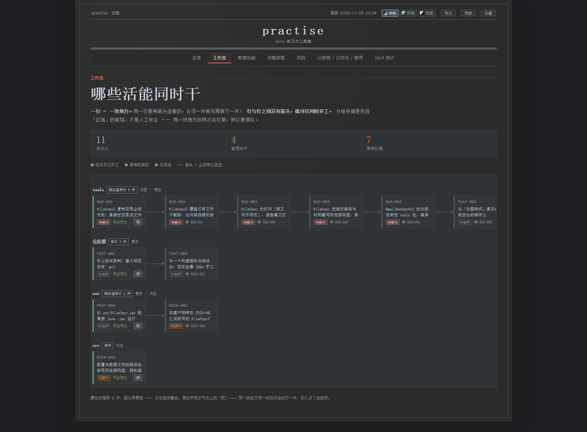

# 交接文档 · 看板（ops-board）开发

> 写给下一个窗口的自己。读完这份就能直接接手，不用翻历史对话。
> 生成时间：2026-11-17 09:5x（Asia/Shanghai）
> 更新：2026-11-21 **四十四改 —— 结论前缀约定**。四十三改还是「猜」自然语言判断做没做成，这次改成**让 Agent 在第一行用固定前缀说话**：`完成：` / `未完成：原因` / `无需处理：原因`。工作台读前缀判定，不再理解语义。⚠️「无需处理」必须和「未完成」分开：两者都没改状态，但前者（比如别处已修好）重试纯属白烧 Token。判定优先级：**台账真的收口 > 自报完成 > 自报无需处理 > 未完成/没格式** —— 台账是磁盘事实、自报是模型一句话，所以台账变了就以台账为准；自报完成但台账没动，信它一次但**日志记一笔**（可查「嘴上做完」）。解析器容忍 markdown 装饰（`**完成**：`/`- 完成：`），但前缀后必须跟冒号或空白（防「完成度 80%」误判）。新增 `wb-verdict-test.mjs`（15 项，**不抄纯函数逻辑**，四种前缀各真跑一遍执行链）。
> 更新：2026-11-20 **四十三改 —— 「跑完了」≠「做成了」**（参考 agent-autoloop 的「没跑成要重派」）。`workbenchPump` 原来无条件 `done = true`，于是「Agent 回了一句话但没动台账」和「真收口了」长得一模一样。现在分三种：真收口→done；状态没动→tries+1 重派；连试 3 次→**红条 stuck「等你看看」**，不再假装成功也不再无限烧 Token。⚠️ 顺带挖出两个真 bug：① `D.items[id].status` **一直是 undefined**（`itemVars` 只给中文 `statusLabel`，没给原始 `status`）→ `moved` 恒 false；② `lr.items[id]` 拿**数组当对象索引**（`/api/board` 的 items 是数组）→ 永远读不到。两个叠在一起，说明「回读台账验证」从写下那天起就没生效过。现在统一走 `itemStatusFromBoard()`。测试也补了自动收口器（以前只回话不干活）+ 段间/退出前 `restoreLedger()`（否则跑一次测试就把看板卡全标成已修复）。新增 `wb-tries-test.mjs`（10 项，真的跑执行链：不改台账→3 次后标红 / 改了→1 次成功）。
> 更新：2026-11-20 **四十二改 —— 工作台折叠箭头不旋转**。折叠状态按「按钮所在的标题容器」加 class：普通模块加在 `.section-head`、工作台加在 `.workbench-head`（它没有 `.section-head`）。旋转规则只写了前者，于是工作台那颗按钮永远指向下 —— 内容收起来了但箭头不给反馈。补上 `.workbench-head.is-collapsed` 选择器。⚠️ 写测试时踩到两处**读动画属性的坑**：`.section-fold::after` 有 `transition: .15s`，点击后同步读 `getComputedStyle` 拿到的是起始帧（还是 45°），必须等 ≥350ms；也不能在一个表达式里加 class 就立刻读。新增 `fold-rotate-test.mjs`（12 项，读 transform 矩阵用 atan2 换算角度，实测 45°→-45°）。
> 更新：2026-11-20 **四十一改 —— 处理记录：筛选条与首条记录加间距**。用户报「标签和最后一条记录之间的间隔有点小」，实测是 **0px**：筛选条 `.legend-line` 的 `padding-top:8px` 是它自己内部的上边距，管不到下面；`.timeline` 又是 `margin:0`，两者严丝合缝贴着。给 `.timeline` 加 `margin-top:10px`，实测 0→10px。单看 CSS 每条都"有间距"、合起来是零 —— 这类问题只有量矩形才看得出来。新增 `history-gap-test.mjs`（量矩形，要求 8~24px；只有一种记录类型或该车道无记录时正确跳过）。
> 更新：2026-11-20 **四十改 —— 删掉详情页的「没实际意义的大标题」**。三个车道页的「按阶段推进」、收口页的「收口记录」、Skill 页的「Skill 台账」全部删除 —— 它们要么对所有页面都一样，要么只是把上一行 kicker 换个说法再说一遍，`clamp(30px,3.5vw,42px)` 的大字白占一块高度。⚠️ **kicker 必须留着**（删掉 h1 后它是页面唯一的身份标识）；`.details-title` 的 CSS 规则一并删，否则是孤儿样式。新增 `no-details-title-test.mjs`（9 项，含「kicker 的下一个兄弟就是状态表」这条防半成品的断言）。
> 更新：2026-11-20 **三十九改 —— 修「点暂停跳到已上线组」**。三十五改把收口页分组从「按车道」改成「按状态」，但车道页格子的落点还在按车道拼（`stage-<lane>-closed`），于是需求车道的「已上线」和「暂停」都指向同一个 id → 点「暂停」看到「已上线」。新增 `closedGroupIdFor()` 从 `CLOSED_GROUPS` **反查**认领该阶段的那一组，三处共用；顺带用新的 `closedIdsOf()` 逐格判断目标组是否存在（不存在退回静态，避免死链）。检查了三个车道：**只有需求页的「暂停」是错的**（只有它有两个收口阶段映射到不同组）。新增 `cell-target-test.mjs`（判据通用：格子名必须等于目标分组标题，合并组则要求出现在其说明里）。
> 更新：2026-11-20 **三十八改 —— 风险车道去掉「缓解中」**。核实过：两个看板 6 条风险全是「观察中」或已收口，`mitigating` **一次没用过**，所以从 `board.config.json` 删掉（含 `statusLabels` 那条）。风险页 4 阶段 → **3 阶段**（观察中 / 已解除 / 已知并接受），状态表 4 格 → 3 格。⚠️ 但 **`flow.mjs` 与 `client.js` 的未收口清单里继续留着 `mitigating`** —— 那是「数据里什么算没做完」的判据，不是「页面上显示什么」，保守一点：万一旧数据里出现，仍按未收口处理，不会静默把没做完的风险标成已收口。新增 `risk-mitigating-test.mjs`（11 项，含「代码里必须还在」这条反向断言）。
> 更新：2026-11-20 **三十七改 —— 需求车道新增「计划列表」总览表**。三个车道现在结构一致（状态表 → 总览表 → 各阶段）：问题「待处理问题」/ **需求「计划列表」** / 风险「待处理风险」。计划列表收需求车道所有未上线条目（计划中 + 开发中），复用 `pendingSection()` 所以列与样式和「待处理问题」逐项一致；量词按车道给（需求是「N 个待推进」）。⚠️ 连带修掉一个真 bug：需求页两个 `[data-ask-feature]` 按钮，绑定用的是 `querySelector` 只绑第一个 → **第二个是死按钮**，现在改 `querySelectorAll` 全绑。新增 `feature-planlist-test.mjs`（18 项，行数从 ledger 现算、真点第二个按钮）。
> 更新：2026-11-20 **三十六改 —— 工作台卡片的区域标签也挪到编号行右侧**。上一轮只改了报表卡片（「文件」标签），工作台卡片的区域标签（演练A/B…）还挂在 `wb-pick-main`（包着标题文字那层），所以停在标题右侧。现在四种卡片形态统一成「编号行：`⠿ OPS-903 …… [演练B]`／标题行／底部按钮」，靠 `.wb-pick-row .wb-pick-prefix{margin-left:auto}` 顶到行尾。`wb-tag-style-test` 的基准也从「标题右缘」改成「编号行」。
> 更新：2026-11-20 **三十五改 —— 收口页分类重构 + 菜单栏「点了没切换」的真因**。① 收口页的表格与页面分组以前各算一套（表 5 格 / 页 3 组，名字粒度全对不上），现在共用 `parts.mjs` 的 `CLOSED_GROUPS`：**已解决 / 已上线 / 已暂停 / 其他已收口**——新增「已暂停」，把「已知并接受」并进去、「已解除」不单列（当成一种暂停）。② 菜单点击偶发失效的真因是**视图与 hash 不同步**：阶段筛选换了视图但不改 hash，再点那个 hash 时浏览器不发 hashchange、点击处理器又提前 return，于是毫无反应。现在筛选后同步 hash + 导航点击兜一层。③ 顺带修掉 `flow-workbench-run` 的间歇性假红（模拟收口器靠 120ms 采样追瞬时状态，会漏），改成按「已跑完的卡」确定性收口，连跑 4 次全绿。新增 `nav-switch-test.mjs` / `closed-groups-test.mjs`。
> 更新：2026-11-20 **三十四改 —— 「文件」标签挪到编号行右侧（紧跟 FEAT-901 之后）**。这是同一个标签的第二次位置修正：原版贴在每条证据前（重复 5 遍）→ 三十一改提到 `<h3>` 标题行（用户说「那是正文的右侧」）→ 现在挂在**编号行**里。三种卡片出口共用一个 `idLine`，`.card-file-tag` 改成 `inline-block + vertical-align:middle`。新增 `file-tag-pos-test.mjs`（17/14 项，四个视图逐个量矩形：同一行 / 在编号右侧 / 不在 h3 里 / 每卡最多一个）。
> 更新：2026-11-20 **三十三改 —— 车道页去掉「已收口」空壳分节，状态表格子改跳收口页**。已上线/暂停/已解决/已解除/已知并接受这些阶段的卡片全在收口页，车道页上只剩下「这 N 项已收口…」一行链接，所以**不再渲染那一节**；0 项但未收口的（开发中/待验证/缓解中）保留（「计划中」哪怕 0 项也必须在，旁边挂着 AI 入口）。状态表与侧栏阶段表里已收口那几格改成跳到收口页的对应分组。⚠️ 抓到真 bug：收口页分组是按需渲染的，**0 收口条目的板（practise）那个落点不存在**，格子会成死链 —— 现在按 `lanesWithClosed()` 判断，没那组就退回静态 `is-static`。新增 `closed-section-test.mjs`（cyber 9 项 / practise 7 项）。
> 更新：2026-11-20 **三十二改 —— 区域标签（演练A/B/C…）挪到标题右侧，与「搁置」按钮轮廓同大但配色区分**。四种卡片形态统一成「标题行 = 标题文字 + 区域标签；底部 = 操作按钮」。标签与按钮共用 `9px / 2px 5px / 1px solid / 3px 圆角`（量出来都是 15px 高），靠**颜色**分：标签是蓝调只读、按钮是中性灰可点。新增 `wb-tag-style-test.mjs`（14 项，量 computedStyle 逐项比对）。
> 更新：2026-11-20 **三十一改 —— 卡片去「备选」字样 / 文件标签提到标题右侧 / 候选池不再内部滚动**。① 备选卡底部那个「备选」小标签删掉（分组标题已经说过了）；② 「文件」类型标签从每条证据前面**提到 h3 标题行右侧**，一张卡只出现一次，证据行里留空占位保持左缘对齐（命令/提交/实测值/链接 仍贴在各自行）；③ `.workbench-pool` 去掉 `max-height:440px; overflow:auto` —— 三组都有卡时池子里会冒第二条滚动条，现在池子随内容变高、滚动交给整页。新增 `wb-pool-layout-test.mjs`（23 项）。
> 更新：2026-11-20 **三十改 —— 报头大标题变小、行高收紧**。`.masthead h1` 从 `clamp(24,3vw,34)` 收到 `clamp(19,2.2vw,25)`、行高 1.1→1.06、字距 .1em→.07em，报头 padding 8/9→5/6px。1440 宽下 h1 **34→25px**、报头 **78→60px**。新增 `masthead-size-test.mjs`（两块板各一份，18 项）：盯尺寸预算 + 六档宽度（1440→600）不挤。
> 更新：2026-11-20 **二十九改 —— 工作台加「搁置队列」**。每张备选卡多一个「搁置」按钮：点了从备选消失、进单独一行「搁置」，**不进执行队列**（拖拽和「全部加入」都跳过它），行里改显示「备选」按钮，点一下回到备选。搁置是**用户的意愿**不是台账状态 —— 存 localStorage、按板分开、`ledger.json` 一个字节不动。
> 更新：2026-11-20 **二十八改 —— 推送改走 `scripts/push-github.mjs`**。凭据一直在 Windows 凭据管理器里（target `GitHub - https://api.github.com/ZJR24`），以前却靠 `%TEMP%%\.gh-tok` 这个会被清理的临时文件，清一次就误判成「没有 token」。新增 `scripts/lib/wincred.ps1` + `scripts/push-github.mjs`：读凭据 → 比内容 → 走 API 推 → 记同步点，支持 `--dry-run`。三个坑见正文（blob 是 UTF-8 不是 UTF-16 / C# 要放进 Add-Type / 不能 git rev-list 比远端）。
> 更新：2026-11-20 **二十七改 —— 演练模式 + 一批演练数据**。用户要「加一点测试数据，
> 让对话窗口不要具体去执行但做一个回应，好在看板里测窗口的反应效果」。
> ① cyber 板加了 5 张标题带「【演练】」的假卡（OPS-901/902/903 · FEAT-901 · RISK-901），
> 覆盖同区串行 / 同区排队 / 跨区并行 / 需求车道 / 三车道混排；
> ② 工作台加了 **演练模式** 勾选框（`data-wb-rehearsal`，默认关线上执行）——
> 勾上只把交活的话术换成「只回应、别改 ledger.json」，claim / 派活 / 等回答 / release
> 整条链路照跑，所以看到的队列行为就是真执行的行为；
> ③ 顺带修了个真 bug：prompt 里的「卡片 id」一直是**标题**（`itemTitle()` 返回标题，
> 再 `split("·")[0]` 猜卡号），窗口拿它去 ledger.json 里定位不到卡 —— 现在 `workbenchAsk`
> 显式收 `cardId` 参数。
> 二十六改（上一轮）：**每个页面每个大标题模块都能收起**。所有「大标题 + 正文」的块
> 统一走 `parts.mjs` 的 `sectionHead()`：标题栏左侧那根红竖线变成按钮，点一下收掉正文、
> 标题栏留着，再点展开；状态记本机、刷新后保持、默认全部展开。六页共 25 个模块全覆盖
> （工作台 / 处理记录 / 待处理问题(风险) / 各阶段 / 已解决 / 三个 Skill 分组）。
> 刻意不用 `<details>` 包整块 —— 标题栏右侧挂着「问 AI」按钮，summary 里的按钮会被
> 浏览器当成展开/收起吃掉。新增 `section-fold-test.mjs` 专盯**覆盖面**（扫全部模块逐个验，
> 漏了谁就红）。
> 二十五改（上上轮）：**三件用户报的事** —— ① 在跑的卡重新留在「待执行队列」里（此前
> `workbenchRefresh` 把 `state==='running'` 过滤掉了，卡一被领走就掉回备选）；
> ② 串行也复用窗口了：所有卡交给固定窗口 **「执行台」**（此前每张卡 `fresh:true` + 会话键
> 回落到卡 id，跑 N 张开 N 个窗口）；③ 会话名不再「名称 · 名称」——
> `item`（复用键）/`title`（兜底后缀，永不等于 item）/`sessionTitle`（完整会话名）三字段分工，
> 宿主 `POST /ops-board/ask` 补上了 `sessionTitle` 转发，复用旧窗口时还会把
> 「明显是自动拼的」标题改掉（用户自己起的名字不动）。
> 二十四改（更早）：**并行时多一个「分析窗口」**。点「分析」不再由代码直接按区域分组：
> 先把卡交给一个**调度窗口**判断「这么分批合不合理、会不会抢同一块地」，它回一段 JSON 计划，
> 校验通过就按它派活，不通过就整份丢弃回退到按区域分组（并写明原因）。于是
> **2 个批次会出现 3 个窗口**（1 个分析 + 2 个干活），正是用户描述的样子；
> 干活窗口按计划给的 `lane.key` 复用（同类任务回到同一个窗口）。
> 二十三改（上一轮）：**并行 = 每路（区域）一个对话窗口，多路同时跑**——此前用户选「并行 + 每批 2 张」却只拿到一个窗口：旧实现把「一次喂几张」当成窗口划分依据，整批塞进固定会话键 `本批 N 卡`，**卡数相同的两批会撞进同一个窗口**，所以永远只有一个。现在窗口数 = 区域前缀数（与「一次喂几张」无关），「一次喂几张」只决定**同一条队列里**一次交几张。早前两步：①「工作流」页已彻底删除（视图、导航项、设置项、渲染函数一并去掉；工作台只留在「总览」页）；②「每批 1 张却像有两个任务」的显示问题：并行队列里同路第二张起标「排队中 · 等 XXX」（虚线边）。
> 上一轮结束时的状态：**工作台在「总览」页顶部**（`#view-overview`，全站唯一一份）。候选池分两组：上面「待执行队列」横排可拖排顺序的卡，下面「备选」区横排放没进队列的卡（点击卡片加入队列 /「全部加入」/「✕移出」都不会丢卡，只是回备选区）。点「分析」后：
> - **串行**：步骤区单列出执行顺序（同区域链序由 flow.mjs 约束拨正），`cap=1` 逐张放行；
> - **并行**：按区域前缀拆成**多个任务队列，一路一行 = 一路一个对话窗口**——每队列卡**横向**排（左→右 = 该路执行顺序），**多队列纵向叠放**（`.wb-lanes`/`.wb-lane`）。`workbenchStartLanes` 同时把**每一路**都开起来（不是轮流），路与路真并发。**同一条路内一次交几张由「一次喂几张」决定**：每批 1 张 → 同路第二张起标「排队中 · 等 <前一张>」+ 虚线边，等前一张回来再给下一张；每批 N 张 → 第 N+1 张起才标排队；整批全交 → 该路全部卡一次给它，不标排队；
> - **并行执行每路一条独立对话**：`workbenchAsk` 第三参 `convKey`，`wbConvKey(id)` 按卡所属路返回「路N · 前缀」，同一路的卡复用同一会话键 → 左侧会话列表一条路一条对话；非并行每张卡各一个会话。
> 全部测试绿：flow-test 11/0（工作流页已删 + 旧 hash 不白屏 + 工作台单实例在总览）、flow-workbench-test **77/0**（含并行拆路+前后拖拽+分批开关显隐+初始空队列+点卡撤回备选+[5h2]多路真并发+[5i]同路逐张 / [5k]无 Harness 环境时报错不静默+[5j]排队卡标记）、flow-workbench-run-test 10/0（真 claim→ask→release，串行 3 件 / 并行 5 件 4 路）、flow-api-test 33/0（数据驱动：领取/互斥/跨区/落盘重启）、wb-mount-test 12/0、wb-overview-live-test 11/0、stale-route-test 3/0、card-fold 16/12、verify-board 双板通过。

---

## 一、一句话现状

看板已经能用，**工作台在「总览」页顶部**（2026-11-18 用户从工作流页搬过来，看满意后把那一页整个删了）。它是**单实例节点**，切视图时跟着搬到当前页的 `[data-wb-mount]` 空位；没有挂载点的页（问题页 / Skill 页）则收进隐藏暂存区 `#wb-park`，节点不掉线、状态不丢。
- **总览页现在只有「工作台 + 处理记录」**（2026-11-19 二十改）：原来的「待处理问题」「待处理风险」两块表
  已分别搬到「问题修复」页和「风险」页，总览一张表都不剩。
- **每个页面的第一个模块都是状态表**（2026-11-19 二十一改）：「问题修复 / 风险 / 新增功能」页的 `.stage-board`
  提到「待处理」块之前；「已修复 / 已关闭 / 暂停」页新增一块跨车道合并表（左「已收口 N」，右 5 格）；
  Skill 页的数字表也提到「问 AI」之前。**总览页仍然没有状态表**（用户定的：工作台第一）。
- **三个「按车道/页面聚合」的 AI 入口**：问题页「总结项目状态」（整本台账）、风险页「风险审核」（只审风险车道）、
  需求页「计划中」右侧「和 AI 谈谈要加什么」（只谈需求车道）—— 各自独立会话，互不串味。
- **报头一行三栏**（2026-11-19 二十二改）：顶栏不再是报头上面独立的一行，
  书名左边是「台账 · 更新 2026-11-17 23:55」，右边是「夜晚 / 护眼 / 纸面」+「导出 / 搜索 / 设置」。
  项目名只在中间出现一次；760px 以下退化成「书名在上、两翼各一行」。
- **工作台 = 候选池（待执行队列横排 + 备选区）+ 分析（串行/并行）+ 自动执行**。
- **并行 = 多路队列**：点「分析」选并行，步骤区横排成多列 `.wb-lane`（每列一个区域前缀一路，纵向上到下列出该路整条链），不同路可同时推进（同一区域仍互斥，由 claim 保证）；
- **并行每路一条独立对话**：并行执行时用 `wbConvKey(id)` 给 `workbenchAsk` 传 `convKey`，同一路的卡共用一个会话键 → 左侧 Harness 会话列表一条路一条对话；非并行每张卡各一个会话。
- **批次模式**（`useBatches`/整批）：看板分批 → 一批整份清单交给单个 Agent 自主规划批内，见 §4.4。
顶部分批/串行执行引擎不变。全部测试通过（flow-test 11/0、workbench **57/0**、run-test 10/0、api-test 33/0、wb-mount 12/0、verify-board 双板通过）。
**工作台与流程接口测试都已改成数据驱动**：不再写死卡数/卡号，实时读 `/api/flow/plan` 推导期望值，看板随真实收口变化也不误报（`flow-api-test` 2026-11-18 重写，原先写死「7 件未收口 / OPS-022 可开工」，台账一推进就整片红）。
**领取状态已落盘**（`flow-claims.json`，重启不丢，D22 已闭环）。
**工作台（拖卡排顺序→分析→串行/并行→自动逐张/逐路交给 Harness 处理）已完成**，见 §4.4。

**当前最该做的下一件事**：把 `/api/evidence/stale`（38 张卡 / 110 处引用）接到 UI ——
接口早就算好了，但没有任何界面露出。

---

## 二、目录与文件（全部绝对路径）

### 2.1 三个目录，角色不同，别搞混

| 目录 | 角色 | 能不能随便改 |
|---|---|---|
| `D:\WorkSpace-Tools\ops-board\` | **模板 / 脚本源**（唯一一份代码） | 改这里 |
| `D:\WorkSpace-Tools\ops-board-reports\<看板名>\` | **每块看板自己的数据 + 产物** | 数据在这 |
| `D:\WorkSpace-Tools\dsh-ops-board\` | **DSH 插件**（把看板嵌进 GUI） | 改这里要同步 |

> ⚠️ **三个目录都没有 git 版本控制**。改大东西前自己先备份（本机习惯：`文件名.bak-YYYYMMDD-HHMMSS`）。

### 2.2 每块看板目录的结构（关键：**每个看板有自己的 config**）

```
D:\WorkSpace-Tools\ops-board-reports\cyber-egg-basket\
  board.config.json     ← ⚠️ 看板自己的视图配置，改模板不影响它
  ledger.json           ← 台账数据（61 条）
  project.json          ← {"projectDir": "...", "templateDir": "D:\\WorkSpace-Tools\\ops-board"}
  dist\index.html       ← 渲染产物（831 KB）
  scripts\*.mjs         ← 4341 字节的转发 shim，spawnSync 调模板里的真脚本
```

> **踩过的坑**：只改模板的 `board.config.json` 加视图，看板不会变 ——
> 它读自己那份。两块看板都要各改一次（改前备份成 `board.config.json.bak-flow`）。

### 2.3 核心代码文件

| 文件 | 大小 / 行数 | 干什么 |
|---|---|---|
| `scripts\render.mjs` | 42.4 KB / 907 行 | **渲染入口**。视图分发 + 每个视图的 HTML 拼装 |
| `scripts\lib\flow.mjs` | 11.2 KB / 288 行 | **工作流图推导**（下面单独讲） |
| `scripts\lib\workbench.mjs` | ~4 KB / ~110 行 | **工作台分析（纯计算）**：串行/并行建议，见 §4.4 |
| `scripts\lib\css.mjs` | ~64 KB / ~770 行 | 全部样式，一个字符串（含工作台 `.wb-*`） |
| `scripts\lib\client.js` | ~186 KB / ~4620 行 | 浏览器端交互（路由、搜索、AI 面板、领取/交还、**工作台驱动器**） |
| `scripts\lib\parts.mjs` | 21.2 KB / 546 行 | 卡片、表格、阶段块等可复用片段 |
| `scripts\serve.mjs` | ~29 KB / ~795 行 | 独立 HTTP 服务 + `/api/flow/*` + `/api/workbench/analyze` |
| `scripts\verify-board.mjs` | 42.3 KB / 794 行 | 产物自检（孤儿样式、死链、标签闭合） |

### 2.4 依赖文件（这是你要的「依赖」部分）

**运行时不依赖任何第三方包。** `package.json` 里没有 `dependencies` 字段，只有：

```json
{
  "name": "ops-board",
  "version": "0.1.0",
  "private": true,
  "type": "module",
  "engines": { "node": ">=18" }
}
```

依赖的只有 **Node 内置模块**：

| 模块 | 用在哪 |
|---|---|
| `node:fs` | 读写 ledger / config / 产物 |
| `node:path` | 路径拼接 |
| `node:http` | `serve.mjs` 的服务器 |
| `node:child_process` | `spawnSync`（看板脚本转发给模板） |
| `node:url` | 请求路径解析 |

测试脚本额外用 **CDP（Chrome DevTools Protocol）** 驱动无头 Edge，也是零依赖
（手写 WebSocket 帧，用 Node 内置的 `fetch` + `WebSocket`）。

**Edge 路径**（写死在几个测试脚本里，换机器要改）：
```
C:/Program Files (x86)/Microsoft/EdgeCore/141.0.3537.99/msedge.exe
```

**这块是设计选择，不是巧合**：渲染层是「零依赖字符串拼 HTML + 一个 CSS 文件」。
所以加 React Flow 之类的图库 = 前端整体重写，违反渐进替换原则。
**内联 SVG 手拼是唯一兼容的做法** —— 现在的图就是这么做的。

---

## 三、这一轮做了什么（工作流可视化重做）

### 3.1 用户的原话

> 「现在这个界面是啥意思，不知道咋用，也没有我现象中的可视化」

之前那一版是**泳道 + 卡片列表**，用文字标签表达「抢地 2」「可并行 3」。
数据是对的，但**形式不是图** —— 用户看到的是嵌套列表，不是可视化。

### 3.2 现在的样子



（另一块看板：`screenshot-flow-cyber.png`）

**一行 = 一块地方**（按条目 `area` 字段的前缀自动分组，不是人工标注）。

- 同一行里**有箭头连着的** = 必须一件做完再做下一件
- **行与行之间没有箭头** = 可以同时开工

`practise` 那块看板：11 件未收口，**4 条路能同时开工、7 件得排队**。
一眼看得出 `tools` 那条链有 6 件（`BUG-001 → BUG-002 → BUG-003 → BUG-004 → BUG-005 → FEAT-003`）只能串着做，
而 `仓库根` / `out` / `src` 跟它无关，可以并行。

`cyber-egg-basket` 能看出那个跨泳道的坑：`免费额度` 一行 3 件
（`OPS-022 → OPS-025 → FEAT-014`），横跨「问题」和「需求」两条泳道，行标签标了「跨泳道串行 3 件」。

### 3.3 节点上有什么

- **编号**（`<a href="#OPS-022">`，点进去跳到那张卡片）
- **一句话标题**
- **阶段标签 + 状态**：`可以开工`（绿左边框）/ `等 XXX`（灰）/ `执行中`（蓝）
- 可开工的节点右下角有 **「领」按钮** → 点了占住这块地，别人再点后端拒掉

### 3.4 `flow.mjs` 的四步推导（改之前必须读懂）

```
buildFlow(config, ledger, claimed) → { lanes, totals, graph }
```

1. **建全局节点**：遍历所有未收口条目，每个算出
   `laneKey / laneLabel / title / status / statusLabel / tone / step / stepLabel / area / prefix / severity`
2. **全局定头**：按前缀分组，组内按 `(step, id)` 排序。把已被领走的挪到队尾，然后
   - `isHead = (i === 0 && !isClaimed)`
   - `waitFor = i === 0 ? "" : queue[i-1].id` ← **紧邻前驱，不是队首**
   - `chainHead = queue[0].id`
   - `blocks[]` / `parallelWith[]`
3. **按车道组装**（给老的 lane 视图用，图不依赖它）
4. **算像素坐标**：`layoutGraph(byPrefix)` → 每行一个 y、节点横向排开、箭头连相邻两件

**三个关键常量**（`flow.mjs` 顶部）：

```js
const NODE_W = 188;      // 节点宽
const NODE_H = 88;       // 节点高
const GAP_X = 52;        // 横向空隙（留给箭头）
const ROW_GAP = 26;
const LABEL_H = 26;      // 行标题占位
const PAD_TOP = LABEL_H + 6;   // ⚠️ 顶部必须留，否则第一行标题被容器切掉
const NODE_W_MIN = 132;
const WIDTH_BUDGET = 1120;     // 期望一屏容纳宽度
```

`nodeWidthFor(maxCount)` 按最长链反解节点宽度 —— 链越长节点越窄，尽量一屏看全。

### 3.5 这一轮踩的四个坑（都是真 bug，别再犯）

| # | 现象 | 根因 | 修法 |
|---|---|---|---|
| 1 | 行标题压在节点上、行与行重叠 | 画布坐标和行内坐标混用：行整体偏移一次，节点又偏移一次 | 节点坐标改成**相对行**（`top:0`），行标题用 `translateY(-100%)` 浮在行上方 |
| 2 | `FEAT-014` 写「等 OPS-022」，箭头却从 OPS-025 来 | `waitFor` 取的是队首，箭头连的是紧邻前驱 | `waitFor = queue[i-1].id`，另存 `chainHead` |
| 3 | 长链被右边裁掉 | 工作流页挤在右侧 2/3 栏 | 加 `.layout.is-wide`：进工作流页时侧栏 `display:none`，内容占满整宽。判据写在 DOM 上（`data-wide-view`），不硬编码视图名 |
| 4 | 第一行标题被容器切掉 | 标题浮在行上方，画布顶部没留空间 | `PAD_TOP = LABEL_H + 6` |

### 3.6 宽视图机制（新加的，值得记住）

`render.mjs` 里工作流 `<section>` 加了 `data-wide-view` 属性；
`client.js` 的 `show()` 里统一处理：

```js
var layout = document.querySelector(".layout");
if (layout) layout.classList.toggle("is-wide", target.hasAttribute("data-wide-view"));
```

CSS（`css.mjs`）：

```css
.layout.is-wide{grid-template-columns:minmax(0,1fr)}
.layout.is-wide>.rail{display:none}
.layout.is-wide>.views{padding-left:0;border-left:0}
```

**以后再加宽视图只需在 section 上加 `data-wide-view`，不用改 JS。**

---

## 四、并行领取（后端）

### 4.1 API（`serve.mjs`）

| 方法 | 路径 | 作用 |
|---|---|---|
| GET | `/api/flow/plan` | 现在能开工哪几件？谁在等谁？ |
| POST | `/api/flow/claim` | 领一件（同区域互斥） |
| POST | `/api/flow/release` | 交还一件 |

**关键设计**：`serve.mjs` 不自己推导「谁能开工」，而是
`buildFlow(config, ledger, new Set(flowClaims.keys()))` —— 和渲染层**同一个函数**。
早先两处各算一套，结果图说 OPS-022 能开工、API 说 FEAT-014，测试专门盯着这条（`flow-api-test` 第 8 节）。

### 4.2 领取状态已落盘（D22 已做，2026-11-17）

```js
// serve.mjs —— flow-claims.json 落在每块看板自己的目录
const claimsPath = resolve(argValue("claims") || join(ROOT, "flow-claims.json"));
```

- 每次 `claim` / `release` 都写回 `flow-claims.json`（临时文件 + 原子改名，不落半截）。
- 启动时若有文件就加载；文件损坏按空状态启动，不被卡死。
- `--claims <文件>` 可覆盖路径，测试用它指向临时文件隔离。
- 顺带修了一个隐藏 bug：**已执行中的件不能再 claim**（即便同一个人点重了也不行），
  否则会静默覆盖持有者。`target.state === "running"` 时回 409。

**测试**：`flow-api-test.mjs` 加了第 [9] 节——领 OPS-024 后**重启服务**，
断言它仍是 `agent-B / 重构` running、跨重启互斥仍生效；第 [10] 节验证交还后
落盘文件也清空。全程用临时 claims 文件，不碰真实 `flow-claims.json`。
基线从 25 提到 **32 通过 / 0 失败**。

> ⚠️ 真实看板目录下会出现 `flow-claims.json`（只在有人领过之后）。它是并行状态，
> 属于数据不是代码，别删。测试运行时用的是临时目录，不会污染它。

### 4.3 已知缺陷（下一轮要修）

**没有超时回收**（D15）—— 某台执行者崩了/关机了，他领的活会永久占着
`flow-claims.json` 里那条（现在落盘了，等于永久占着那块地），别人永远领不了。
下一轮要给 claim 记录的 `at` 加「超时」语义：超过 X 分钟没交还，允许他人接管。

> 已经踩过的坑值得记住：`flowClaims` 曾经写在请求处理器**里面**，
> 每个请求都新建一个空 `Map`，于是 claim 返回 `200 {"ok":true}` 但下一次 plan 显示还在 ready。
> **API 报成功、什么都没发生** —— 这是最坏的一种失败。现在状态在模块作用域 + 落盘，已不再有这个问题。

### 4.4 工作台（自动执行，2026-11-17 已完成）

让「看图 → 手动点领」升级成「**拖卡** → 分析 → 选择串行/并行 → 自动逐张交给 Harness 处理」。
在工作流视图页签下方多了一块 `.workbench`。

**用户流程**：候选人池（来自 `/api/flow/plan` 的 ready + waiting + running）**拖动卡片
排出执行顺序**（上面先做，每张可点 ✕ 移出，底部可一键全部加入）→
「分析」调 serve 纯计算得到串行/并行两种建议（铺成步骤区）→ 选模式 →
「开始执行」→ 驱动器逐张/逐路 `claim → 交给 Harness → 收口 → release`，步骤区每张标 done/asking/wait。
「停止」发停请求，当前卡跑完即停。
- **串行**（analyze 后单列直排）：步骤区单列出执行顺序，同区域链序由 analyze 兜底拨正。
- **并行 = 多路队列**（analyze 后横排成列）：步骤区按区域前缀横排成多列 `.wb-lane`（`WB.lanes`），
  每列一路、纵向上到下列出该路整条链；不同路可同时推进（同一区域仍互斥，由 claim 保证）。
- **并行每路一条独立对话**：执行时 `workbenchAsk(itemTitle, done, convKey)` 第三参传
  `wbConvKey(id)`（=「路N · 前缀」），同一路的卡共用同一会话键 → 左侧 Harness 会话列表
  一条路一条对话；非并行（convKey 空）每张卡各一个会话，仍按卡 id 圈定。

**拖拽语义（重要）**：池不再用勾选，改成一张**可拖拽排序的队列**（`WB.dragPool`，
顺序即用户要的执行顺序）。分析时把该顺序作为 `order` 提交给服务端；
服务端 `planWorkbench(config, ledger, ids, order)` **在同区域仍保持链序**的前提下采纳拖动顺序
（同块地不能跳着做 —— 即使把后件拖到前件前面，也会被拨回链序），跨区域则完全尊重拖动顺序。

**关键文件**：
- `scripts\lib\workbench.mjs`（纯计算）—— `planWorkbench(config, ledger, selected, order?)`：
  传入 `order` 走 `serialByDrag`（按拖动顺序 + 同区链序兜底）；不传回落 `serialAuto`（旧分块）。
  串行=同区域成链、并行=分轮（同一轮无同前缀，互斥不踩）。和 `flow.mjs` 用同一个 `areaPrefix` 判据。
- `scripts\serve.mjs` —— `POST /api/workbench/analyze` 接受 `{ids, order?}`；并把
  `/ops-board/b/<id>/api/*` 前缀剥成 `/api/*`（浏览器裸开和 Harness 里共用一套路由）。
- `scripts\lib\client.js` —— 工作台驱动器 `WB` + `workbenchPump`：claim→ask→release；并行按 cap
  同时放多件；409 做**有上限重试**（等前件收口落盘）；`WB.execOrder` 记执行顺序。
  `renderWorkbenchPool` 铺可拖拽卡片（HTML5 `dragstart/dragover/drop` 排序 + ✕ 移出 + 一键加入）。
  ⚠️ `/api/workbench/analyze` 必须走 `wbUrl()`（带 `/ops-board/b/<id>/` 前缀）而不是裸路径
  —— 插件代理不改 XHR，裸路径在 GUI 里 404，按钮点了没反应（2026-11-17 已修）。
- `scripts\lib\css.mjs` —— `.workbench*` / `.wb-*` 样式（候选池、`wb-pick-grip` 拖把、
  `wb-dragging` / `wb-drop-target` 拖拽态、`wb-pick-x` 移出钮、`wb-pool-foot`）。

**⚠️ 关键语义（最容易翻车）**：`flow.mjs` 里一张卡要真的**收口**（状态离开未收口集合）
同区域下一件才顶上，`release` 只是把占用还给系统。所以工作台交给 Harness 的 prompt 会要求
「处理并**更新台账**（收口/推进状态）」；若 Harness 只分析不改台账，串行链会停在第一件（这是对的）。
测试里的 answer stub 会真的改 `ledger.json` 才让链往下走。

**2026-11-17 修「串行卡死在第一件 + 对话窗空」**：
- 根因一：`workbenchAsk` 的 prompt 只让 AI「给建议」，从不「动手改台账」→ 卡永远不收口 →
  同区域下一件无限 409 重试（那串「还没就绪/稍后重试」）。已改成**真实执行 prompt**：
  明确要求读 `ledger.json` + `board.config.json`，按车道 stages 取收口状态（bug→fixed/closed、
  feature→shipped、risk→resolved/accepted）把 status 改成它，或至少推进。
- 根因二：`serve.mjs` 的 `ensureFresh` 只看台账/配置的新旧重渲染，**不看模板的
  `scripts/lib/client.js`**（它被内联进 index.html）→ 改完前端逻辑页面还是旧的
  （「改了没反应」经典源头，AGENTS 三之六）。已把 `CLIENT_JS` + `RENDER` 加进 freshness 判据。
- 根因三：被残留领取卡死。清理路径：`POST /api/flow/release {id, by}`；没人领会 404。
  若某个进程持有读盘一次就重启（`flow-claims.json` 落盘，重启不丢——好处也是坑：
  进程挂了但 claim 还在，重启同读它）。
- 新增：工作台某张卡回答完会**回读台账核对**（`getLedgerBoard`→`/api/board`）确认状态是否
  真动了 / 收口，并在步骤区与日志里标明「已收口 / 推进 / 未收口」，不再把「拿到回答」当成功。

**2026-11-17 五改（终版）：「工作流」是干净可靠的二维流程连线图**
- 用户要「一块大规划区，卡片自由拖动排流程」，不满意横向单队列。参考 React Flow / LogicFlow 后做了
  二维平面，但初版过度设计（网格点阵背景 + 拖空白平移 + 滚轮缩放 + 固定 520px 视口）出问题被退：
  **卡片被 520px 视口裁掉/看不见、箭头被卡片盖住看不见、网格背景碍眼**。
- 本轮定为**干净可靠的二维流程连线图**，三项痛点全修：
  - **卡片完整显示**：`.flow-canvas` 不再 `absolute;inset:0`（那会被父级 `520px` 锁死把多行卡裁掉），
    改 `position:relative` + 显式 `width/height`（来自 `layoutGraph`），`.flow-canvas-pane` 改
    `overflow:auto`，超高时**纵向滚动看全、不裁剪**（已实测 `clipped:[]`）。
  - **箭头清晰可见**：箭头从「贴行顶」改成「行内卡片垂直中点」（`row.startY + e.y1/y2`，落在卡与卡
    之间 52px 空隙），颜色用 `var(--blue)`，不被卡盖住。
  - **背景干净**：去掉点阵 linear-gradient 网格（`backgroundImage:none`），去掉拖空白平移 + 滚轮缩放
    （这俩在滚动容器里反而碍事）。拖空白处只正常滚动。
- 数据：复用 `flow.mjs` 的 `flow.graph`（`layoutGraph` 已产出每张卡 `{x,y,w,h}` 与 `rows[].edges`
  箭头坐标）；页面一张张按绝对坐标铺在 `.flow-canvas` 平面上，SVG 箭头把串行链连起来
  （行内箭头 = 必须等前面做完；行与行无箭头 = 可同时做，即「并行」）。区域标题浮在每行上方。
- 渲染（`render.mjs` `viewFlow`）：`.flow-canvas-wrap > .flow-canvas-pane`（`overflow:auto`，
  `min-height:240px`）内嵌 `.flow-canvas`（相对定位、显式宽高、绝对定位卡片 + 垫底 `.flow-edge-svg`
  箭头 + 行标题）。底部 `.flow-canvas-controls` 带说明 + 「复原位置」按钮。
- 交互（`client.js` `bindFlowDrag` + `flowDragStart/Move/End`，pointer 自实现，HTML5 DnD 在
  `<a>/<button>` 结构失灵故不用）：
  - **按在可拖卡**（非 `<a>/<button>`、非 claimed）→ 走够 6px 阈值 → 克隆 `.flow-ghost` 跟光标、
    源卡半透明，**自由 2D 位移**：`node.style.left/top = 起点 + 屏幕位移`；
  - 空白处按住走正常滚动（去掉了平移 pan 分支）；滚轮缩放已移除。
  - up/落定后 `flowReadOrder` 读所有可拖卡的 `getBoundingClientRect`，按「上→下、同行左→右」排序 →
    `flowRefreshOrderFromCanvas` 写进 `WB.dragPool` + 刷新工作台候选池；被领走（正在执行）的卡不可拖。
- 语义：同一份 `WB.dragPool` 同时驱动画布空间顺序与工作台执行顺序，二者始终一致；
  同区域链序（同块地不能跳着做）仍由服务端 analyze 兜底，画布规划自由、执行时遵守。
- 样式：`.flow-canvas-pane`（可滚动视口，无网格）+ `.flow-canvas`（相对定位定宽高）+
  `.flow-canvas-card`（绝对定位）+ `.flow-edge-svg` / `.flow-edge`（蓝箭头）+ `.flow-ghost` +
  `.flow-row-label` + `.flow-canvas-controls`。
- 测试：`flow-test.mjs` 改成验「无网格背景 + 卡片不被裁剪 + 空白拖不动 + 坐标铺卡 + 箭头连接 +
  自由 2D 拖卡」（**21/0**，双看板）；`flow-workbench-test.mjs` [5b] 用真实节点坐标大位移拖第一张卡
  越过下方几行、验证坐标顺序变 + `dragPool` 同步 + [5c] analyze 采纳该顺序（**21/0**）。

**2026-11-17 六改（让拖卡真正像「可拖动的流程控制」）**
- 用户指出两个基本功没到位：「卡片被拿起字体异常」「被箭头连着的卡片移动，箭头不跟随」，
  并追问参考了哪个项目。这里明确参考 React Flow：**边每次根据节点新坐标重算**（`getBezierPath`）。
- **箭头跟随**（`client.js` 新增 `flowUpdateEdges(fromId)`）：拖动每一帧，找出所有「以该卡为源或目标」
  的边，用两张卡当前画布坐标重算 `d`（源卡右边缘中点 → 目标卡左边缘中点，bezier 控制点取两端 x 中点）。
  被拿起卡的**入边和出边**都会跟着动；落定/复位不破坏（卡片留新位置、边已实时更新）。
- **幽灵字体修好**（`flowMakeGhost` / `flowUpdateGhost`）：不再 `cloneNode` 真实卡片（克隆会把内联样式/
  外层继承的字体 scale 一起带进 `document.body`，在嵌入环境里易字体走样），改成**独立构造轻量影子**：
  显式写死字体族/字号/宽 188px，只带 id+标题，杜绝级联问题。
- 测试：`flow-test.mjs` 新增 [5c]「拖动卡片 → 箭头实时跟随 + 幽灵字体正常」（验幽灵可见、字号显式、
  宽 188px、被拖卡的入/出边 d 变化）→ **25/0**（双看板）。
- 参考来源：React Flow `BaseEdge.tsx`（`getBezierPath` 按 sourceX/Y、targetX/Y 生成边 d，每帧随节点重算）。

**2026-11-17 七改（按用户反馈调布局 + 加一键清空）**
- 用户四点要求，全部落地：
  1. **去掉「大画布 · 拖卡片排流程」大标题**（`render.mjs` 删掉 `<h1 class="details-title">`，只留 kicker「工作流」）。
  2. **工作台移到第一行**：把 `.workbench` 块挪到 `.flow-canvas-wrap` **之前**（流程页第一个子块，位于
     summary/legend 之后、画布之前），画布在其下方。实测 DOM 子块顺序 `[workbench, flow-canvas-wrap]`。
  3. **工作台一键清空**：`render.mjs` 的 `.workbench-actions` 加 `<button data-wb-clear>清空</button>`；
     `client.js` 新增 `workbenchClear()`（清空 `dragPool`/plan/steps/order、收起步骤区、复位按钮、log），
     在 doc 点击委托里接 `[data-wb-clear]`。正在执行时先 stop 再清。
  4. **拖动时卡片底部字不再显示**：CSS 里 `.flow-canvas-card.flow-drag-src .flow-node-foot,
     .btn-flow-claim{display:none}` —— 被拖走的那张原卡拖动时底部状态文字隐藏；幽灵卡本就只带 id+标题。
- 测试：`flow-test.mjs` 新增 [9]「布局调整」（验无标题、工作台第一行、有清空按钮、拖动时原卡底部隐藏、
  幽灵无 foot）→ **30/0**（双看板）；`flow-workbench-test.mjs` 新增 [5d]「一键清空」→ **23/0**。

**2026-11-17 八改（拖动彻底干净 + 右键选「下一步」）**
- 用户二度反馈「拖动时底部文字还是显示」。DOM 探针确认源卡 foot 已隐藏、幽灵无 foot，但幽灵卡
  标题没限高、把卡片撑到 ~120px（源卡 88px），拖动时底部多出一截 → 视觉上就是「底部有字」。
  修法：`flowMakeGhost` 固定幽灵 `height:88px` + 标题 `-webkit-line-clamp:3` 截断。实测幽灵高回到
  93px（含边框）、标题 3 行截断，底部不再外溢。
- **新增右键选「下一步」**：`client.js` 加 `flowContextMenu`（document contextmenu）、`flowMenuClose`、
  `flowPickNext`、`flowCloseMenuOnAway`；`bindFlowDrag` 里注册 contextmenu + 点击别处/滚动关菜单；
  CSS 加 `.flow-menu*` 浮动菜单样式。右键一张未领的卡 → 弹菜单列出画布上其余未领卡（**不依赖异步
  WB.candidate，用画布 DOM 现取**，离线/要点开就能用）→ 点选后把那张卡 `splice` 到右键卡**紧后一位**
  并刷新 `WB.dragPool` 与候选池。右键卡不在队列时会先用画布当前顺序重建再插入。
- 测试：`flow-test.mjs` [5c] 补幽灵高度断言；新增 [9b]「右键弹菜单 + 选下一步 + 排到它之后」
  → **35/0**（cyber）、**33/0**（practise 有跳过的）。

**2026-11-17 九改（彻底根治「拖动显示原文」+「卡片文字只显示一半」）**
- 用户又反馈「卡片的文字只显示了一半;拖动的时候底部还是显示原文,不要显示」。这次的真正根因
  不再是 foot:DOM 探针逐元素取证后发现,
  - **卡片文字只显示一半** = 卡片固定高 `88px` + `overflow:hidden` + flex 收缩,当
    id+标题+foot 内容总和超过 88 时,flex 把标题**压缩成条** → 看起来「只显示一半」。
    修法:卡片改 `height:auto;min-height:88px`,去掉 `overflow:hidden`;
    `.flow-node-title` 去 `-webkit-line-clamp:3`、设 `flex:0 0 auto` + `white-space:normal`,
    标题再长也完整展示、卡片随内容撑高。
  - **拖动时底部显示原文** = 幽灵卡带了**标题文本**,松开时原卡标题也还半残地露着。
    这次下狠手:幽灵卡**去掉标题、只留 id**,`height/min-height:56px` 的干净小卡;
    拖动中的**原卡**标题 `visibility:hidden`、foot/按钮隐藏(id 半透明),拖动时整片只看到一个
    带 id 的简洁影子,不再有任何原文。
  - **还顺带修掉一个隐患**:幽灵标题用内联字符串拼 style,而字体族含双引号会**截断整个 style
    属性**(实测 `style="font-family:"` 就断了,后面 nowrap 全变垃圾属性)。现全改 style 属性逐个
    赋值 + textContent,不再内联拼串。
- 测试:`flow-test.mjs` [5c] 幽灵断言改为「id-only、无标题、高 40–70」;[9] 增 `srcTitleHidden`/
  `ghostHasTitle`;→ **39/0**（cyber）、**39/0**（practise）。

**2026-11-17 十改（执行引擎重构：看板分批 → 整批交给单个 Agent 自主规划）**
- 用户定调:主要目的不是好看的流程卡片,而是「**在看板里设好任务链 → 交给 Agent 自主解决**」;
  卡片拖动只是表现形式。且要求**整体参考一个成熟成品**,而不是零敲碎打。
- 我参考了任务编排类成品的执行引擎(先研究 n8n 的 `execution-engine/workflow-execute.ts` 架构,
  再结合你的选择定形)。经几轮确认你的偏好是:
  - **不是引擎拓扑自动分流**(n8n 编排器那种),而是「**Agent 自主**:整链交给单个 Agent 自己规划」;
  - **批次由「看板定」**(你手动把可并行的一组划成一批),**不是服务端自动拆**串/并行;
  - **单次 ask 携整批清单**,claim 仍逐张(保留互斥防撞车),每张完成回读台账更新看板。
- 落地(纯执行引擎层,拖动/箭头 UI 不动):
  - `workbench.mjs` 新增 `planBatches(config, ledger, batches)`:**按看板手动分批**返回每批卡元数据,
    不再产出 serial/parallel 自动建议;
  - `serve.mjs` `/api/workbench/analyze` 收到 `batches` 就走分批,否则回落旧逻辑;
  - `render.mjs` 工作台新增「分批(每批 N 张 / 整批全交)」下拉;
  - `client.js`:`workbenchAnalyze` 按批分组铺步骤区(batch=带虚线框的分组)——
    执行改为 `pumpBatch` 逐批:claim 完整批 → **一次 ask 携带整批卡清单**
    (id+标题+台账路径+收口要求,由 Agent 自主决定批内顺序/是否并发)→ release 全部 → 下一批;
    `workbenchStartBatches`/`finishBatch`/`releaseAll` 处理整批收尾;
  - `workbenchRefreshModeBtn` 现在也随队列非空启用「分析」(清空后重加卡可再分析)。
- 说明:execute 提示词把「这一批的整张清单」交给 Agent,让它自主规划批内先做哪个/哪个可并行;
  批次间仍是串行。若想整批一个 Agent 全跑,选「整批全交」。
- 测试:flow-workbench-test 增 [5e](每批 3 张→3 批/卡总数 7/标分批执行)[5f](整批全交→1 批/含全部 7 卡)
  [5g](**整批真实执行**:5 张不同区域头件整批全交 → claim 全部→**一次 ask 带整批清单**→release→全 done)
  [5h](**断言 ask 的 question 确实携带「本批卡片清单」**)→ **33/0**;flow-test 39/0 ×2;verify 双板通过。
- ⚠️ **分批 claim 受「同区域串行约束」**:serve 只放行「当前该区域可开工」的卡;若用户把同区域
  未收口的后续卡也塞进同一批,该卡会 409 claim 不到而滞留(反复重试)。真实运行时 Agent 会真的
  收口卡、解锁同区域后续卡所以能继续;测试用「不同区域头件」构造了一批全可开工的场景,绕过假撞车。

**2026-11-18 十一改（删三格统计 + 拖动手感重构：抓起卡=带标题的醒目浮卡）**
- 用户反馈:「5未收口 / 4能同时干 / 1得排队等 这些不要; 卡片拖动效果还是很烂」。
  - **删三格统计** = `render.mjs` `viewFlow` 去掉 `.flow-summary` 三格块(kicker 后直接进图例);
    `css.mjs` 删掉 `.flow-summary*` 7 条规则 + `@media` 里的 `.flow-summary`——否则 verify 8b 孤儿样式报错。
  - **拖动手感重构** = 老实现是「原卡 opacity:.5 + 一个 id-only 的小幽灵」,反馈弱、看不清抓的是哪张。
    改为:拖动时**原卡淡出让位**(`opacity:.32`+`grayscale(.8)`+去阴影),焦点移到**带标题原文、稍放大
    (`scale 1.03`)、深阴影、蓝描边的「抓手」浮卡**(id 大字 + 标题,一眼看清抓的是哪张);
    `flowMakeGhost` 重写(带标题、宽=原卡+6、不再固定 56 高)。
- **单卡落点只重排「那一张」**:旧 `flowRefreshOrderFromCanvas(apply)` 拖动落点为**重排整池**(按画布坐标
  全部重算),用户「不知道怎么排的」。改为传 `fromId` 时**只把被拖的这张卡**按它在画布上的站位插入
  原池对应位置,其它卡顺序完全不动;日志明确「已排到第 N 位」;`flowCanvasRank` 数被拖卡的站位数。
  (复位/平移仍走整池重排。)
- 测试:`flow-test.mjs` [5c]/[9b] 幽灵/抓手断言从「id-only」改为「带标题原文」;
  **flow-workbench-test 改成数据驱动**——不再写死「7 张/2 排队」,实时读 `/api/flow/plan` 的
  `total`/`queued` 推导期望(看板卡数会随真实收口变化);[4] 串行链、[5] analyze 的 ids、[5e]/[5f]/
  [5g] 批次数/卡数全部改为实时推导;[5g] 头件从实时 plan 的 ready 里取(不再写死 OPS-022/RISK-002)。
  → flow-test **36/0** ×2;workbench **33/0**;verify 双板通过(无孤儿样式)。
- ⚠️ **cyber 看板实际收口 61→56(剩 5 未收口)**:OPS-022、RISK-002 两张已于 2026-11-17 被真实工作
  收口(带完整证据)。这是**看板数据随真实工作变化**,不是 bug;测试之前写死 7 才会误报,现已数据驱动。

**2026-11-18 十二改（画布 ↔ 工作台顺序双向同步 + 去行标题 + 右键箭头**）
- 用户反馈:「右键选下一步,点了之后没有箭头指向那张卡」、「画布上有标题不要」、「工作台分析出的顺序
  画布没同步,希望能按分析顺序在画布上排出来,再在画布上调顺序」。
- **画布顺序 = 工作台顺序**(核心):新增 `flowReorderCanvas(leadingIds)` —— 把画布上所有未领卡按
  `WB.dragPool`(工作台队列)重排成一列(上→下 = 执行顺序),未在队列的卡按视觉顺序接在后面;
  再 `flowDrawOrderEdges(order)` 按相邻顺序重画箭头(order[i] → order[i+1],向下指向下一张)。
  调用时机:
  - **`workbenchAnalyze` 成功**后 → 画布按这次分析出的 `WB.order` 重排(画布立即反映分析顺序);
  - **`flowPickNext`(右键选下一步)** 后 → 画布重排,箭头立刻指向被选为下一步的那张卡;
  - **拖卡落定**(`flowDragEnd`)→ 保守只重画顺序箭头(不改坐标,保留自由摆放),使箭头跟随最新顺序;
    顺序仍写回 `WB.dragPool`(既有 `flowCanvasRank` 逻辑)。
- **去掉画布行标题**:`render.mjs` 删除 `.flow-row-label` 那行标签(区域名「免费额度 · 串行」等);
  `css.mjs` 删除 `.flow-row-label/-name/-tag/-lanes` 规则(否则 verify 8b 孤儿样式报错)。
- **新建辅助**:`flowFullOrder()`(dragPool 前导 + 视觉顺序接尾)、`flowNodeBox()`、`flowDrawOrderEdges()`。
- 测试:
  - `flow-test.mjs` [9b] 增断言「画布出现指向所选手卡的顺序箭头」(`.flow-edge[data-edge-from=anchor][data-edge-to=next]`);
  - `flow-workbench-test.mjs` [5c] 增断言「analyze 后画布按 analyze 顺序重排(前几段与步骤区一致)」;
  - → flow-test cyber **36/0**、practise **37/0**(多 1 条箭头断言);workbench **34/0**;verify 双板通过(无孤儿)。
- ⚠️ 画布初始仍是 `layoutGraph` 的区域自动排版(带依赖箭头);**点一次「分析」后**才切到执行顺序列。
  想回到初始布局点「复原位置」(`flowResetView` 走 apply=false 按画布视觉重排,不顺带改 dragPool 顺序)。

**2026-11-18 十五改（画布上下分区：队列在上横向排 + 未排队卡进底部「备选」区）**
- 用户反馈:「明明没参与任务列的卡片为什么还会出现在画板上…应该在底部是备选状态,横着展示」
  「现在队列都是竖排序很难受,你最好改成横的排序」。用户确认:画布上下分区 + 队列横排。
- **改法**:
  - **画布分区**:`flowReorderCanvas`/`flowLayoutCards` 改成两段——①上面「队列区」= dragPool 里的卡
    (含正在执行的 claimed)按横排从左到右铺,卡之间画「右缘→下一张左缘」执行箭头;②下面「备选区」=
    画布上但没进队列、也没在执行的卡,横排铺开,标 `.flow-node-standby`(虚线边/淡背景)。备选不连箭头。
  - **分区重排触发时机**:工作台候选池加载后、移出/加入队列、全部加入时调 `flowReorderCanvas()` 重排;
    不动用户正在进行的自由拖动(拖动仍是纯摆放)。
  - **工作台队列横排**:`.wb-pick` 从竖排改横排卡片(固定宽、flex 换行);`renderWorkbenchPool` 分两组——
    「执行队列」(可拖排序、✕ 移出)+「备选」(虚线框空白选卡,点一下加入队列;底部保留「全部加入」按钮)。
  - 移出队列的卡 → 进画布备选区(不丢,可随时加回);清空 → 卡全部保留在备选区。
- 测试:`flow-test` 新增 [10](移出队列的卡变 `.flow-node-standby` 且在下方备选区、队列卡横向 left 递增)
  ——cyber/practise 各 **43/0**;`flow-workbench-test` [2](✕ 移出进备选区)、[5d](清空后保留在备选)
  **35/0**;verify 双板通过,无孤儿样式。
- 用户反馈:「右键选下一步时,画布又调成了垂直顺序,别动我的存放位置」「已经在任务队列里的卡,就不要作为可选选项」。
- **改法**:
  - **右键「下一步」只更新执行顺序 + 重画箭头,不再重排画布位置**:`flowPickNext` 不再调 `flowReorderCanvas`
    (那会把所有卡按执行顺序重排成一排/一列,覆盖用户手动 2D 摆放)。改成只把 nextId 插进 `WB.dragPool`
    anchor 之后,并 `flowDrawOrderEdges` 画「右缘→下一张左缘」箭头指向所选卡。卡片位置全都不动。
  - **analyze 后同样不改卡的位置**:`workbenchAnalyze` 里把 `flowReorderCanvas(analyzedIds)` 换成「更新
    dragPool 顺序 + flowDrawOrderEdges」,只排箭头、不动卡片。卡怎么摆用户说了算,箭头反映顺序即可。
  - **候选过滤掉已在队列的卡**:`flowContextMenu` 的候选列表排除 `WB.dragPool` 里已有的卡(含正在执行的
    claimed 卡)。已经在任务队列里的卡不再作为「下一步」可选项弹出。
- 测试:`flow-test` [9b] 改为——清空队列到只剩锚点 → 右键弹菜单,断言 ①候选不含队列里已有的卡、
  ②选「下一步」后卡片位置不动、③画布出现指向所选手卡的箭头。cyber **40/0**、practise **40/0**;
  `flow-workbench-test` [5c] 改断言为「analyze 后箭头指向工作台下一步(不改卡位置)」,**34/0**;verify 双板通过。

**2026-11-18 十六改（去掉可拖动流程画布 → 工作流页 = 工作台；并行改「横排多路队列 + 每路一条独立对话」）**
- 用户原话:「画板不要了,但我觉得现在这个队列展示形式不错,但是我想看到他的并行怎么展示」。确认两点:
  ①**完全去掉画布**——工作流页不再有可拖动的二维流程连线图(拖动自由摆放/右缘→左缘箭头/右键下一步/区域
  上下分区等画布专属行为随之消失);②**并行 = 横排多路队列,执行时每路各开一个独立 Harness 会话**。
- **删画布**(`render.mjs` `viewFlow`):删掉 `flow.graph` 的排版(cardHtml/edgeHtml/edgeSvgHtml/byPrefix/G/
  canvasHtml/flow-legend),模板只留 kicker「工作流」+ `.workbench`(候选池 + 分析 + `.data-wb-run`)。
  `client.js` 里残留的 `flowReorderCanvas`/`flowLayoutCards`/`flowDrawOrderEdges`/`bindFlowDrag`
  因 `#flowCanv` 节点不存在,调用被 try/catch + `wbPresent()` 兜成 no-op(不崩,成死代码)。
- **并行 = 多路队列**(`workbenchAnalyze` 并行分支):不再按 round 单列直排带「第N轮」tag,而是把 order 按
  区域前缀归组成 `WB.lanes`,`stepsEl` 渲染 `<div class="wb-lanes">` 横排多列 `.wb-lane`(每列一路、头标
  「路N · 前缀」、纵向 `.wb-lane-cards` 依次排该路整条链)。CSS 新加 `.wb-lanes`/`.wb-lane`/`.wb-lane-cards`
  (横排 `flex; overflow-x auto`,路内纵排)。串行分支保持单列直排。
- **并行每路一条独立对话**(`client.js`):新增 `wbConvKey(id)`——并行时返回该卡所属路「路N · 前缀」;
  `workbenchAsk(itemTitle, done, convKey)` 第三参传它,`convTitle = convKey || itemTitle` 作为会话键(item)
  → 同一路的卡共用同一会话键 → 左侧 Harness 会话列表一条路一条对话;prompt 正文仍引用真实卡 id(cleanId)。
  非并行 convKey 空 → 每张卡各一个会话(按卡 id 圈定,现网已按 item 作用域)。
- 测试重排:完整删掉画布交互的 flow-test 段,`flow-test.mjs` 重写成「壳验」——画布已去(`#flowCanv`/canvas-wrap 不存在)+
  工作台在 + 候选池有卡(file:// 无后端则跳过池/路断言,深度交给 workbench 覆盖)→ **4/0** 双板;
  `flow-workbench-test` 新增并行拆路断言(seed 跨区域 pool → analyze → 断言 `.wb-lane` ≥2 路,每路每卡只属一路),
  [5b] 改「队列序 = dragPool 序」、[5c] 改「并行铺多路」、删画布 edge 断言 → **33/0** 双板;verify 双板通过。
- 方式:改 `render.mjs`/`lib/client.js`/`lib/css.mjs` 后 `node scripts/render.mjs --board "<dir>"` 重渲染
  cyber/practise 双板 → dist 内联最新 client.js(substring 校验) → flow-test + workbench + verify 全绿。
- **复盘修正（并行形态 + 拖拽 bug）**：
  - **队列只能往前拖、不能往后拖是 bug**：`bindWbDrag` 的 `drop` 原来一律 `splice` 到目标**前**，
    往后拖（源在目标前）会插错位。改成按相对原位置判定 —— 源在目标**前**（往后拖）→ 插目标**后**；
    源在目标**后**（往前拖）→ 插目标**前**。workbench-test [2b] 补「前/后都能拖」双向断言。
  - **并行展示重做**：去掉顶部「并行执行 · 最多同时 N 路」说明文字模块——并行时对 `[data-wb-run]`
    加 `wb-run-parallel`，CSS `.wb-run-parallel .workbench-run-head{display:none}`（按钮仍保留，只藏说明行）。
    并行队列**一路一行**：`.wb-lane` 成一横行（左侧 `.wb-lane-name` 前缀名 + 右侧 `.wb-lane-cards` 横排
    卡，`.wb-lane-cards{display:flex;flex-wrap:wrap}`，卡上只留序号+id+标题，去掉 why），多路纵向叠放
    （`.wb-lanes{display:block}`）。串行分支仍单列直排带 why。
  - 并行横排卡上的 `.wb-lane-cards .wb-step` 去掉竖排左缘线、改卡片式圆角。
- **再修正（分批 = 并行下的开关，不再与串/并行平级）**：
  - 用户觉「分成串行/并行/分批三个平级选项」很容易混。实际实现里分批本就叠加在并行上
    （代码 `WB.mode="parallel"`），是界面假象造成平级冲突。
  - **界面**：分批下拉框收进「并行」档——CSS 用
    `.workbench-controls:has(input[name=wb-mode][value=parallel]:checked) .workbench-batch{...}`
    让**只有选「并行」时才显示**分批，串行时整块隐藏；文案改名「再打包交给 Agent 自主」，首项「不分批（一路一张挨着领）」。
  - **逻辑**：`workbenchAnalyze` 的 `useBatches` 与 `workbenchStart` 的批次判断都加 `viewMode==="parallel"` 前置，
    串行下即便 `WB.batchSize>1` 也不再走分批，彻底杜绝叠用。
  - 测试：[5e] 新增「串行时分批开关 display=none / 并行时 display=flex」双断言；workbench **39/0** 双板。
- **再修正（初始状态 + 分批文案）**：
  - 用户嫌「执行队列一开始就是满的、备选反而不显示」。初始铺卡改为**执行队列空、所有卡都在备选区**
    （`workbenchRefresh` 首跑 `WB.dragPool=[]`），用户自己点/拖把想做的加进队列。
    **正在执行（running）的卡也在备选区展示**（带「某某 正在做」，无 `data-wb-add` 不可点加入，只作占用提示）。
    空队列显「尚未排卡」。
  - 「再打包交给 Agent 自主」太抽象，改**「一次喂几张给 Agent 自主处理」**，选项直白：不分批（一张一张来）/
    每批 2 / 3 / 5 张 / 整批全交（一次全给它）。
  - 测试：[2] 重写为「初始队列空 + 全在备选 → 全部加入 → 可拖拽 + 排队标记」；workbench **42/0** 双板。
- **再修正（池子高度 + 点卡撤回 + running 占用说明）**：
  - `workbench-pool` 高度 280px → **440px**，`.wb-pick` 卡加 `min-height:74px`，展示更舒展。
  - **点执行队列卡本体即撤回备选**：队列卡绑 click（跳过 ✕/拖把/刚拖过）→ 从 `WB.dragPool` 移除回备选；
    组标题改「执行队列（点卡片撤回备选 / 拖动排序）」。备选卡点一下加入本来就支持。
  - `win-jskt98 正在做`（running）卡**为什么不能选**：它已被另一个会话/工作台领走在处理，
    加进你的队列没有意义（会重复抢卡、收口互相覆盖）；系统只把它当占用提示，release 回 ready 后自动可选。
  - 测试：[2c]「点击队列卡本体 → 撤回备选区」；workbench **43/0** 双板。
- **再修正（改名 + running 状态可读）**：
  - 「执行队列」组标题 → **「待执行队列（点卡片撤回备选 / 拖动排序）」**。
  - running 卡的状态从「· win-jskt98 正在做」改成**「处理中（win-jskt98 在用）」**黄色状态戳
    （`.wb-state-tag`），卡片整体置灰（`.wb-occupied` 淡背景 + 标题变 muted），直观表明：被人领走
    在处理的卡不可加入，处理完自动回到可选备选。悬停有完整说明。
  - **标签溢出修复**：`.wb-state-tag` 原 `white-space:nowrap` + `.wb-pick-foot` 单行 flex →
    一起撑破 168px 卡片；改 `.wb-pick-foot{flex-wrap:wrap}`、标签 `white-space:normal;max-width:100%;
    flex:1 1 auto;min-width:0`，长状态文字在卡内换行不再溢出。
  - **假占用排查（「win-jskt98 正在做，没人做他」）**：cyber 板 `flow-claims.json` 有 3 条 2026-11-17
    15:08 的残留 claim（OPS-022/OPS-024/RISK-002，全 by win-jskt98），无人在做却显示处理中——
    正是「进程挂了 claim 还在，重启同读它」老坑。已备份
    `flow-claims.backup-20261118.json` 后**清空 claims**，`/api/flow/plan` 验证 running=0、total=5，
    卡恢复可选。⚠️ 待用户确认：是否要加「claim 超时自动过期」机制防复发（涉及真实长任务误过期风险）。
- **再修正（总览「需求一览」→ 收口页第一个模块「已解决」）**（2026-11-18 用户定）：
  - 总览页删掉「需求一览」模块（`viewOverview` 的 `restLanes` 排除 feature 车道），总览只留待处理问题/待处理风险/处理记录。
    > ⚠️ **此条已被「二十改」覆盖**：待处理问题/风险也搬去了各自车道页，**总览现在只剩工作台 + 处理记录**。
    > 上面这句只反映 2026-11-18 当时的状态，别按它去总览找表。
  - 收口页（已修复 / 已关闭 / 暂停）**第一个模块**新增「已解决」：只列 feature 车道的收口条目
    （已上线/暂停等 `open:false` 阶段，`isClosedLaneItem`），卡片折叠态；原「需求 · 已收口」分组不再重复列。
    空收口页不显示该模块。已确认：只列已收口的 FEAT，总览不再有它。
    > ⚠️ **此条已被「二十一改」调整**：收口页的第一个模块现在是**跨车道合并状态表**，
    > 「已解决」退到第二位。上面「第一个模块」的说法只反映 2026-11-18 当时的状态。
  - 验证：cyber「已解决（已上线 22 · 暂停 2 · 共 24 项）」第一模块；practise 收口页原为空、模块不出现；
    `需求一览` 双板残留 0。全部门禁仍绿（workbench 43/0、flow-test 4/0、verify、card-fold 16/12）。
- **再修正（底部空白收敛）**（2026-11-18 用户：底部有空白，要向顶部一样处理 → 选「只收敛空白」）：
  - 实测：内容底 9178px，`.page` 底 9208px（底部 padding 30px）+ 页面外 margin 28px，滚到底悬空 58px。
  - `.page` 改 `padding:24px 42px 24px`（顶/底对称）、`margin:0 auto 12px`（只给阴影呼吸）。
    收敛后内容底 9178 → 页面底 9202、页外 12px，与顶部对称不再悬空。全部门禁仍绿。
- **工作台搬到总览页顶部**（2026-11-18 用户要求，先看效果；「工作流」页暂时保留，满意后再删）：
  - 用户原话：「我想把工作流的工作流移动到总览页看看效果」→ 追问后确认「**先保留工作流页面，我满意了再去掉这页**」。
  - 关键约束：工作台带运行状态（`WB.run`/`order`/执行进度），**不能两页各渲染一份**——
    `querySelector('[data-workbench]')` 会取到先出现的那份，另一份成永远不动的死壳。
  - 做法：**单实例 + 按视图搬移**
    1. `render.mjs`：工作台抽成 `workbenchBlock()`；新增 `wbMount()` 输出 `<div class="wb-mount" data-wb-mount></div>` 空位；
       总览页（顶部，`.main-col` 第一个）与工作流页都留挂载点；`buildHtml` 里把工作台**只注入第一个挂载点**。
    2. `client.js`：新增 `mountWorkbench(viewEl)`，在 `show()` 切视图时把工作台 `appendChild` 到当前视图的挂载点
       （同一 DOM 节点搬家，事件与状态都不丢）。没有挂载点的页（问题页/Skill 页）把它收进 `#wb-park` 隐藏暂存区。
  - ⚠️ **踩过的坑**：一开始「没有挂载点就从文档里 removeChild」，结果切回来 `querySelector` 找不到节点，工作台再也挂不上
    （wb-mount-test 第 4 项连挂 2 条）。**收起来必须是移入隐藏容器，不能从 DOM 摘掉**。
  - 测试：新增 `wb-mount-test.mjs`（10 项：单实例/搬移/收起/回来+状态保留）、`wb-overview-live-test.mjs`
    （8 项，带真实后端：总览页铺候选池 5 张、并行分析 4 路、切页结果不丢）；
    `flow-test.mjs` 同步改语义（画布已去 + 挂载点存在 + 从总览进入时工作台在总览）→ 8/0。
  - CSS：`.wb-mount` 三条规则（`display:block` / `:empty` 隐藏 / `>.workbench{margin-top:0}` 防双份留白）——
    **不加会被 verify-board 判「class 没有 CSS 规则」**。
  - 全量门禁：workbench 47/0 双板 · flow-test 8/0 · verify-board 双板通过 · card-fold 16/12。

- **再修正（新增功能页去掉「提审中」阶段）**（2026-11-18 用户定）：
  - 两板 `board.config.json` 的 feature lane `stages` 删掉 `key:"review"`（提审中）阶段，
    并同步删 `statusLabels.review`；`open` 状态集合里保留 "review" 无妨（通用列表，当前无卡用）。
  - 已查：两板 feature 卡 0 张处于 review，删除无卡片无处安放。
  - 验证：cyber 新增功能页 stage-board「0 计划中 / 1 开发中 / 22 已上线 / 2 暂停」无提审中；
    practise 同无。cyber dist 残留的「提审中」31 处全部来自处理记录 history 的历史文本（10-27 记录原文），
    不是阶段模块，不动。全部门禁仍绿。
- **再修正（「每批 1 张」执行时仍出现两张）**（2026-11-18 用户报）：
  - 现象：并行模式默认选「不分批（一张一张来）」，执行时队列里同时出现两张。
  - 根因：`useBatches = parallel && (batchMode || batchSize>1)` 里 batchSize=1 被判成
    「不分批」→ 走旧并行 `workbenchPump`，其 cap=maxParallel（默认 3）→ 同时放多张。
    两个方案经 ask_user 确认：**保持多行队列显示 + 执行限速**；选 1 = 一次只 1 张在跑。
  - 修复：
    1. `workbenchPump` cap 改读 batchSize：并行 + 每批 1 张（含默认/未设）→ cap=1；
       并行 + 每批 >1 / 整批 → 不进这里（workbenchStart 走分批）。
    2. render.mjs 选项文案「不分批（一张一张来）」→「每批 1 张（一张一张来）」，消除「不分批」歧义。
    3. 分批粒度 change 日志：v=1 时写「每批 1 张（一张一张来，同时只在跑一张）」。
  - 新增测试 [5i]（flow-workbench-test 43→47）：并行+批1 走真实执行（claim→ask→release，
    拦 /ops-board/ask 回 answer），采样每次 ask 时 active/inflight 数，断言 max ≤ 1 且全部卡走完
    （至少 2 张可开工卡）。双板 47/0。

**2026-11-18 十七改（删掉「工作流」页 + 执行/接口测试改为数据驱动）**
- 用户原话：「工作流页可以去掉」。触发条件是上一轮那句「先保留工作流页面，我满意了再去掉这页」——
  **用户看满意了，所以现在删**。
- **删页面**（`render.mjs`）：删掉整个 `viewFlow()`，删掉 `buildHtml` 里 `if (v.kind === "flow")` 分支
  （未知 kind 一律 `return ""`），删掉只给它用的 `import { buildFlow }`。**`wbMount()` 保留** ——
  单实例工作台的挂载机制不依赖工作流页。
- **删配置**：两块 `board.config.json` 的 `views` 去掉 `flow` 项
  → `overview / lane:feature / lane:bug / lane:risk / closed / skills`（6 个视图）。
  备份 `board.config.json.bak-rmflow-20261118-193145`。
- ⚠️ **顺手堵掉一个白屏隐患**：老用户 localStorage / 书签里存着 `#view-flow`，页面删了之后
  `route()` 找不到这个视图 → 整页空白。改法：`show()` 本来就有返回值，`route()` 里
  `if (!show(raw.slice(5), true)) { forgetRoute(); show("overview"); }`；`forgetRoute()` 顺手把
  localStorage 里的坏落点删掉，避免每次刷新都读一遍。`stale-route-test`（3/0）专门盯这条。
- **测试处置**：
  - `flow-test.mjs` 改语义：**工作流页已删**（DOM 里没有 `[data-view=flow]`、导航没「工作流」、
    设置里没 flow 选项）+ 无 `#flowCanv` + 旧 hash 落回总览 + 工作台在总览且单实例 → **11/0** 双板。
  - **删掉 `flow-e2e-test.mjs`**：它点的是 `[data-flow-claim]`「领这件」按钮——那是画布才有的东西，
    画布十六改就删了，这个脚本从那时起就是死的（实测 0 个按钮，随后在 `running[0].by` 崩掉）。
    它唯一独有的覆盖（点按钮 → 真领取 → 后端记录）已由 `flow-workbench-run-test`（真实 UI 路径
    跑通 claim→ask→release）和 `flow-workbench-test` `[5g]`（批内 claim→ask→release）承担。
  - **重写 `flow-api-test.mjs`（32 项写死 → 33 项数据驱动）**：旧版把台账当时的快照当契约
    （「未收口 7 件」「能并行 5 路」「OPS-022 可开工」「排队 2 件」），台账一推进就有 20 条红 ——
    **红的不是代码，是测试把数据当成了规格**。新版先 `GET /api/flow/plan` 读出「谁是头 / 谁在排队」，
    再用这份实时结果去验**不随数据变化的语义**：plan 内部自洽（total = 可开工 + 排队、
    parallelNow = ready 数、同区至多一个头、排队指向同区紧邻前驱）→ 领取 → 同区互斥（含排队件被拒）
    → 跨区并行 → 交还只认领取人 → 重启落盘（D22）→ 交还后落盘清空。当前 33/0。
  - ⚠️ 教训（写进 5.3）：**接口测试要验「关系」，不要验「当时的数字」**。数字属于台账，台账会变。
- 全量门禁：verify-board 双板通过 · flow-test 11/0 ×2 · flow-workbench-test 57/0 ×2 ·
  flow-workbench-run-test 10/0 · flow-api-test 33/0 · wb-mount-test 12/0 ·
  wb-overview-live-test 11/0 · stale-route-test 3/0 · card-fold 16/0 & 12/0。
- 产物：cyber **910.2 KB / 61 卡 / 6 视图**、practise **412.9 KB / 11 卡 / 6 视图**（十八改后涨到 912.3 / 415.0）。

**2026-11-18 十八改（并行队列里的「排队卡」显式标出来 + 删诊断脚本）**
- 用户反馈两件事：①「`diag-flow-drag.mjs` 删掉」；②「每批 1 张（一张一张来）但是有的队列里
  会出现两个任务」。②是我追了好几轮的那个「不分批」抱怨的**真正落点**，终于定位了。
- **先取证再改**：写临时探针（真后端 + 真 Edge）实测「并行 + 每批 1 张」分析后的形状 ——
  得出 4 条路：数据源 1 张 / 云环境 1 张 / 重构 1 张 / **免费额度 2 张**（`OPS-025` + `FEAT-014`）。
  **执行侧 cap 确实是 1**（`workbenchPump` 里 `cap = 1`，`[5i]` 断言 maxActive ≤ 1 早已通过）。
  → 所以问题**不在执行，在显示**：同路第二张和正在跑的头一张长得一模一样，
  用户看到「一条队列里有两个任务」，很自然会读成「不是一张一张来」。
- **改法（用户选 B）**：`workbenchAnalyze` 里算 `oneByOne = !WB.batchMode && WB.batchSize <= 1`，
  为真时同路第二张起加 `.wb-step-queued` + `data-wb-queued="1"` + 一句
  「排队中 · 等 <同路前一张 id>」。样式：**虚线左边框 + 淡背景 + 标题转灰**，
  和正在跑那张的**实线蓝边**一眼可分；提示单独占一行（`flex-direction:column`），
  否则挤在 220px 的小卡里会溢出。
- **只在每批 1 张时生效**（用户明确要求）：每批 2/3/5 张或整批全交时**不动** ——
  那些卡是要**一起交给 Agent** 的，本来就该全列出来，标「排队」反而是错的。
- ⚠️ **容易漏的一步**：`workbenchMark` 也必须清 `wb-step-queued` 和 `data-wb-queued`，
  否则某张卡真的轮到它跑起来后，还挂着「排队中 · 等 X」，**自相矛盾**。已加进 remove 列表。
- 测试：`flow-workbench-test` 新增 **[5j]**（10 项，47 → **57/0** 双板）：每批1张时排队卡数量 =
  Σ(每路卡数-1)、提示必须指向**同路前一张**（不是随便一张）、排队卡虚线/头一张实线、
  切每批2张后回到整批清单且标记清零、串行无标记、**跑完标记与属性都清干净**。
- 删 `scripts/diag-flow-drag.mjs`（画布时代的排查脚本，`[data-flow-node]` 已不存在，跑不通）。
- 产物：cyber **912.3 KB** / practise **415.0 KB**（体积涨 ~2 KB = 新样式 + 新逻辑）。
- 全量门禁：verify-board 双板通过 · flow-test 11/0 ×2 · flow-workbench-test **57/0** ×2 ·
  flow-workbench-run-test 10/0 · flow-api-test 33/0 · wb-mount 12/0 · wb-overview-live 11/0 ·
  stale-route 3/0 · card-fold 16/0 & 12/0。

**2026-11-18 十九改（版本控制 + 死代码清理 + 一键门禁 `gate.mjs`；门禁上线首日抓出 3 个真 bug）**

> 本轮起因是用户要「先做版本控制，再处理之前评估里没处理好的问题」。顺序：先能回滚，再动刀。

- **版本控制（从零到有）**：`D:\WorkSpace-Tools\ops-board` 此前**不是 git 仓库** ——
  一个 51 文件 / 1000+ KB 的项目，改错了没有任何退路。本轮 `git init` + 首次提交（63 文件），
  推到 `github.com/ZJR24/dsh-ops-board`。只推**分发产物**（`dsh-ops-board/` 插件 + `ops-board-template/`
  模板骨架），不推开发脚本与看板数据。
  - ⚠️ **本机两个坑**：①全局 `.gitconfig` 有 `url.…insteadOf https://github.com/` 指向一个**已挂的镜像**，
    裸 `git push` 会 `504`；②凭据助手被**有意禁用**（防弹窗），`git credential fill` 直接报
    `Cannot prompt because user interactivity has been disabled`。
    绕法：临时 `GIT_CONFIG_GLOBAL`（只放身份）+ token；`github.com:443` 本机**时通时不通**
    （实测 3 次全 False，而 `api.github.com`/`codeload.github.com` 正常），
    最终用 **Git Data API**（blobs → tree → commit → ref PATCH）推送成功。
- **`export-plugin.mjs` 白名单化**：导出时自检报「源码里还有 31 处本机路径 / 示例值」而中止。
  查清后发现是**扫描范围与复制范围不一致**（扫了整个 `scripts/`，却只想复制其中一部分），
  于是把一大片测试数据里的看板绝对路径当成了产品污染。改成 `PLUGIN_FILES` / `PLUGIN_DIRS` /
  `TEMPLATE_FILES` / `TEMPLATE_SCRIPTS` 白名单 + `scanFile`/`scanTree`，并新增 `resolveLibs()`
  按 `from "./lib/<x>.mjs"` 递归求依赖闭包（9 个 lib）—— 否则模板独立跑会 `ERR_MODULE_NOT_FOUND`。
  另修：模板 `board.config.json` 里残留 `kind:"flow"` 导致 `verify-board` 报「`#view-flow` 找不到落点」。
- **删死代码（画布时代遗留）**：`client.js` 删 **688 行**（`paintFlowNode`、`claimFlowItem`、
  `flowDrag*` 全套、`flowContextMenu`、`flowReorderCanvas`、`flowDrawOrderEdges` 等 30+ 个函数），
  `css.mjs` 删 **76 行**（`.flow-legend*`/`.flow-canvas*`/`.flow-edge*`/`.flow-ghost*`/`.flow-menu*`/
  `.flow-node-*`/`.flow-state-*` 整块）。判据：十六改已把画布整页删掉，这些函数**没有任何调用点**。
  - ⚠️ **保留**：`flowActor`（localStorage `ops-board-flow-actor`）、`postJson`、`claimForWorkbench`/
    `releaseForWorkbench` —— 名字带 flow 但服务于工作台领取，**不是死代码**。
  - 产物：cyber 912.3 → **873.1 KB**、practise 415.0 → **375.8 KB**（共 −64 KB）。
    `verify-board` 的「无孤儿样式」独立印证了删掉的 CSS 确实没人用。
- **新增 `scripts/gate.mjs`（一键门禁）**：20 个测试脚本此前**没有注册表**，靠人记得跑哪几个
  —— 「改了一处，跑了三个测试就以为没坏」。现在 `SUITES` 数组登记 23 项，`npm test`/`npm run gate`
  一条命令跑完：先渲染双板 → `verify-board` → 逐项跑测试，打印每项耗时，任一失败即 exit 1。
  支持 `--fast`（跳过 11 项慢的，实跑 12 项）、`--list`、`--only <子串>`。
  > 这里的 23/12 是**十九改当天**的数字。二十改加了 `stage-ask` 双板后是 **25 项 / --fast 14 项**，
  > 以 §5.2 的基线为准。
  - ✓ 已做**负向验证**：往 `client.js` 的状态表塞一个假状态 → 门禁红并**点名**失败的那一项。
- **新增 `scripts/status-consistency-test.mjs`（10 项）**：`flow.mjs` 的 `OPEN_STATUSES`（Set）与
  `client.js` 的 `isOpenWbStatus`（数组）是**手抄的两份**（`client.js` 是单 IIFE、被内联进 HTML，
  运行时无法 import `.mjs`）。两份漂移**不会有任何报错**，只会让工作台把已收口的卡当成还能做。
  这条测试盯的就是这个沉默漂移。⚠️ 写它时踩过：`client.js` 是 CRLF 而 `flow.mjs` 是 LF，
  负向验证用 CRLF 拼 `Replace` 会**静默不生效**，测试照样绿 —— 假阴性。
- **门禁上线首日抓出 3 个真 bug（这是做门禁最大的回报）**：
  1. **`evidence-look` / `report-ui` 缺 `--board`**：两者都要求 `--board <绝对路径>`，我在 `SUITES`
     里没传，`resolve(process.cwd())` 落到模板根（不是看板目录）→ report-ui **27/11 失败**、
     evidence-look 报「找不到被跟踪的项目目录」。补上参数后 **47/0** 与 **41/0**。
     ⚠️ 教训：**测试脚本的 `--board` 是必需契约，不是可选装饰**；漏传时的报错看起来像功能坏了。
  2. **大提交的 diff 静默变空**（`code-look.mjs`）：取 diff 用 `execFileSync`，`maxBuffer` 只给
     `MAX_DIFF*2 = 400KB`。而 `execFileSync` 的 `maxBuffer` 是**硬上限**，超了抛 `ENOBUFS`、
     **一个字节都拿不到**（不是截断，是全丢）。实测 cyber 看板 `f079811`（51 文件 / +184 / −11081）
     diff 有数 MB → catch 成「diff 取不出来」→ 浮层正文一片空白。
     ⚠️ 关键认知：**截断逻辑根本没执行到**，失败发生在 git 写管道那一层，截断在它之后。
     修法：缓冲区提到 8MB；真超了再走 `spawnSync` 兜底取前 200KB，并且**如实写明被截断**。
     新增 `scripts/code-look-test.mjs`（**18 项**）用**临时构造的 git 仓库**（小提交 + 6MB 提交）
     钉死边界，不依赖任何真实看板数据 —— 因为原测试点哪个 commit 取决于台账，**同样的代码两种结果**。
     ✓ 已做负向验证（退回旧缓冲区 + 关掉兜底 → 4 项红）。
  3. **调试端口竞态**：`evidence-look`/`report-ui` 固定用 `OUT/profile` 当浏览器 profile，
     而上一轮留下的 `DevToolsActivePort`（里面是**已关闭的旧端口**）会被这一轮的等待循环读到，
     于是锁定死端口 → 连 `/json` 全超时 → `target` 为 `undefined` →
     在 `new WebSocket(target.webSocketDebuggerUrl)` 处崩（报的是 `TypeError`，看起来像浏览器起不来）。
     实测：预置死端口再启动 Edge，循环第一次就读到它，**3/3 次锁死**；而 Edge 启动时自己也会重写
     这个文件，所以真实脚本里是**竞态** —— 单跑常没事、连着跑才偶发（本轮门禁撞了一次）。
     修法：profile 带时间戳（不继承上一轮目录）+ 启动前 `rmSync` 掉该文件（不继承上一轮端口）
     + 补 `if (!target) { kill; 报错; exit 1 }` 明确契约（原来直接 `TypeError`）。
     其余 15 个脚本本来就是 `Date.now()` 唯一 profile，不受影响（已逐个核对）。
- **清理**：删 6 个 `.bak-*`（3 个内容已在 git 里可直接删；另 3 个 git 之前的历史快照先归档到
  `D:\WorkSpace-DeepSeek\ops-board-pregit-bak` 再删）+ `.uitest/`（**41.3 MB / 873 文件**）。
  项目体积（不含 `node_modules`/`.git`）：66 文件 / 2.06 MB。
- **`package.json` 脚本**：新增 `test` / `test:all` / `gate` / `gate:fast`；`build` 原来写成
  `render.mjs && verify-board.mjs`（两者都要 `--board`，裸跑不通）→ 改成 `gate.mjs --fast`。
- **门禁基线**：`npm run gate` → **23 通过 / 0 失败（270.9s）**；`npm test`（--fast）→ **12 通过 / 0 失败（174.4s）**。
  逐项耗时：flow-workbench 60.2s、flow-workbench-run 73.5s 是最慢两项，其余多在 10s 内。
- ⚠️ **本文档编号有断档**：`十三改`、`十四改` **从未写过**（全仓库搜不到任何痕迹）。
  本轮把错位的 `十二改`（原排在 `十八改` 之后）搬回 `十一改` 之后，但没有能力凭空补出
  十三/十四 —— **不知道就是不知道，不编**。若日后发现对应改动，补在两处之间即可。

- 对话窗为什么空：插件侧 `dsh-ops-board/client.js` 的 `askInHarness` **强制 `inline=true`**，
  从不 `ui.openSession` —— 会话在后台跑，回答回看板面板（步骤区的 why 文本），
  不会弹独立对话窗。这是设计（避免点一下就跳走），用户如想看见话，看步骤区记录即可。

**测试**：`flow-workbench-test.mjs`（**21/0**，UI 拖池 + 二维大画布拖卡排顺序 + analyze 端点 + 同区链序拨正 +
服务健康）与 `flow-workbench-run-test.mjs`（7/0，真 claim/互斥/收口/串行顺序/并行 rollout，用临时
看板拷贝；无头 CDP 不便模拟拖动，直接驱动 `window.__wb.dragPool`）。

**已知小事**：`window.__wb` 探针在 CDP 里有时读不到（可能被 try/catch 或页面重建吞了），
但功能断言（完成数、顺序、claims 归零）都过了，不影响产品。超时后的有上限重试（badTries ≤ 6）
在极端慢的收口下可能让某步卡久一点，但不会无限自旋。

---

**2026-11-19 二十改（「待处理问题 / 风险」搬到各自车道页 + 需求车道加「和 AI 谈谈要加什么」）**

> 用户原话：「新增功能页面：计划中右侧，增加按钮，用于和ai沟通增加功能；总览页面，待处理问题移动到问题修复，
> 待处理风险同理，都放在第一行第一模块；去掉新增功能/问题修复/风险每个阶段数值的开头表单；」
>
> **第 4 项当场撤回**：追问后用户答「**暂时不删了**」—— `.stage-board` 那排阶段数字原样保留，
> 本轮**没有**动 `stageBoard()`、`.stage-board*` CSS，也没动 `uitest.mjs` 里那两条相关断言。
> 下面三件事才是本轮真正做的。

- **① 总览不再放表格：只剩「工作台 + 处理记录」**。
  两块待处理表搬走后，`restLanes` 本来就排除 bug/risk/feature 三条车道，于是 `laneTables` 在**两块板上都渲染为空**
  —— 总览页一张表都不剩。确认后用户选择「**总览不再放表格，只留工作台 + 处理记录**」，
  所以 `viewOverview` 的返回值现在是 `wbMount() + laneTables + 处理记录`，`laneTables` 的代码**保留**（留着兜底其它车道）。
  - ⚠️ **连带后果（已向用户讲明并获同意）**：总览页不再有任何 `td.title-cell` 链接，
    于是 `uitest.mjs` 的〔4〕「点总览表格编号跳转」**失去前提**，本轮把它改到问题车道上做同样的验证
    （点「待处理问题」表里的编号 → 落到 `lane-bug` 那张卡片 + 在视口内），语义没丢，落点换了。

- **② 「待处理问题」「待处理风险」整块搬到各自车道页的第一行第一模块**。
  `pendingSection()` 从 `viewOverview` 内部提到模块级（`render.mjs` 322–345），内部 `openOfLane`/`itemsOfLane`
  改成按传入的 lane 算；新增 `lanePendingBlock(config, ledger, lane)`（389–406）按车道派发：
  bug →「待处理问题」+`data-ask-global`，risk →「待处理风险」+`data-ask-risks`，其它车道返回空串。
  `viewLane()` 在 `${stageBoard(...)}` **之前**输出它，所以它天然落在 `.details-main` 的第一个模块位。
  - ✓ **重复是被接受的**：同一条未收口条目会**同时**出现在待处理表和阶段卡片里。
    追问时用户选的是「**接受重复，先搬过去**」，所以**没有**去重、也**没有**改阶段卡片的数据逻辑。
  - ⚠️ 原样搬走的价值：`session-pick-test.mjs` ⑫ 要求那个按钮所在的 `section` 里 `h2` 恰好是
    「待处理风险」—— 因为 `<h2>` 和按钮在同一个 `pendingSection` 里一起搬，这个断言**不需要改**（已实测仍绿）。
  - ⚠️ `data-ask-global`（「总结项目状态」）是**全站唯一的「整本台账」入口**，
    搬走后仍在文档里（只是换页），`verify-board` 与几个测试用的都是**整份 HTML 级**的正则/选择器，不受影响。

- **③ 需求车道「计划中」右侧新增「和 AI 谈谈要加什么」**。
  `stageBlock()` 加第 5 个参数 `options.headAsk`（`parts.mjs`），有值时在 `.section-head` 里
  渲染 `<button class="btn btn-ask head-ask" data-ask-feature>`；`viewLane` 只在
  `lane.key === "feature"` 且 `stage.key === "planned"` 时传它。
  - **按钮挂在分节标题「计划中」右侧，不是 `.stage-board` 数字格里** —— 追问后用户选的是「分节标题右侧」。
    这样第 4 项撤回后也不冲突：数字区一点没动。
  - ⚠️ **「计划中」在两块板里都是 0 条**（实测无任何 `statusLabel==="计划中"` 的条目），
    所以按钮是渲染在**空阶段**上的 —— 这正是要它存在的原因：没有条目时也能开口问「缺什么功能」。
    已核对产物：`<h2>计划中</h2><span>0 项<button …data-ask-feature>和 AI 谈谈要加什么</button></span>`。
  - **作用域是需求车道，独立会话**：`AI.featureScope` + 哨兵 `__feature__`，
    与 `__skills__` / `__risks__` 平级。`featureItems()` 取**全部**需求条目（**含已上线/暂停**）——
    不只看未上线的，否则 AI 会把已有功能当缺口重复建议。
  - 改动点（`client.js`，共 15 处）：`AI.featureScope` 标志、`ctxLabel()` 文案、
    `featureItems()`、`HARNESS_FEATURE_QUICK`（4 条动作）、`harnessContext` 的 `__feature__` 分支、
    `harnessPost` 的 `title`、`paintQuick()`、`resetChat()`、`scopeId()`、`savePanelState`/`restorePanelState`、
    `openPanel`/`openSkillPanel`/`openRiskPanel` 里的互斥复位、`openFeaturePanel()`、
    `loadHistoryFromHarness` 的 fresh 标记、`applySessionList` 的 `own`/`scopeTitle`/fresh-force、
    无面板时的 `[data-ask-feature]` 移除、`featureAsk` 点击绑定、`CHAT_ONLY` 路由、
    `fallbackToShellWindow` 的 `featureScope`、`sendHarness` 的 scope 三元。
  - 插件侧（`D:\WorkSpace-Tools\dsh-ops-board\client.js`）**不需要改也不用重启**：
    它的 `open(payload)` 只读 `payload.proxy` 与 `payload.scope`，新哨兵天然通过。

- **校验补强**：`verify-board.mjs` 新增 `data-ask-feature` 存在性检查（缺了就报「需求车道「计划中」右侧缺按钮」），
  并把 `askOff` 分支的正则扩展到 `-feature`，防止关掉 ask 后还残留按钮。

- **产物**：cyber 873.1 → **879.0 KB**、practise 375.8 → **381.7 KB**（两块各多一张待处理表 + 一个按钮）。
  体积涨是因为待处理表**搬家而不是消失**，条目本身没变（61 / 11 卡，6 视图，id 154 / 101 全唯一）。

- **测试**：新增 `stage-ask-test.mjs`（**33/0**，双板）专盯本轮三件事 —— 按钮在「计划中」分节标题里
  （且**不在** `.stage-board` 数字格里，把撤回的第 4 项钉死）、点它开面板作用域是「新增功能」、
  发出去的 `item="__feature__"` / `title="新增功能"` / 上下文覆盖**全部**需求条目
  （用台账条数与问题里「共 N 条」对照，不写死数字 —— practise 板 4 条全是未收口，
  一开始那条「含已上线」的断言在小板上误红了）、两块待处理表在各自车道页第一行第一模块且总览零张表。
  - **「第一行第一模块」用了两层判据**：ⓐ 它是该页第一个 `<section>`；ⓑ 它在 `.stage-board`
    数字条**之前**（`compareDocumentPosition`）。只做 ⓐ 不够 —— 数字条是 `div` 不是 `section`，
    把待处理块挪到数字条后面，ⓐ 照样成立。这个漏洞是**负向验收抓出来的**（当时挪过去仍然 31/0）。
    > ⚠️ **ⓑ 已被「二十一改」反转**：现在要求状态表在**前**，判据换成
    > `board.compareDocumentPosition(sec) & 4`。ⓐ 仍然有效（状态表是 div，不占 section 位）。
  - 已做两次负向验收：摘掉按钮 → **16/11 红**；把块挪到数字条之后 → **31/2 红**（正是那两条位置断言）。
    两次还原后 `git diff` 均为空，再跑回 33/0。
  `npm run gate` → **25 通过 / 0 失败（286.1s）**（23 + 新增 stage-ask 双板）；
  > 上面这些数字是**二十改当天**的。二十一改后 `stage-ask` 变成 **46/0（cyber）/ 41/0（practise）**、
  > 门禁 288.6s —— 当前基线以 **§5.2** 为准。
  `npm run uitest` 双板 → **交互验收通过**。
  ⚠️ `uitest.mjs` **不在** `gate.mjs` 的 25 项里（它是人工按需执行的），**改完渲染相关的东西必须单独跑它**。

---

**2026-11-19 二十一改（每个页面的第一个模块都是状态表 + 收口页补一张合并表）**

> 用户原话：「各个页面显示各个状态的状态表应该是第一个模块；已修复/已关闭/暂停这个页面没有这个表，加上」
>
> 追问定下的三件事：① 问题页/风险页的**顺序**是「状态表第一，待处理块紧跟其后」（不是把块搬走）；
> ② 收口页要的是**一张合并表、按状态列**（不是每车道一张）；③ **总览页不加**，保持工作台第一。
>
> ⚠️ 这条**反转了二十改的 ②**：二十改要「待处理块第一行第一模块」，现在要状态表在前。
> 二十改撤回的第 4 项（删掉 `.stage-board`）**依然撤回**，本轮恰恰是**重用**这个组件。

- **① 车道页：`stageBoard` 提到 `lanePendingBlock` 之前**。
  `viewLane()`（`render.mjs`）里两行对调即可，`plannedKey`/`headAsk` 那段逻辑一个字没动 ——
  所以「计划中」右侧那个按钮**没跟着搬**（它挂在 `stageBlock` 的 `.section-head` 里）。
  产物顺序：`kicker → 标题 → 状态表 → 待处理表 → 各阶段 → 图例 → 处理记录`。

- **② 收口页：新增跨车道合并状态表**（`closedBoard(config, ledger)`，`parts.mjs` 紧挨 `stageBoard`）。
  左边大数是「已收口 N」，右边按**已收口阶段**铺格（随配置自动增减，现在是 5 格：
  已解决 31 / 已上线 22 / 暂停 2 / 已解除 1 / 已知并接受 0），放在 `${solved}` 之前。
  - **格子只在有数时才是链接**：收口页的分组是**按需渲染**的（某车道没有收口条目就不出现），
    0 的那格指过去就是死链，`verify-board` 第 7 条会报。0 格渲染成 `<span class="stage-board-cell is-static">`，
    数字用 `var(--muted)`、`cursor:default`（新增两条 CSS）。
  - **同车道两个收口阶段共用一个落点**：已上线/暂停都指 `#stage-feature-closed`（「已解决」那一组）。
    刻意**不**指 `#stage-feature-shipped`/`-paused` —— 那两个 id 在需求车道页上，跨页跳会跑题。
    因此点任一格筛出来的是**整组**而不是单个状态，`applyStageFilter` 拿到的是 `.detail-group`，筛选正常工作。
  - **全零也照样渲染**（practise 板 0 收口）：5 格全是静态 span、大数 0，下面接原来的
    「还没有已收口的条目。」—— 不会出现「有表没内容」的割裂感，也不会缺模块。
  - 判据是**从配置推**（`lane.stages.filter(s => !s.open)` + `isClosedLaneItem`），
    没有写死「5 格」「已解决」这些字面量，换一块 stages 不同的板也不会错位。

- **③ Skill 页：数字表提到「问 AI」之前**。原来是 `标题 → 项目目录 → 问 AI → 状态表 → 三个分组`，
  现在把状态表整块移到 `issue-section` **之前**：`标题 → 项目目录 → 状态表 → 问 AI → 三个分组`。
  `data-ask-skills` 仍在，`verify-board:318` 与 `uitest` 的〔2g〕都是文档级查询，不受影响。

- **④ 总览页不动**。用户选的是「总览不加，保持工作台第一」，所以 `viewOverview` 仍然
  `wbMount() → laneTables(空) → 处理记录`，**零表零状态板**。

- **陈旧注释一并改掉**：`render.mjs` 里两处写着「第一行第一模块」「放在 stageBoard 之前」的注释
  已按新顺序重写（它们是给下一个人看的，留着会把人带错方向）。

- **测试**：`stage-ask-test.mjs` **33 → 41 项**（cyber），practise 也是 41 项；
  cyber 另加 5 条收口页筛选往返（该板有可点的格子），所以 **cyber 46 / practise 41**，
  两块板项数**故意不等** —— 那 5 条在 0 收口的板上没有可验对象，按设计跳过而不是放宽成永远真。
  - 反转的那两条：`beforeBoard`（`sec.compareDocumentPosition(board) & 4`）改成
    `boardAbove`（`board.compareDocumentPosition(sec) & 4`）。ⓐ `isFirstSection` **保留** ——
    状态表是 `div`，待处理块仍是页面里第一个 `section`，这条依然为真且能防「有别的 section 抢到前面」。
  - 新增 ⑤ 三组断言（收口页 4 条 + 筛选往返 5 条 + Skill 页 3 条）：收口页有表 / 5 格 /
    **大数 = 各格之和** / 有数的格子都能落到真分组（无死链）/ 表在所有分组之前；
    点一格 → 点亮 + 只留那组 + 出提示条 + 状态表本身还在 + 再点恢复；Skill 页有表 /
    在「问 AI」之前 / 在三个分组之前。
  - **负向验收两轮，全部只红目标那条**（改的是临时副本里的 `dist/index.html`，不碰源码）：
    第一轮 —— 表挪到页尾 → 40/1（boardAbove）；删掉收口页的表 → 36/1；格子指向不存在的分组 → 40/1（死链）；
    格子数字改错 → 40/1（`56 vs 58`）；Skill 表挪到「问 AI」后 → 40/1（beforeAsk）。
    第二轮 —— 把收口页那格改指 `#view-closed`（**存在但不是 `.detail-group`**，`applyStageFilter`
    会 `return false` 退回普通跳转）→ 43/3，红的正是「点亮 / 只留一组 / 提示条」；
    另外两条（表还在、再点恢复）在这种改法下本来就为真，属反向保护断言，不必强求一起红。

- **产物**：cyber 879.0 → **879.9 KB**、practise 381.7 → **382.5 KB**（收口页各多一块 5 格表）。
  条目数、视图数、id 唯一性都没变（61/11 卡，6 视图，id 154/101 全唯一）。

**2026-11-19 二十二改（顶栏并进报头 + Skill 页去掉那行「项目目录 / 别名 / 统计于」）**

> 用户原话：「Skill统计，项目目录：D:\WorkSpace-WeChat\cyber-egg-basket · 别名：cyber-egg-basket / 赛博鸡蛋篮 ·
> 统计于 1 天前 这句话不要；更新 2026-11-17 23:55 赛博鸡蛋篮 · 台账　和　夜晚 护眼 纸面 导出 搜索 设置
> 这两个部分分别放在赛博鸡蛋篮（标题）左右两百年」
>
> 「两百年」是「两边」的笔误，用户随后确认是**左右两翼**、不是上下堆叠。
> 追问「左翼要不要带项目名」时用户选的是**去掉项目名**：左翼只留「台账 · 更新 2026-11-17 23:55」，
> 因为 `h1` 已经写着「赛博鸡蛋篮」，再写一遍就是重复。

- **① 删掉 Skill 页那行 `.rail-note`**（`render.mjs` 里 `viewSkills` 的第三行）。
  原文是 `项目目录：<code>…</code> · 别名：… · 统计于 N 天前`，删后 Skill 页顺序变成
  `kicker → 标题 → 状态表 → 问 AI → 三个分组`，中间不再插一行灰字。
  - **只删这一行，不删数据**：`context.mjs` 仍把 `skills.project / projectNames / updatedAt` 塞进
    `board-data`（`client.js:2043` 读 `D.skills`、`:2523` 数数），删 HTML 不会让它们变成孤儿；
    `relTime()` 也留着 —— `skillRow()` 的「N 个会话 · 共调 M 次 · X 天前」还在用它。
  - 顺带确认过：**没有任何测试断言这句文字**（`项目目录|统计于|别名|projectNames` 只出现在
    `collect-skills.mjs`、`context.mjs`、README 的问 AI 载荷表和散文里）。

- **② 顶栏整体并进报头，`topbar()` 函数被 `masthead()` 吸收**（`render.mjs` 原来两个函数现在一个）。
  报头从「单栏居中书名」改成 **`grid-template-columns:minmax(0,1fr) auto minmax(0,1fr)`**：
  | 栏 | 内容 |
  |---|---|
  | 左翼 `.topbar` | `台账 · 更新 2026-11-17 23:55`（**不含项目名**，靠 `justify-content:flex-start`） |
  | 中栏 `.masthead-title` | `<h1>` 项目名 + `.en` 副标题 |
  | 右翼 `.topbar-right` | `.theme-picker`（夜晚/护眼/纸面）+ `导出` / `搜索` / `设置` |
  - **`.topbar` / `.topbar-right` / `.topbar-btn` / `.theme-swatch` 这些类名一个都没改**，
    只把 `.topbar` 的 `border-bottom` 和 `padding` 在 `.masthead>.topbar` 里收掉。
    这是刻意的：`html[data-chat="1"] .topbar`（独立窗口藏骨架）、`verify-board:58` 的结构清单、
    `chatwin-test:168` / `standalone-e2e:161` / `chatwin-negative:47` 的选择器数组全按这些类名定位，
    改名要同时动 5 个脚本，收益为零。**下次再想「顺手清理类名」时先看这一段。**
  - **两侧各 `1fr`、中栏 `auto`**：左翼比右翼短不会把书名推歪。实测 1440 / 1180 / 1000 / 900
    四档下 `h1` 中点与报头中点的偏差都是 **−1px**（亚像素舍入），两翼同一行、书名夹在中间。
  - **760px 以下退化成三行**（`.masthead-title{order:-1}` 把书名提到最上，两翼各占一行居中）——
    900px 还能撑住，560px 三栏就挤不开了。实测 560 / 760 都无横向溢出。
  - `html[data-chat="1"] .masthead` 那条隐藏规则本来就有，报头整个藏掉，
    里面嵌着的 `.topbar` / `.topbar-right` 跟着一起不可见 —— 独立窗口形态行为不变（实测 `display:none`）。

- **③ 打印形态刻意改了**：`@media print` 原本藏 `.topbar`、**不**藏 `.masthead`，
  合并后如果不额外处理，纸面上会多出「台账 · 更新 …」和三个主题色块。
  现在打印块里补了 `.masthead{grid-template-columns:minmax(0,1fr)}` + `.masthead>.topbar-right{display:none!important}`
  —— 纸面只剩书名和副标题，居中不变（实测打印媒体下两翼都是 `none`、`cols=657px` 单栏）。
  `verify-board` **没有**任何打印断言，所以这是设计决定，不是「测试逼的」。

- **④ 只改了措辞的自检**：`finder-settings-test` 4 处、`report-ui-test` 1 处、`uitest` 1 处里
  写着「顶栏有「搜索」/「设置」/「导出」」的**断言文字**改成「报头右翼有…」，
  选择器（`#finder-open` / `#settings-open` / `#export-open`）一个没动，项数不变。

- **⑤ 回归**：双板 `verify-board` 通过；`stage-ask-test` **46/0（cyber）· 41/0（practise）**（项数不变）；
  `uitest` 双板「交互验收通过」；`npm run gate` **25 通过 / 0 失败**。
  产物体积 cyber 879.9 → **881.2 KB**、practise 382.5 → **383.9 KB**（报头多了两翼的按钮和色块）。

**2026-11-19 二十二改补（总览页工作台和导航栏之间留出间距）**

> 用户原话：「工作台边缘和导航栏保持一点间距」

- **根因不是工作台，是它的容器**。总览页的内容列是 `.main-col`，原来只写了 `min-width:0`，
  **一点上内边距都没有**；另外五个视图用的是 `.details-main{padding:22px 0 24px}`。
  于是总览页的工作台上边框离导航底边 **实测 0px** —— 边框和导航的下边线叠在一起，看起来像「粘住了」。
  左边索引栏有 `padding:24px`，所以两栏的「头」也是错开的（0 vs 24）。
- **改法**：`.main-col` 补成 `padding:22px 0 24px`，和 `.details-main` 取同一个值。
  改的是一个声明，不是给 `.workbench` 加 margin —— **工作台的 `margin-top` 必须留 0**，
  它的定位是「容器负责留白，卡片自己不留」，见下一条。
- **顺手修掉一条说谎的注释**：`.wb-mount` 那里原来写着「挂载点负责占位与顶部间距」，
  但 `.wb-mount` 实际只有 `display:block`，**从来没给过任何间距**。这行注释会让人以为
  「留白已经有了，不用管」，正是这次问题的诱因。现在改成如实描述：
  留白归容器（总览 `.main-col` 22px / 别的页 `.details-main` 22px），
  `.wb-mount>.workbench{margin-top:0}` 是为了不在这层留白上再叠 18px。
- **实测（1440 宽）**：工作台离导航 **0 → 22px**；侧栏首元素 24px，两栏齐头；
  六个视图的首个模块现在分别是 22px（总览工作台）/ 112px（五个车道页的状态表，
  那 90px 差是页首 kicker + 标题，本来就有）。560–1440 五档横向溢出全 0。
- **回归**：双板 `verify-board` 通过（「无孤儿样式」照旧 —— 这次只改已有类的声明，没加新类）；
  `uitest` 双板「交互验收通过」；`npm run gate` **25 通过 / 0 失败**。
  产物体积 cyber 881.2 → **881.6 KB**、practise 383.9 → **384.3 KB**。
- **没有测试锁这处几何**：`wb-overview-live-test` 只量工作台的宽高、不量位置；
  `stage-ask` / `uitest` 里查的 `.details-main` 总览页根本没有（总览用 `.main-col`）。
  所以这条是**纯视觉修整**，靠上面那组实测数据作证，不是测试逼出来的。

**2026-11-19 二十三改（并行 = 每路一个对话窗口，多路真并发）**

用户原话：「看板的工作台，选择了并行处理3个任务，但是没有给到两个对话窗口处理，而是给到一个窗口处理，和预期的不一样。」

追问后确认两件事：① 他实际选的是**并行 + 每批 2 张**（不是每批 1 张）；② 他期望的语义是
**「每路（区域）一个窗口，多路同时跑」**——窗口数由**区域**决定，与「一次喂几张」无关。

- **根因：并行有两条代码路径，用户命中的那条从来没建过路表。**
  | 路径 | 触发条件 | 窗口怎么来 | 实际会话键 |
  |---|---|---|---|
  | A 路表路径 | `useBatches === false`（每批 1 张） | `WB.lanes` 按 `prefix` 分组 | `wbConvKey(id)` → `路N · 前缀` |
  | B 分批路径 | `useBatches === true`（每批 2/3/5/整批） | **只建 `WB.batches`，`WB.lanes` 全程为空** | 硬编码 `本批 N 卡` |

  B 路径的 `workbenchStartBatches` 每批发**一次** `harnessPostWithCapture("本批 N 卡", …)`，
  会话键只跟**张数**有关 → **卡数相同的两批撞进同一个窗口**。用户 4 张卡分 2 批、每批 2 张，
  两次 ask 的 `payload.item` 都是 `本批 2 卡`，于是只出现一个窗口。

- **先取证再改**：写临时探针（真后端 + 真无头 Edge，拦 `/ops-board/ask` 记录 `payload.item` 与并发峰值）：

  | 选择 | ask 次数 | 不同 `payload.item` | 并发峰值 |
  |---|---|---|---|
  | 并行 + 每批 3 张，3 卡 | 1 | `本批 3 卡` | 1 |
  | 并行 + 每批 2 张，3 卡 | 2 | `本批 2 卡`、`本批 1 卡` | 1 |
  | **并行 + 每批 2 张，4 卡** | 2 | **`本批 2 卡` ×2（撞键）** | **1** |
  | 并行 + 每批 1 张，3 卡 | 3 | `路1 · 数据源`、`路2 · 重构`、`路3 · 免费额度` | **1** ← 也是 1！ |
  | 串行，3 卡 | 3 | 3 × `路N · 前缀` | 1 |

  最后一行说明**还有第二个毛病**：连路表路径（A）都不是真并发 —— `workbenchPump` 的 `cap`
  在「每批 1 张」时被钉成 1，三路也是轮流跑。用户看到的「一个窗口」是 B 的撞键，
  「没同时跑」是 A 的 cap=1，两个 bug 叠在一起。

- **① `planBatches` 同时给出 `lanes`**（`workbench.mjs`）：仍然返回用户手排的 `batches`（批次只决定
  **一次喂几张**），另外按 `c.prefix || "(未分区域)"` 分组成 `lanes:[{prefix,cards}]`，顺序 = 用户拖的顺序。
  新增 `maxParallel: lanes.length`。**批次和路是两个正交维度**，代码注释里写死这句，防止后人再合并。

- **② 并行一律走「路引擎」，分批路径整体删除**（`client.js`）：
  `workbenchStartBatches` / `pumpBatch` / `workbenchPumpBatchFallback` 三个函数一起删掉，
  换成 `workbenchStartLanes` + `workbenchLaneStep`。`workbenchStart` 里
  `if (WB.mode === "parallel") { workbenchStartLanes(); return; }` —— 并行**不再**按 `useBatches` 分岔。
  `workbenchAnalyze` 的分批分支现在也建 `WB.lanes`（`batchMode` 时退化成一条名为「整批全交」的路）。
  - **`workbenchStartLanes` 不做 `await` 串联**：`workbenchLaneStep(0)` 发起后立刻对
    `li=1..n-1` 各调一次 `workbenchLaneStep(li)`，让每路各自进入 claim→ask→release 循环。
    这才是「多路同时跑」的来源，**别再改回 `await` 串行**。
  - **路内串行由 `WB.laneCursor[li]` 保证**：每路一个游标，前一批 `finishLaneBatch` 回来才推进，
    所以同一条队列永远不会有两个窗口抢同一块地（区域互斥在 `serve.mjs` 的 claim 里还有一道）。
  - **`perBatch` 的取值**：`WB.batchSize || 1`，`batchMode` 时强制成 `lane.cards.length`（整批全交 = 一条队列全部一次交）。

- **③ 「整批全交」仍然是一个窗口（刻意保住的老契约）**：`WB.batchMode` 时 `WB.lanes` 被写成
  单条 `{prefix:"整批全交", cards: 全部}`，`perBatch` 又强制成整条长度 → 恰好一次 ask。
  `flow-workbench-test` 的 `asks === 1` 因此仍然成立。**不要把整批全交也按区域拆开**，
  那是把用户的「一次全给它」改成了「按区域分给几个窗口」，语义相反。

- **④ 「排队中」标记改成按批大小算，不再绑死「每批 1 张」**：路内第 `perBatch` 张之后才标
  `wb-step-queued` + `data-wb-queued` + 「排队中 · 等 <前一张 id>」。于是
  每批 1 张 → 第 2 张起全标（和原来一样）；每批 2 张 → 第 3 张起标；整批 → 一张都不标。
  `workbenchMark` 的清理列表里本来就有 `wb-step-queued`/`data-wb-queued`，卡真跑起来时自动摘掉，
  不会出现「已经轮到它了还挂着等 X」。

- **⑤ 顺手修的两处**：
  - **CSS 清掉三个孤儿规则** `.wb-batch` / `.wb-batch-head` / `.wb-batch-reason`（分批 DOM 删掉后没人用了）；
    `.workbench-batch` / `.wb-batch-label` / `.wb-batch-size` 和那条 `:has()` 显隐规则**保留**
    （下拉框本身还在，只是含义从「分几批」变成「每条队列一次几张」）。`verify-board` 的
    孤儿样式扫描是绿的，说明没有漏删也没有多删。
  - **文案改了口径**（`render.mjs`）：单选「并行（拆成多行队列，每路同时推进）」→
    **「并行（每条队列一个对话窗口，多路同时推进）」**；批大小标签「一次喂几张给 Agent 自主处理」
    → **「每条队列一次喂几张（一条队列 = 一个对话窗口）」**；选项「每批 1 张（一张一张来）」
    → **「每批 1 张（窗口一次拿一张，做完再给它下一张）」**。原来的措辞把「批」和「窗口」混在一起，
    是这次误解的一半来源。运行日志同步改成「每条队列一次交给它 N 张」。

- **⑥ 测试**（`flow-workbench-test.mjs` 57 → **63 / 0**）：
  - 把 6 处 `.wb-batch` 断言改写成 `.wb-lane` 断言（分批 DOM 已不存在）：
    路数 ≥1、路内卡总数仍 = 期望、整批全交 = **恰好 1 路**且装下全部卡且**无排队标记**。
  - 「并行时隐藏 phase 说明行」原来断言 `[data-wb-phase]` 文本为空，实际是**整行 `display:none`**
    （并行分支只把文本置空、不渲染进度），改成量 `getComputedStyle(...).display === "none"`。
  - 提示词断言 `本批卡片清单` → **`本次交给你的卡片清单`**。
  - **新增 `[5h2]`（这条是本次的正向回归）**：并行 + 每批 2 张，取**跨区域**的可开工头件，
    真跑一遍并断言四件事 —— 窗口数 = 路数（不是 1、也不是 `ceil(卡数/2)`）、
    **每次 ask 的 `payload.item` 互不相同**（撞键的直接反证）、**并发峰值 ≥ 2**（真并发的定义）、
    所有卡收口。实测：4 路 → 4 次 ask，键分别是 `路1 · 免费额度`/`路2 · 重构`/`路3 · 数据源`/`路4 · 云环境`，峰值并发 **4**。
  - **`[5i]` 的判据从「全局 active ≤ 1」改成「同一条路内 active ≤ 1」**：旧断言把「并行」写成了
    「全局只能跑一张」，和新语义正面冲突（并行本来就该多路同时跑）。现在量的是 `perLaneMax`，
    实测 1；采样串 `4a4,4a4,…` 正好证明「4 个窗口各自 1 张」而不是「1 个窗口 4 张」。
  - **新增 `[5k]`（顺手修掉一个既有硬崩）**：真机探针（真页面 + 真 serve + 只补 `__OPS_HARNESS__`）
    跑通过程中抓到 `TypeError: Cannot read properties of null (reading 'id')` at `harnessPostWithCapture`。
    根因：该函数直接读 `env.id`，而 `harnessEnv()` 在**页面不是被 Harness 面板加载**时返回 `null`
    （直接开 `dist/index.html`，或走 `serve.mjs` 的裸地址）。表现是**点「开始执行」然后什么都没发生**，
    连日志都没有——四张卡的 claim 全成功了，随后全部静默死掉。
    现在改为：`env` 为空 → 立刻 `done({ok:false, error:"当前页面不在 Harness 面板里…"})`，
    走正常失败路径写进日志。`[5k]` 把 `__OPS_HARNESS__` 置空后点开始，断言日志出现可读原因、
    且和点之前不一样（防「没反应也算过」）。
    ⚠️ 这个坑只在**裸开页面**时出现；测试一直没抓到，是因为 `flow-workbench-test` 自己会注入
    `window.__OPS_HARNESS__`。

- **回归**：双板 `verify-board` 通过（「无孤儿样式」照旧，证明 CSS 删得干净）；
  `flow-workbench-test` **63 / 0**；`npm run gate` **25 通过 / 0 失败**。
  产物体积 cyber 881.6 → **885.5 KB**、practise 384.3 → **388.2 KB**（客户端多了路引擎那几百行）。

- **没做也不该做**：没有删掉「每批 1/2/3/5 张 + 整批全交」这个选择器 —— 它是用户门面上的功能，
  这次只是把它的**含义**从「划分窗口」纠正成「划分一条队列里的投喂节奏」。


**2026-11-21 四十四改（结论前缀约定：让 Agent 用固定格式说话）**

起因：四十三改修了「跑完了 ≠ 做成了」，但那还是**靠猜** —— 我们拿自然语言
去推断做没做成，而「我看了，但没改台账」这种话，猜错就是假成功。

借 agent-autoloop 的做法：**让 Agent 在第一行用一个固定前缀表明结果**，
判定就变成「读前缀」，不是「理解语义」。

#### 三种前缀（顶格写在第一行）

| 前缀 | 含义 | 工作台怎么处理 |
|---|---|---|
| `完成：…` | 真做完了 | 记完成 |
| `未完成：原因` | 跑了但没做成 | 不记完成，进重试（连试 3 次标红） |
| `无需处理：原因` | 看过了，本来就没事 | **记完成且不重试**，灰条 |

`wbVerdictNote()` 拼这段话术，三个执行入口（逐张 / 整批 / 路批量）共用一份
—— 和 `wbRehearsalNote()` 同一个套路，免得三处各写一份、改一处漏两处。

#### 「无需处理」为什么要单列

它和「未完成」**看起来一样**（都没改状态），但含义完全不同：

- 未完成 = 想做没做成 → 值得重试
- 无需处理 = 本来就不用做（比如别处已修好）→ **重试纯属白烧 Token**

混成一种的话，一张已经修好的卡会被白白重派三次。

#### 判定的优先级（重要）

```
① 台账真的收口了        → 一定算成（最可靠的信号，不信它自报）
② 台账没动 + 自报「完成」 → 也算成，但日志留痕「自报完成但台账没动」
③ 台账没动 + 自报「无需处理」→ 算成且不重试
④ 自报「未完成」/ 没按格式 → 不算成，进重试
```

**为什么「台账」比「自报」可信**：台账是磁盘上的事实，自报是模型的一句话。
所以只要台账真变了就以台账为准；模型说完成但台账没动，我们信它一次但**记一笔账**，
这样万一出现"嘴上做完"能查出来。

#### 解析器的容错

`wbParseVerdict()` 不要求格式完美 —— 模型很爱写 `**完成**：`、`- 完成：`、`## 完成：`，
这些都认（去掉 markdown 装饰再判断）。冒号全角半角皆可。

但**前缀后面必须跟冒号或空白**：防止「完成度 80%」这种被误判成「完成」。

> 判据：**约定是为了减少歧义，不是为了惩罚不听话的模型。**
> 形态上的小差异应该容忍，语义上的差异（完成 vs 完成度）必须挡住。

#### 测试

`scripts/wb-verdict-test.mjs`（进 gate，15 项）—— **不单独测纯函数**，
因为 `wbParseVerdict` 在 IIFE 内部、页面外取不到，抄一份逻辑出来"验抄写"没有意义。
改成四段端到端，每种前缀真跑一遍执行链，看结果落在哪条分支：

| 场景 | 断言 |
|---|---|
| 说「无需处理」 | 只派 **1** 次、done、**stuck=false**、skipped=true、界面 `.wb-step-na` |
| 说「未完成」 | 派 ≥2 次、最终 stuck=true、红条、日志引用了它写的原因 |
| 说「完成」但台账没动 | done=true，且日志出现「自报完成但台账没动」 |
| 不按格式说话 | 派 ≥2 次、最终 stuck、日志提示「没按约定前缀」 |

**回归**：`wb-verdict` **15/0**；
`npm run gate` **53 通过 / 0 失败（516.9s）**；
双板 `verify-board` 通过（cyber 1020.0 KB / practise 463.0 KB）。


**2026-11-20 四十三改（「跑完了」≠「做成了」；顺带挖出两个真 bug）**

起因：看了 [KKKKhazix/agent-autoloop](https://github.com/KKKKhazix/agent-autoloop)（6111★），
它的核心一句是「Agent 没跑成 → 过几分钟重派，每次翻倍，连续第 3 次才告诉你」。
对照我们自己的代码，发现我们**把「跑完了」直接当成「做成了」**。

#### 改动

`workbenchPump` 里原来无条件 `next.o.done = true`。现在分成三种结局：

| 情形 | 判定 | 界面 |
|---|---|---|
| 状态**离开**未收口集合 | 真做成，`done` | 绿条（划掉标题） |
| 状态没动 | 没做成，`tries+1`，稍后重派 | 灰条「第 N 次没做成，稍后重试」 |
| `tries >= 3` | 停下来等人 | **红条**「试了 3 次没做成，等你看看」 |

上限 3：每次重试都真花钱，而「同一张卡 3 次都改不动台账」基本已经不是抖动，
而是卡在某个要人判断的地方了 —— 那时候该人来拍板。
路批量分支（`finishLaneBatch`）同样处理，且**没做成的卡不推进 laneCursor**，
否则那一路会跳过它们。

#### ⚠️ 挖出的第一个 bug：`D.items[id].status` 一直是 undefined

`client.js` 里判断「状态动没动」要读 `D.items[id].status`，但 `D.items` 是
`context.mjs` 的 `itemVars()` 生成的**展示结构** —— 它**只有中文 `statusLabel`，
没有原始 `status`**。所以 `prev` 永远是空串、`moved` 恒为 false。

**这意味着「回读台账看状态变没变」那一步，从写下那天起就没生效过。**
现在 `itemVars()` 补上了 `status: item.status`。

#### ⚠️ 挖出的第二个 bug：`lr.items[id]` 拿数组当对象索引

`getLedgerBoard` 读的 `/api/board` 返回的是**ledger.json 原文**，它的 `items` 是**数组**。
而代码写的是 `lr.items[id]` —— 字符串下标取数组，永远是 `undefined`。

两个 bug 叠在一起，`afterStatus` 恒为空、`closed` 恒为 false。
现在统一走 `itemStatusFromBoard(board, id)`（按数组 `find`）。

> **教训：这两处都是「读一个不存在的字段」——不报错、不抛异常，只是永远拿到 undefined。**
> 判断「状态有没有变」这种逻辑，必须**用真实数据验一次**，
> 光看代码「它应该会读到」是不够的。

#### 测试要跟着改（它模拟的 Agent 太敷衍了）

`flow-workbench-test` 原来只回一句 answer、**不动台账**。在新规矩下每张卡都会被重试
3 次，ask 次数变 3 倍，一批断言全挂 —— 那不是引擎坏了，是模拟的 Agent 不干活。

加了自动收口器 `closeCardsInLedger()`：每轮驱动时先从 ask 的 prompt 里正则捞真实卡号
（**不能拿 `body.item`，那是复用键**：lane.key / 「执行台」/「整批全交」），
把那些卡在台账里改成该车道的收口状态，再回答案。

两个配套细节：
- **段间要 `restoreLedger()`**：前一段真把卡收口了，后一段就「没有可开工的卡」了。
- **退出前也要 `restoreLedger()`**：否则跑一次测试就把看板上的卡全标成已修复了。
  （实测确认：加这条之前，跑完测试演练卡全变 fixed/shipped/resolved。）

**新增测试** `scripts/wb-tries-test.mjs`（进 gate，10 项）：
真的跑执行链，只控制「Agent 改不改台账」：
- 场景 A 只回话不改 → 断言 **ask ≥ 3 次、tries=3、stuck=true、红条、日志写了原因**；
- 场景 B 回话同时把状态改成 fixed → 断言 **只 ask 1 次、没被误判成 stuck、tries ≤ 1**。

> 场景 B 的断言刻意**不断言「绿色完成态」**：卡改成 fixed 之后 `buildPlan` 就不再把它
> 列进可开工清单（它已收口），pump 重试 claim 会一直拿到「不在可开工清单里」最终搁置 ——
> 那是**正确行为**，不是 bug。真正要验的是「没被误判成做不成」。

**回归**：`wb-tries` **10/0**、`flow-workbench` **101/0**（就 77→101 那批）；
`npm run gate` **52 通过 / 0 失败（478.6s）**；
双板 `verify-board` 通过（cyber 1008.3 KB / practise 454.4 KB）。


**2026-11-20 四十二改（工作台的折叠箭头不旋转）**

用户原话：
> 「总览的工作台的收缩按钮，收放不会旋转」

#### 根因

折叠状态是 JS 按「**按钮所在的那个标题容器**」加 class 的：

- 普通模块 → `.section-head.is-collapsed`
- 工作台 → `.workbench-head.is-collapsed`（它没有 `.section-head`）

而旋转规则只写了 `.section-head` 这一条：

```css
.section-head.is-collapsed .section-fold::after{transform:rotate(-45deg) ...}
```

于是工作台那颗按钮**永远指向下** —— 内容确实收起来了，只是箭头不给反馈。
补上 `.workbench-head.is-collapsed` 选择器即可（两条用逗号并列）。

#### 写测试时踩的两个坑（都记在测试注释里）

1. **不能在点击后立刻读角度**。`.section-fold::after` 有 `transition: transform .15s`，
   同步读 `getComputedStyle` 拿到的是**动画起始帧**（还是 45°），断言会假红说"没旋转"。
   必须等 ≥350ms 再读。
2. **不能在一个表达式里加 class 就立刻读**。同样因为 transition ——
   同一个同步块内读到的永远是起始值。改成「加 class → `await wait(350)` → 读 → 恢复」，
   每个容器独立走一遍。

> 这两条其实是同一个道理：**读动画属性必须等动画跑完**。
> 第一版测试因此报了 3 条假红，而实际修复早就是好的。

**新增测试** `scripts/fold-rotate-test.mjs`（进 gate，两块板各一份，12 项）：
- 工作台的折叠按钮：起点展开 → 点击收起（正文确实 hidden）→ **箭头角度差 ≥60°**
  → 再点展开 → 角度回到原值；
- 普通模块的折叠按钮同样要转（对照）；
- 两种折叠容器**各自**加 `is-collapsed` 都能让箭头旋转（防止有人只修一处）。

判据读的是 `::after` 的 `transform` **矩阵**，用 `atan2(b, a)` 换算成角度 ——
不是看 CSS 文本里有没有那条规则。实测：`45° → -45°`。

**回归**：`fold-rotate` **12/0**（cyber / practise 各一份）；
`npm run gate` **51 通过 / 0 失败（443.4s）**；
双板 `verify-board` 通过（cyber 1003.9 KB / practise 447.1 KB）。


**2026-11-20 四十一改（处理记录：筛选条与第一条记录之间加间距）**

用户原话：
> 「处理记录，标签和最后一条记录之间的间隔有点小」

**实测是 0px —— 完全没有间距。** 第一条记录的日期直接贴着「类型：全部 / 发现 / 修复…」
那一排筛选标签。

为什么会是 0：筛选条（`.legend-line`）的 `padding-top:8px` 是它**自己内部**的上边距，
管不到它下面；而 `.timeline` 的 `margin:0`，所以两者严丝合缝地贴在一起。
单看 CSS 每一条都"有间距"，合起来却是零 —— 这类问题只有量矩形才看得出来。

#### 改法

```css
.timeline{ ... margin:10px 0 0; ... }   /* 原来是 margin:0 */
.history-kinds{padding-bottom:2px}      /* 让它像一块完整工具条，不是焊在正文上 */
```

实测所有带筛选条的页：间隙 **0px → 10px**。

**新增测试** `scripts/history-gap-test.mjs`（进 gate，两块板各一份）：
用 `getBoundingClientRect` 量「第一条记录顶边 − 筛选条底边」，要求落在 **8~24px**——
下限防贴在一起，上限防改过头变成"断开"。

两处**故意的跳过**（都是数据状态，不是样式坏了）：
- 只有一种记录类型的页不渲染筛选条（原版行为，一个类型不值得给筛选）；
- 该车道一条记录都没有时不渲染时间线（practise 只有 2 条记录，按车道过滤后全空）。

> 教训：**「元素之间有没有间距」不能读单个 CSS 属性判断** ——
> 要看两者矩形的实际差值。margin 折叠、padding 归属、行盒都会让"看起来设了间距"
> 的样式合起来变成零。

**回归**：`history-gap` **5/0**（cyber）· **2/0**（practise，全跳过）；
`npm run gate` **49 通过 / 0 失败（433.1s）**；
双板 `verify-board` 通过（cyber 1003.4 KB / practise 446.6 KB）。


**2026-11-20 四十改（删掉详情页的「没实际意义的大标题」）**

用户原话：
> 「需求 / 按阶段推进 这种没有实际意义的大标题不要加上」

追问确认：**三个页面的大标题全删**。

#### 删了什么

| 页面 | 删掉的 h1 | 保留下来的 kicker |
|---|---|---|
| 需求 / 问题 / 风险 | **按阶段推进** | 需求 / 问题 / 风险 |
| 已修复 / 已关闭 / 暂停 | **收口记录** | 已修复 / 已关闭 / 暂停 |
| Skill 统计 | **Skill 台账** | Skill 统计 · Agent 用过的与产出的 |

理由：「按阶段推进」对**每个**车道都一模一样，`clamp(30px,3.5vw,42px)` 的大字
把内容往下推一大截，却不提供任何新信息 —— 上一行 kicker 已经写明这是哪个车道。
另外两个同理（「收口记录」「Skill 台账」都是把 kicker 那句换个说法又说一遍）。

#### 两个必须注意的点

1. **kicker 不能跟着一起删**。删掉 h1 之后它是页面**唯一的身份标识**，
   少了它整页就没有标题了。测试里专门有一条断言「每页都有 kicker 且有文字」。
2. **CSS 规则也要删**（`.details-title`）。渲染产物里不再有这个类，
   但样式留着会被 `verify-board` 的孤儿样式检查判成死样式 —— 那正是它存在的意义。

删完实测：kicker 的下一个元素**就是**状态表（间距 0px），不再有空白占位。

**新增测试** `scripts/no-details-title-test.mjs`（进 gate，两块板各一份，9 项）：
- 五个详情页都没有 `h1` / `.details-title`，并点名三个原来有「按阶段推进」的页；
- 每页 kicker 仍然在、有文字；
- kicker 的 `nextElementSibling` **就是** `.stage-board`，且两者间距 <24px
  （防「删了标题但留了一块 padding 空白」这种半成品）；
- `css.mjs` 里没有 `.details-title` 的规则（查的是**作为选择器出现**，
  注释里提到这个名字不算）。

**回归**：`no-details-title` **9/0**（cyber / practise 各一份）；
`npm run gate` **47 通过 / 0 失败（402.9s）**；
双板 `verify-board` 通过（cyber 1002.8 KB / practise 446.0 KB，均无孤儿样式）。


**2026-11-20 三十九改（修：点「暂停」跳到「已上线」组 —— 格子落点按状态算，不按车道算）**

用户原话：
> 「新增功能页面，点击暂停跳转到 已修复/已关闭/暂停 页面显示的类别是已关闭而不是暂停，
> 检查下其他页面的跳转有没有这样的问题」

#### 根因

三十五改把收口页的分组从「按车道」改成了「按状态」（已解决 / 已上线 / 已暂停），
但**车道页那两处格子的落点还是按车道拼的**：

```js
const anchor = s.open === false ? `stage-${lane.key}-closed` : ...;
```

于是需求车道的「已上线」和「暂停」**都指向 `#stage-feature-closed`**，
而那个 id 现在是「已上线」组 —— 点「暂停」看到的是「已上线」的内容。

#### 检查了全部三个车道

| 车道 | 收口阶段 | 修前落点 | 修后落点 |
|---|---|---|---|
| 问题 | 已解决 | `stage-bug-closed`（已解决组）✅ | 不变 |
| 需求 | 已上线 | `stage-feature-closed`（已上线组）✅ | 不变 |
| 需求 | **暂停** | `stage-feature-closed`（**已上线组**）❌ | **`stage-risk-closed`（已暂停组）**✅ |
| 风险 | 已解除 | `stage-risk-closed`（已暂停组，合法合并）✅ | 不变 |
| 风险 | 已知并接受 | `stage-risk-closed`（同上）✅ | 不变 |

**只有需求车道的「暂停」是错的** —— 因为只有那个车道有两个收口阶段映射到**不同**的组，
其余车道都是一对一地落进自己那组（或合法的合并组）。

#### 改法

新增 `closedGroupIdFor(lane, stage)`：拿 lane + 该阶段的状态，**从 `CLOSED_GROUPS` 反查**
认领它的那一组，用那组的 id。三处共用：

- `stageBoard()`（车道页状态表）
- `railLanePanel()`（侧栏阶段表）
- 兜底：查不到（配置新增了没人认领的状态）→ 退回 `stage-closed-other`，
  和 `closedGroupsOf()` 的兜底一致。

顺带修了同一处的第二个隐患：原来「格子能不能点」用的是**车道级**的
`lanesWithClosed()`（这条车道有没有任意一条收口）。需求车道有两个不同目标组，
其中一组没条目时，那一格仍会给出链接 → 死链。现在新增 `closedIdsOf(config, ledger)`
（实际会渲染的分组 id 集合），逐格精确判断，不存在就退回静态 `is-static`。

> **判据：落点必须跟着「分组怎么划」走，不能跟着「数据从哪个车道来」走。**
> 一旦分组的维度变了（这次从车道改成状态），所有按旧维度拼的落点都会失效，
> 而且失效方式是**静默的**：链接能点、页面能跳，只是跳到了错的那一组。

**新增测试** `scripts/cell-target-test.mjs`（进 gate，两块板各一份，9 项）：
判据做成**通用**的，不写死映射 —— 对每个已收口格子，拿 href 找到目标分组、
读出分组标题，断言「格子名 == 分组标题」，唯一例外是合并组（格子名出现在分组的
说明文字里，如「已暂停」组写着「暂停 3 · 已解除 1 · 已知并接受 1」）。
另外专项：需求页「暂停」必须落到「已暂停」且不能落到「已上线」；
「已上线」「暂停」两格必须指向**不同**分组；真点一下确认落点标题就是「已暂停」。

**回归**：`cell-target` **9/0**（cyber）· **5/0**（practise，0 收口全静态，按设计跳过）；
`npm run gate` **45 通过 / 0 失败（401.6s）**；
双板 `verify-board` 通过（cyber 1001.1 KB / practise 444.3 KB）。


**2026-11-20 三十八改（风险车道去掉「缓解中」）**

用户原话：
> 「风险页：缓解中有必要加上吗，没必要的话，我想去掉」

**核实结论：没必要，确实从没用过。** 两个看板一共 6 条风险，
状态全是 `watching`（观察中）或已收口（`resolved` / `accepted`），
**`mitigating` 一次都没出现**。一个从没被用到的阶段，留在页面上只是多一格、
多一个分节、让人多判断一次「这算观察还是缓解」。

#### 改了什么

只动数据（`board.config.json`），**不动代码**：

- 两个看板的 `risk.stages` 删掉 `mitigating` → 风险车道从 4 阶段变 3 阶段：
  **观察中 / 已解除 / 已知并接受**；
- `risk.statusLabels` 里 `mitigating: "缓解中"` 一并删掉；
- 风险页状态表从 4 格变 3 格，分节同步减少。

#### 为什么代码里保留 `mitigating` 兼容

`flow.mjs` 的 `OPEN_STATUSES` 与 `client.js` 的 `isOpenWbStatus` 里**继续留着
`"mitigating"`**（用户确认过这个取舍）。理由：

- 这两份清单是「哪些状态算**未收口**」的判据，不是「页面上显示哪些阶段」；
- 万一哪天台账里手动写进了 `mitigating`（旧数据、脚本、外部同步），
  它仍然被当成「还没处理完」，**不会把一张还在缓解的风险错当成已收口**；
- 反过来如果删掉，那条风险既不属于任何阶段（渲染校验会报错），
  也会被当成已收口 —— 那是最坏的一种错：**静默地把没做完的事标成做完了**。

> 判据：**「页面上显示什么」和「数据里什么算未完成」是两件事**，
> 前者可以按产品意图裁剪，后者应当保守（宁可多认几个未收口状态）。

**新增测试** `scripts/risk-mitigating-test.mjs`（进 gate，两块板各一份，11 项）：
- 配置层：`stages` 只剩 `watching,resolved,accepted`、`statusLabels` 里没有 `mitigating`；
- 页面层：状态表没有「缓解中」那一格、**渲染出的文字里完全没有「缓解中」**、
  没有那个分节、格子数 = 阶段数、每个落点都真实存在；
- **代码层**：`flow.mjs` 的 `OPEN_STATUSES` 与 `client.js` 的 `isOpenWbStatus`
  里 `mitigating` **仍然在**（防止有人「顺手删干净」而埋下静默误判）。

**回归**：`risk-mitigating` **11/0**（cyber / practise 各一份）；
`npm run gate` **43 通过 / 0 失败（389.5s）**；
双板 `verify-board` 通过（cyber 1001.2 KB / practise 444.3 KB）。


**2026-11-20 三十七改（需求车道新增「计划列表」总览表）**

用户原话：
> 「新增功能也要有像问题修复（待处理问题）那样的总览表；这个总览表叫做计划列表」

#### 改动

需求车道页顶部现在也有总览表了，位置和其它两页完全一致
（状态表 → 总览表 → 各阶段分节）：

| 车道 | 总览表标题 | 标题右侧入口 |
|---|---|---|
| 问题 | 待处理问题 | 总结项目状态（整本台账） |
| **需求** | **计划列表** | 和 AI 谈谈要加什么（需求车道） |
| 风险 | 待处理风险 | 风险审核（风险车道） |

- 「计划列表」收的是**需求车道里所有还没上线的条目**（计划中 + 开发中），
  和「待处理问题」语义一致：这一页要干的活的一张总表。
  ⚠️ 不能只取「计划中」—— 开发中的也是没做完的计划，只列 planned 会让这张表
  在开发阶段空掉，反而看不出在手的功能有多少。
- 复用 `pendingSection()`（同一个 `itemTable` 渲染），所以列、排序、样式
  和「待处理问题」那张表逐项一致。
- 加了一个 `countNoun` 参数：问题/风险显示「N 个待处理」，需求显示「N 个待推进」——
  「3 个待处理功能」读着别扭。

#### 连带修掉一个真 bug：需求页的第二个 AI 入口是死的

加完「计划列表」后，需求页有**两个** `[data-ask-feature]` 按钮（计划列表一个、
计划中阶段一个）。而绑定代码用的是 `document.querySelector(...)` —— **只绑第一个**，
第二个点了毫无反应（也没任何提示）。

改成 `querySelectorAll` + `forEach` 全绑。测试里真点了第二个，确认面板被唤起
且作用域落在「新增功能 · 只谈需求车道」。

#### 两个测试跟着改（都是选择器不够具体）

`stage-ask-test` 与 `closed-section-test` 原来都用 `querySelector('[data-ask-feature]')`
取「计划中那个按钮」—— 现在第一个命中的是计划列表里的，于是
`closest('.detail-group')` 变 null，两条断言假红。
改成**在 `#stage-feature-planned` 里找**，才是在验「计划中那一节的入口」。
顺带在 `stage-ask` 里补了一条「需求页一共两个入口」。

**新增测试** `scripts/feature-planlist-test.mjs`（进 gate，两块板各一份，18 项）：
- 有「计划列表」、它是一张 `.table-wrap > table`（不是卡片堆）；
- **行数 = 台账里需求车道未上线条目数**（从 `ledger.json` 现算，不写死）；
- 排在状态表之后、第一个阶段分节之前；
- 列齐全（编号 / 标题 / 状态 / 区域 / 更新）、计数用「待推进」；
- 两个 AI 入口文案一致、分别位于计划列表与计划中，**真点第二个**确认不是死按钮；
- 三个车道的总览表互不串位（「计划列表」只在需求页）。

**回归**：`feature-planlist` **18/0**（cyber / practise 各一份）；
`stage-ask` 46→**47/0**、practise 41→**42/0**；`closed-section` 9/0 + 7/0；
`npm run gate` **41 通过 / 0 失败（383.3s）**；
双板 `verify-board` 通过（cyber 1001.9 KB / practise 445.1 KB）。


**2026-11-20 三十六改（工作台卡片的区域标签也挪到编号行右侧）**

用户原话：
> 「工作台卡片标签位置还是在正文的右侧而不是 0PS-903（标题）右侧」

**我上一轮只改了一半。** 三十四改把**报表卡片**的「文件」标签挪到了编号行，
但**工作台卡片**的区域标签（`演练A` / `演练B`…）还挂在 `wb-pick-main` 里 ——
那一层包的是**标题文字**，所以标签实际停在标题右侧。
用户两次说的其实是同一件事，只是分别指两种卡片。

#### 改动（`client.js` + `css.mjs`）

四种工作台卡片形态（待执行 / 处理中 / 备选 / 搁置）的结构统一成：

```
编号行(.wb-pick-row)：[⠿] OPS-903 ……………… [演练B]   ← 标签在这里
标题行(.wb-pick-title)：卡片标题文字
底部(.wb-pick-foot)：  [✕] / [搁置] / [备选]
```

- 标签从 `.wb-pick-main` 挪进 `.wb-pick-row`，紧跟 `.wb-pick-id` 之后；
- `.wb-pick-row .wb-pick-prefix{margin-left:auto}` —— 靠 flex 的 auto 外边距顶到行尾，
  **「在右侧」是行内对齐的结果，不是靠 padding 猜的**；
- `.wb-pick-main` 这一层不再需要，删掉（连带 CSS 一起删，否则
  `verify-board` 的孤儿样式检查会报）。

#### 判据换了基准

`wb-tag-style-test.mjs` 的第 [1] 节原来拿**标题行**当基准（`tr.right`），
那正是错的基准 —— 换成对**编号行**量：

- 标签在 `.wb-pick-row` 里（不在标题那行、不在底部）；
- **垂直中心落在编号行内**（真验「同一行」）；
- 水平在编号右侧。

实测（cyber 候选池）：`OPS-903 标签@804 编号@692~733 标签中心=280 编号行=271~289`
—— 同一行，且在右边。

**回归**：`wb-tag-style` **16/0**；`npm run gate` **39 通过 / 0 失败（378.1s）**；
双板 `verify-board` 通过（cyber 1000.5 KB / practise 442.7 KB，均无孤儿样式）。


**2026-11-20 三十五改（收口页分类重构 + 菜单栏「点了没切换」的真因）**

用户原话：
> 「已修复/已关闭/暂停页面，表格里的类别和页面上的类别没有完全对应的标题；我希望已暂停
> 增加一个类别；已知并接受合并到暂停里；已解除去掉；然后菜单栏切换页面有时候点击没有切换」

#### ① 收口页：表格与分组一一对应

**改之前两边各算一套**：表格按「车道的每个已收口阶段」铺格子（已解决 / 已上线 / 暂停 /
已解除 / 已知并接受 = 5 格），页面按「车道」分组（已解决 / 问题·已收口 / 风险·已收口 = 3 组）。
数量、名字、粒度全对不上 —— 这就是用户说的「没有完全对应的标题」。

**改法**：在 `parts.mjs` 里定义一份 `CLOSED_GROUPS`，表格（`closedBoard`）和页面分组
（`closedGroupsOf` → `viewClosed`）**都从它生成**。定义即约定：

| 组 | 收哪些 | 对应状态 |
|---|---|---|
| 已解决 | 问题车道 | `fixed` / `closed` |
| 已上线 | 需求车道 | `shipped` |
| 已暂停 | 需求 + 风险 | `paused` + `resolved`(已解除) + `accepted`(已知并接受) |
| 其他已收口 | 兜底 | 配置里新增、上面没列到的已收口状态 |

三件用户要求的事都在这一份定义里：**新增「已暂停」**、**「已知并接受」并进暂停**、
**「已解除」不单列**（当成一种暂停）。
「其他已收口」是刻意留的兜底 —— 免得以后配置加了新状态，台账里有、页面上却找不到
（那是最难查的那种不一致）。

> 组的说明文字只列**组名覆盖不到**的状态：`已解决` 组不再写「已解决 30 · 已解决 3」
> （两个状态同名，标题已经说了），而 `已暂停` 会写「暂停 3 · 已解除 1 · 已知并接受 1」——
> 合并出来的组才有解释力。

#### ② 菜单栏「有时候点击没有切换」——真因是视图与 hash 不同步

**不是没绑事件**，是状态不一致：

1. 阶段筛选（`applyStageFilter`）会调 `show()` 把视图换掉，但**当时不改 hash**；
2. 于是「视图 = A、hash = B」；
3. 用户接着点导航里的 B —— `location.hash` 本来就等于 `"#view-b"`，
   浏览器**不会**触发 `hashchange`，点击处理器里 `location.hash !== href` 又直接 `return`；
4. **点了什么都不发生。**

修两处：
- `applyStageFilter` 切视图后**同步 hash**（`history.replaceState` + `saveRoute`）。
  用 replaceState 不用 `location.hash =`，避免多一次 hashchange 把筛选状态冲掉。
- 导航点击兜一层：hash 已等于目标、但激活视图不是它时，手动 `show()` 补一次切换。

**判据（`nav-switch-test.mjs`）**：人为制造「视图=closed / hash=lane-bug」，
点「问题修复」必须真的切过去 —— 修复前这条是红的；再验真实筛选后 hash 已跟上、
连点六个导航最后一项生效。

#### ③ 顺带修掉一个测试的间歇性假红（5/6）

`flow-workbench-run-test` 的模拟收口器原来只看 plan 里的 `running`，每 120ms 采样一次。
一张卡可能在同一轮里**被领走又交还**，采样漏一次 → 状态没变 →
同区域的下一张（OPS-902 之于 OPS-901）永远 claim 不到 → 卡在 5/6 间歇性红。

改成两个**确定性**来源：页面上 `.wb-step-done` 的卡（走完链路的一定收口）+ plan 的 running。
连跑 **4 次全绿**（之前约 1/3 概率红）。

> 教训：**用采样去追一个比采样间隔更短的状态，注定偶发漏掉**。
> 该用「确定发生过的事件」而不是「此刻正好看到的状态」。

**新增测试**（进 gate，39 项）：
`nav-switch-test.mjs`（9 项）、`closed-groups-test.mjs`（cyber 10 项 / practise 2 项）。

**回归**：`npm run gate` **39 通过 / 0 失败（380.5s）**；
双板 `verify-board` 通过（cyber 1000.7 KB / practise 442.9 KB）；
`stage-ask` 46/0 + 41/0（那条写死「5 格」的过时断言已改成结构判据）。


**2026-11-20 三十四改（「文件」标签挪到编号行右侧，不是标题行）**

用户原话：
> 「我发现你把这个标签放的位置跟我想象的不一样，我希望你放的是这个 FEAT-901 的右侧，
> 而不是正文的右侧」

**这是同一个标签的第二次位置修正**，记清楚最终位置免得再来一次：

| 版本 | 位置 | 结果 |
|---|---|---|
| 原版 | 每条证据前面 | 一条卡 5 条文件证据 → 重复 5 遍「文件」 |
| 三十一改 | `<h3>` 标题行末尾 | 用户说「那是正文的右侧」，不对 |
| **三十四改** | **编号行里，紧跟 `FEAT-901` 之后** | ✅ 最终 |

实现上只动了「标签挂在哪个 span 里」：

- 新增 `idLine` 变量，把「编号 + 严重度 + 状态 + 文件标签」拼成一个 `.id`；
  三种卡片出口（`article` 的 `.card-head`、`card-collapsed` / `card-open` 的
  `summary > .id`）都改用它 —— 位置只写一次，形状统一。
- `.card-file-tag` 从「flex 子项」改成 `display:inline-block; vertical-align:middle`：
  编号行是 inline 流，标签跟着文字往后排，不会换行也不会掉下去。
  `margin-left:6px` 隔开，收起态（`.card-collapsed`）再小一号、间距 5px。
- `<h3>` 里只剩标题文字（`.card-title-text` 还留着，flex 行为不变）。

**新增测试** `scripts/file-tag-pos-test.mjs`（进 gate，两块板各一份，36 项）：
四个视图（三个车道页 + 收口页）逐个量 `getBoundingClientRect`：

- 标签**垂直中心落在编号那一行内**（真正验「同一行」，不是只看左边缘）；
- 标签**水平位置在编号右侧**；
- 标签**不在 `h3` 里**（DOM 归属，不是只看它长得像在上面）；
- 一张卡**最多一个**标签；收口页那 52 张收起态的卡也走同一套判据。

实测样例（cyber 车道页）：`OPS-901 标签@631 编号@502 编号行=660~674 h3@686` ——
标签中心在 660~674 之间，h3 在 686，位置关系正确。

**顺带**：CSS 里写注释时不能用反引号包代码片段 —— `css.mjs` 的样式是模板字符串，
反引号会把注释提前闭合，`node --check` 报 `Unexpected identifier 'FEAT'`。

**回归**：`file-tag-pos-cyber` **17/0**、`file-tag-pos-practise` **14/0**；
`npm run gate` **36 通过 / 0 失败（365.7s）**；
双板 `verify-board` 通过（cyber 999.2 KB / practise 441.5 KB）。


**2026-11-20 三十三改（车道页去掉「已收口」空壳分节；状态表格子改跳收口页）**

用户原话：
> 「因为已上线，或者是其他页面上的这样的标题都移动到已解决或者是暂停这个页面里去了。
> 我希望把或者说这个标题上已经不显示不显示数据的这几个标题给去掉」

追问确认了两点：**只去掉「卡片已搬到收口页」的那几个**（已上线 / 暂停 / 已解决 /
已解除 / 已知并接受）；0 项但还没收口的（开发中 / 待验证 / 缓解中）**保留**；
状态表里对应格子改成**跳转到收口页的相应分组**。

#### 改了什么

1. **新增判据 `shouldRenderStageSection(lane, stage)`**（`parts.mjs`）：
   `stage.open === false` 的阶段在车道页上不渲染。
   理由只有一条 —— 那些阶段的卡片**全在收口页**，车道页上那一节只剩一行
   「这 22 项已收口，卡片都在 …」的链接，纯粹是空壳标题。
   两种必须留着的：`stage.open === true`（哪怕 0 项，「这一阶段暂时没有…」也是有效信息）；
   以及显式 `keepEmpty`（给以后留口子）。
   ⚠️ 「计划中」哪怕 0 项也必须在 —— 它旁边挂着「和 AI 谈谈要加什么」按钮，空着才是常态。
2. **状态表格子分两种落点**：未收口 → 本页分节（可筛选）；已收口 → 收口页的
   `#stage-<lane>-closed` 分组。同一车道的多个收口阶段指向同一个分组
   （需求的「已上线」「暂停」都归「已解决」组），和收口页那块合并状态表的语义一致。
3. **侧栏阶段表（`.stage-table`）用同一套判据**。

#### 一个被测试抓出来的真 bug

第一版改完，**cyber 通过了、practise 直接挂**：它的 `#stage-*-closed` 落点全部不存在。
原因是收口页的分组是**按需渲染**的 —— 一个收口条目都没有的车道，
`#stage-<lane>-closed` 整个 `<section>` 都不会出现（`viewClosed` 里 `if (!items.length) return ""`）。
于是车道页那些格子全成了死链，`verify-board` 第 7 条也会报。

修法：新增 `lanesWithClosed(config, ledger)`，把「这块板哪些车道真有收口条目」算出来，
传给 `stageBoard(lane, items, closedLanes)` 与 `railLanePanel`。
**没有那个分组时格子退回静态 `<span class="stage-board-cell is-static">`** ——
和 `closedBoard` 对 0 项格子的处理完全一致（那边早就写了这条规则，只是车道页这边没跟上）。

> 这条值得记住：**「按需渲染的分组」+「跨页指向它的链接」是一对天生的隐患**。
> 加任何跨页 hash 链接之前，先问一句「目标那一组在这一版数据里会不会根本不渲染」。

**新增测试** `scripts/closed-section-test.mjs`（进 gate，两块板各一份）：
- 已收口阶段的分节**全部不渲染**（阶段清单从 `board.config.json` 读，不写死阶段名）；
- 未收口阶段的分节**全部保留**，且「计划中」的 AI 入口还在；
- 状态表格子：有收口条目 → 指向 `#stage-<lane>-closed` 且落点存在且**在收口页里**；
  没有 → 静态 `<span>` 且带 `is-static`；两种都算合格，**死链算失败**；
- 真点一下「已上线」→ 激活视图变成 `closed`、落点是收口页那个分组、且滚进了视野；
- 侧栏阶段表同一套判据。

**回归**：`closed-section-cyber` **9/0**、`closed-section-practise` **7/0**
（后者第 4 节按设计跳过：0 收口，格子本来就是静态的）；
`npm run gate` **34 通过 / 0 失败（347.7s）**；
双板 `verify-board` 通过（cyber 998.9 KB / practise 441.2 KB）。


**2026-11-20 三十二改（区域标签挪到标题右侧 · 与「搁置」按钮轮廓同大但配色区分）**

用户原话：
> 「演练ABC这几个标签没有像我说的那样放在标题的右侧呀我看这个标签还有那个鸽子按钮，
> 其实很相似，我希望你改动一下这个标签的样式或颜色区分一下。我希望这个按钮的轮廓线形状，
> 与目前标签的轮廓线在大小上保持一致」

（「鸽子按钮」=「搁置」按钮的语音输入。）

#### 我上一轮理解错了什么

三十一改里用户说的是「**文件**标签放在问题标题右侧」，我改的是卡片（报表）的
「文件」标签 —— 那部分是对的。但用户这次说的是**工作台小卡上的区域标签**
（「演练A / 演练B / 演练C」这种 `area` 前缀），它当时还压在卡片底部
`.wb-pick-foot` 里，和「搁置」按钮并排。两个都带 1px 边框、都是 3px 圆角、
字号也接近，所以「很相似」。

#### 改动

1. **区域标签挪到标题右侧**：卡片结构从
   `标题` → `底部[区域标签 + 操作按钮]`
   改成
   `标题行(.wb-pick-main)[标题文字 + 区域标签]` → `底部[操作按钮]`。
   四种形态（待执行 / 处理中 / 备选 / 搁置）全部走同一套。
   `.wb-pick-main` 用 `align-items:flex-start`，标题换行时标签仍然贴在第一行右侧。
2. **轮廓尺寸对齐**：`.wb-pick-prefix` 与 `.wb-pick-shelf` / `.wb-pick-unshelf`
   现在共用同一组数值 —— `font-size:9px`、`line-height:1`、`padding:2px 5px`、
   `border:1px solid`、`border-radius:3px`、`letter-spacing:.02em`。
   实测两者都是 **15px 高**，宽随文字长度（区域 37px / 搁置 30px，那是文字长度差）。
3. **配色区分**（大小一样就必须靠颜色分）：
   - 区域标签 = **只读信息**：文字 `var(--blue)`、边框 `blue 34%` 透明、
     底色 `blue 7%` 透明 —— 和 `.wb-pick-id` 同一族蓝调，一眼是「标签」；
   - 搁置按钮 = **能点的**：起手中性灰（`--muted` + `--rule2` 边框 + `--surface` 底），
     悬停转深（`--ink`）。

**判据（新增测试里量的是 computedStyle，不是看截图猜）**：
两者 `height` 差 ≤1px、`font-size` 相等、`padding` 相等、`border-radius` 相等、
`border-width` 与 `border-style` 相等，而 `border-color` 与 `color` **必须不同**。

**新增测试** `scripts/wb-tag-style-test.mjs`（进 gate，32 项，14 条断言）：
- 每张卡的区域标签都在**标题右侧**（标签左缘 ≥ 标题右缘），且**不在** `.wb-pick-foot` 里；
- 区域标签与搁置按钮的六项轮廓属性逐项比对 + 两项颜色必须不同；
- 造出「待执行 / 备选 / 搁置」三种形态，确认每张卡的标签都在 `.wb-pick-main` 里。

**回归**：`wb-tag-style` **14/0**；`npm run gate` **32 通过 / 0 失败（339.1s）**；
双板 `verify-board` 通过（cyber 1001.3 KB / practise 443.7 KB）。


**2026-11-20 三十一改（卡片去掉「备选」字样 · 文件标签提到标题右侧 · 候选池不再内部滚动）**

用户原话：
> 「卡片上不要显示备选这两个字；文件标签放在问题标题右侧；
> 当每个队列都有卡片，那么工作台高度就不够了，解决下」

#### ① 工作台卡片不再显示「备选」

备选区（`.wb-group`）里每张卡底部原来还挂一个 `<span class="wb-queued">备选</span>`。
分组标题已经写着「备选（点卡片加入队列 / 点『搁置』收起）」，卡上再贴一遍是纯噪声。删掉。

> `.wb-queued` 这个类没有一起删 —— 它还在**队列里「排队中 · 等 XXX」**那处用着
> （`· 等 X` 那个 span 用的是同一个类），删了会把排队提示的样式带掉。

#### ② 「文件」标签从证据行提到标题右侧

原来**每一条**证据前面都贴一个类型小标签（文件 / 命令 / 提交 / 实测值 / 链接）。
一条卡有 5 条文件证据就重复 5 遍「文件」；而人扫卡时想知道的是「这条卡有没有落到
具体文件上」—— 一次就够。

改法（`itemCard`）：先扫一遍 `item.evidence`，**只要有 file 类证据**，就在 `h3` 标题行
末尾挂一个 `.card-file-tag`「文件」；证据列表里 file 那几行改成一个**空占位**
`.ev-kind.is-blank`，让左缘仍然和别的行对齐（不留占位的话这几行会往左缩一截，
看着像排版错位）。

- 只有 file 被提到标题行；**命令 / 提交 / 实测值 / 链接 仍然贴在各自那行**，
  它们本来就是「这一条证据是什么类型」，挪走反而丢信息。
- 标题行改成 `display:flex`（`.card h3` 统一三处出口：`article` / `card-collapsed` /
  `card-open`），标题文字 `flex:1 1 auto`、标签 `flex:none` —— 标题再长也只自己换行，
  不会把标签挤变形。

#### ③ 候选池不再内部滚动

`.workbench-pool` 原来写死 `max-height:440px; overflow:auto`。于是「待执行队列 / 备选 /
搁置」三组一多，**池子里就冒出第二条滚动条**，卡片被截在一个小框里 —— 用户报的
「每个队列都有卡片，工作台高度就不够了」就是这个。

现在去掉 `max-height` 和 `overflow`，池子跟着内容长高，滚动交给整页（只有一层滚动条，
滚轮行为可预期）。`min-height:88px` 留着，避免一张卡都没有时框塌成一条线。
实测三组铺满时池高 321px → 449px，`scrollHeight === clientHeight`（确认没有内部滚动）。

**新增测试** `scripts/wb-pool-layout-test.mjs`（进 gate，31 项）：
- 候选池里**没有一张卡**的可见文案含「备选」，且「搁置」按钮数量 = 备选卡数量；
- 车道页每张有文件证据的卡**都**在 h3 里挂了「文件」、**都在标题行右侧**
  （标签起点超过标题行中点）、一张卡**最多一个**、「证据行里不再出现『文件』」；
- **其他类型标签仍在**（这条不能拿当前页断言 —— 问题车道的卡可能只有文件证据，
  第一版就这么假红了；改成自己拼一张「文件+命令+提交」的卡来验边界）；
- 池子 `max-height:none` / `overflow:visible` / `scrollHeight === clientHeight`；
  造出三组都在的状态后仍然不内部滚动。

**回归**：`wb-pool-layout` **23/0**；`npm run gate` **31 通过 / 0 失败（348.4s）**；
双板 `verify-board` 通过（cyber 999.6 KB / practise 442.0 KB）。


**2026-11-20 三十改（报头大标题变小、行高收紧）**

用户原话：
> 「我希望报表顶部的大标题可以变小点，然后缩小标题所在的行高」

**改动**（`css.mjs` 报头那一段，只动数值不动结构）：

| 属性 | 改前 | 改后 |
|---|---|---|
| `.masthead h1` 字号 | `clamp(24px, 3vw, 34px)` | `clamp(19px, 2.2vw, 25px)` |
| 行高 | `1.1` | `1.06` |
| 字距 | `.1em` | `.07em` |
| 副标题 `.en` | `9.5px` / `.18em` / `margin-top:3px` | `9px` / `.16em` / `margin-top:2px` |
| 报头 padding | `8px 0 9px` | `5px 0 6px` |

**实测（1440 宽）**：h1 从 **34px → 25px**，h1 盒子高 **37px → 27px**，
整个报头 **78px → 60px**（省掉 18px 的顶部占位）。

字距一并收了（`.1em → .07em`）：小字号配宽字距会显得散，这是字号变小后必须跟着调的。

**为什么加了一条新测试**：只把字号调小很容易，但报头是**三栏网格**
（左翼「台账 · 更新」/ 中间书名 / 右翼主题与按钮），字号一动就可能某一档宽度挤在一起，
而只看 1440 一档会漏掉窄屏。所以新增 `scripts/masthead-size-test.mjs`（进 gate，两块板各一份）：

- **尺寸预算**：1440 宽下 h1 ≤ 26px、报头 ≤ 66px、h1 盒子高 ≈ 字号（验行高确实收紧了）、
  副标题还在。以后谁把 clamp 上限调回去、或往报头里又塞一行，会直接红。
- **六档宽度不挤**：1440 / 1200 / 1000 / 900 / 760 / 600 —— 无横向滚动、无标题截断、
  三栏互不压住、导航仍在报头下方。

> 判「三栏是否压住」用的是**水平与垂直都有交叠**，不能只看水平：
> 760px 以下报头变单列堆叠（标题 `order:-1` 提到最上面），那时水平重叠是正常布局。
> 第一版探针只看水平，在 760/600 误报了两条「标题压到左翼/右翼」。

**顺带修的一处测试预算**：`flow-workbench-run-test` 的并行阶段上限从
「至少 60s」改成「按卡数算：`(卡数+1) × 20s`，下限 60s」。60s 单独跑够用，
但在 gate 里同时有别的 Edge 在跑时会不够 —— 那是预算没留够，不是引擎没跑完。

**回归**：`masthead-size` **18/0**（cyber / practise 各一份）；
`npm run gate` **30 通过 / 0 失败（324.2s）**；
双板 `verify-board` 通过（cyber 986.8 KB / practise 438.8 KB）。


**2026-11-20 二十九改（搁置队列：不想在备选里看到的卡，收进单独一行）**

用户原话：
> 「工作台里，有的任务，我是不想他出现在备选的，所以，我觉得有必要在卡片上增加一个按钮（搁置），
> 可以让这个卡片不在备选显示，增加一行搁置队列。搁置队列中的卡片显示备选按钮，点击备选后，回到备选队列。」

**改动**：每张**备选卡**多一个「搁置」按钮。点了它：

1. 这张卡从备选区消失，进「搁置」那一行（`.wb-group-shelf`，虚线点框 + 标题划掉 + 整体淡一档）；
2. **不进执行队列**，`拖进队列` / `全部加入` 都会跳过它；
3. 搁置行里这张卡改显示「备选」按钮，点一下**回到备选**（不是直接进执行队列 ——
   用户说的是「回到备选队列」，那就得是备选）。

**三个设计判断**：

- **搁置是用户的意愿，不是台账状态。** 存 `localStorage`，`ledger.json` 一个字节不动。
  台账里那些卡的 `status` 照旧，机器仍然认为它们可开工 —— 变的只是「我不想看它」。
  测试里专门有一条断言：整轮操作前后 `ledger.json` 完全一致。
- **按看板分开存**：键是 `ops-board-wb-shelved:<boardId>`，`boardId` 优先取 Harness 注入的
  `env.id`，没有就退 `D.project`。同一个浏览器开好几块板时，A 板的搁置不影响 B 板。
- **空的搁置行不占地方**：没搁置任何卡时那一行根本不渲染。

**一处被测试逼出来的坑**：第一版 `shelfKey()` 写的是 `env.id || D.boardId || D.project`，
而 **`D.boardId` 根本不存在**（我凭空写的字段名）。裸页（`serve.mjs` 直接打开）里 `env` 是
`null`，于是键退化到 `D.project`。同一个页面重载没问题，但测试收尾时按写死的键名去删就对不上，
`ok(cleaned === 0)` 直接红了。现在 `D.boardId` 已去掉，测试收尾也改成**走界面**
（把搁置里每张卡的「备选」点一遍）而不是猜键名。

**新增测试** `scripts/wb-shelf-test.mjs`（进 gate，28 项）：
二张必备断言 —— 每张备选卡都有搁置按钮、点了从备选消失且进搁置行、不进队列、
「全部加入」跳过它、搁置里点「备选」回到备选、刷新后状态还在、
**整轮 `ledger.json` 字节不变**、无未捕获异常。

**回归**：`wb-shelf` **26/0**；`npm run gate` **28 通过 / 0 失败（303.6s）**；
双板 `verify-board` 通过（cyber 986.3 KB / practise 438.3 KB）。


**2026-11-20 二十八改（推送改走 `scripts/push-github.mjs`，凭据从 Windows 凭据管理器读）**

用户原话：
> 「关于上传到 GitHub 这件事我已经重申过好多遍了。在 WINDOWS 凭证管理中是有的你没有把它加入到
> 长期记忆里吗，把它加入到长期记忆，以后对话都不要再提这样的问题好吗」

**问题不在"能不能推"，在于每次都用错凭据来源。** 以前推送靠 `$env:TEMP\.gh-tok` 这个临时文件，
它被系统清理过一次，于是报「没有 token、推不了」，还去问了用户 —— 明明凭据管理器里一直有一条。

#### 新增两个脚本（以后推 GitHub 只用它们）

| 文件 | 作用 |
|---|---|
| `scripts/lib/wincred.ps1` | `Get-GitHubToken`：从凭据管理器读 token（target `GitHub - https://api.github.com/ZJR24`），带按用户名兜底查找 |
| `scripts/push-github.mjs` | 读 token → 比对内容 → 走 API 推送 → 记同步点。支持 `--dry-run` / `--repo` |

```powershell
node scripts\push-github.mjs --dry-run   # 只看会推什么
node scripts\push-github.mjs             # 真推
```

#### 三个技术坑（都写进了 `lib/wincred.ps1` 和 `push-github.mjs` 的注释）

1. **凭据 blob 是 UTF-8/ASCII 字节，不是 UTF-16。** 用 `Marshal.PtrToStringUni` 读出来是乱码
   （长度还正好减半，看着像"读到 20 个字符"），请求 API 报
   `Request headers must contain only ASCII characters`。必须 `Marshal.Copy` 成 `byte[]` 再 `Encoding.UTF8.GetString`。
2. **C# 源码必须整体放进 `Add-Type -TypeDefinition`**，写在 `.ps1` 顶层会被当成命令解析，
   报 `Missing using directive`。
3. **不能 `git rev-list <remote>..HEAD`。** 历史上多次提交是**通过 API 建的**，远端 sha 和本地
   sha 不同（内容一样、sha 不同），本地没有远端那个对象 → `fatal: Invalid revision range`。
   改成按 blob sha 比对内容，不依赖共享历史。

#### 还发现一处历史遗留：远端一直存的是 CRLF

最初那版推送脚本「读文件成字符串再 base64」，把 CRLF 原样传了上去，而本地对象库是 LF。
结果 11 个文件（`README.md`、`board.config.json`、`uitest.mjs`、`skills.json` …）**内容一样但 sha 不同**。
现在一律走 `git ls-tree -r` 拿 blob sha + `git cat-file blob` 拿原始字节，这条不会再跑偏；
本次推送顺手把远端那 11 个文件统一成了 LF。

> **判据**：判断"内容是否相同"要比**归一化换行后**的字节，不能直接比文件 sha。

**结果**：远端 `main` → `8fa4468`，`--dry-run` 现在输出「远端内容已经和本地一致」，本地与远端逐字节一致。


**2026-11-20 二十七改（演练模式 + 一批演练数据；顺带修了 prompt 里「卡片 id」的老 bug）**

用户原话：
> 「往看板里 加一点测试数据就是让对话窗口不要具体去执行但是做一个回应然后我在看版里测试一下这个窗口的反应效果」

两件事：**一份能随便跑的假数据**，和**一个「只回话不干活」的开关**。

#### ① 演练卡（cyber 板，`OPS-901/902/903` `FEAT-901` `RISK-901`）

五张标题带「【演练】」的假卡，覆盖要验的几种形态：

| 卡 | 车道 | 区域前缀 | 用来验 |
|---|---|---|---|
| OPS-901 | 问题 | 演练A | 同区串行第一件 |
| OPS-902 | 问题 | 演练A | **和 901 抢同一块地** → 必须排队不越位 |
| OPS-903 | 问题 | 演练B | 跨区能真并行 |
| FEAT-901 | 需求 | 演练C | 工作台不只认问题车道 |
| RISK-901 | 风险 | 演练D | 三车道混排 |

⚠️ **区域必须写成不同的顶层前缀**。第一版全写成「演练/A 区」「演练/B 区」，
而 `areaPrefix()` 取的是 `area.split("/")[0]` —— 五张卡前缀都是「演练」，
于是它们互相排队，claim 直接报「同区域『演练』要排队（等 FEAT-901）」，一张都跑不起来。
这个坑值得记住：**「看起来不同」和「前缀不同」是两件事**。

删除方式：`ledger.json` 里删掉 `-9xx` 那 5 条再重新渲染即可（标题里的「【演练】」是给人看的，
代码不认它，别指望有自动清理）。

#### ② 演练模式（工作台勾选框 `[data-wb-rehearsal]`）

勾上之后，交给对话窗口的话术换成「只回应、别改 ledger.json」；
**claim / 派活 / 等回答 / release 整条链路照跑** —— 否则演练就测不到真链路，
而用户要验的恰恰是「窗口接活的表现」。

- 默认**关**（= 真执行）。演练是偶尔的需求，真执行是日常；
  默认开着迟早有人以为机器在干活、其实什么都没做。
- 串行/并行都显示（不像「复用分析窗口」只在并行时出现 —— 演练两种模式都要能跑）。
- 勾上时整行描红边：忘了关的人不该以为卡被真收口了。
- 话术只有一处来源 `wbRehearsalNote()`，三个执行入口（逐张 / 路批量 / 整批）
  共用，免得三处各写一份、改一处漏两处。
- **不动工作台的判定逻辑**：分析、分路、cap、claim 重试全部原样，
  所以演练里看到的队列行为就是真执行的行为。

#### ③ 顺带修掉的真 bug：prompt 里的「卡片 id」是标题

`workbenchAsk` 里原来靠 `itemTitle.split("·")[0]` 猜卡号，可
`itemTitle()` 返回的**就是标题**（`it.title || id`），标题里没有「·」时
`cleanId` 就等于整条标题 —— prompt 里写成
「卡片 id：FileCopy2 复制目录必定失败…」，窗口拿这个去 `ledger.json` 里根本定位不到卡。
现在 `workbenchAsk` 多收一个 `cardId` 参数，调用方（`workbenchPump` 的 `launch`）
把真实 id 传进来。这是演练模式暴露出来的 —— 写演练断言时才发现
「prompt 里点了名」这条过不去。

**新增断言** `[5r]`（`flow-workbench-test`，77 → 101）：勾选框存在且默认关、
串行/并行都可见、演练时照常发 ask、prompt 带「只回应，不要真执行」、
不再出现「这是真实执行」、prompt 里有**真正的卡编号**（顺带盯住 ③ 的回归）、
关掉后回到未选。

**顺带修的测试脆弱点**：`flow-workbench-run-test` 的并行阶段写死 `await wait(26000)`。
区域里多一张卡要多轮一轮，26s 就不够了 —— 改成「轮询到全部 done，最多 60s」。
（这条失败是**数据变多**引起的，不是引擎坏了；已用真实报告确认。）

**回归**：`flow-workbench-test` **101/0**、`flow-workbench-run` **10/0**；
`npm run gate` **27 通过 / 0 失败（293.2s）**；双板 `verify-board` 通过
（cyber 978.4 KB / practise 426.3 KB）。


**2026-11-20 二十六改（每个页面每个大标题模块都能收起）**

用户原话：
> 「每个页面每个大标题模块，我觉得都应该是可以被收起的」

**改动**：所有「大标题 + 正文」的块统一走 `parts.mjs` 的 `sectionHead()` 生成标题栏，
左侧那根红竖线做成了按钮（`.section-fold`）——点一下收掉这块的正文，标题栏留在原位，
再点展开。覆盖到 **25 个模块 / 六页**（cyber 实测；practise 22 个）：

| 页面 | 可收起的模块 |
|---|---|
| 总览 | 工作台 · 处理记录 |
| 问题修复 / 需求 / 风险 | 待处理问题(风险) · 各阶段（待解决/待验证/已解决/计划中/开发中/已上线/暂停/观察中/缓解中/已解除/已知并接受） · 处理记录 |
| 已修复/已关闭/暂停 | 已解决 · 问题·已收口 · 风险·已收口 |
| Skill 统计 | 问 AI · 会话里用过的 · 项目产出的 · 为它写的 |

**几个刻意的决定**：

- **不用 `<details>/<summary>` 包整块**。标题栏右侧常挂着「问 AI」按钮
  （`data-ask-feature` / `data-ask-risks` / `data-ask-skills`），summary 里的按钮点击会被浏览器
  当成展开/收起处理，那个入口就废了。正文改由 JS 按 `data-fold-body` 加 `[hidden]`，
  事件只挂在左侧小按钮上。`stage-ask-test` 的 46 条断言（含「按钮在 .section-head 里」）
  因此一条都没动。
- **竖线只画一次**。它原来由 `.section-head h2::before` 画；现在按钮自己画同一根线
  （`.section-fold::before`），可收起的标题栏就关掉 h2 的伪元素 —— 否则折叠钮和标题
  各画一根，视觉上变两道杠。
- **默认全部展开**，状态记 `localStorage['ops-fold-<key>']`。这块是干活的地方，
  一进来就该看见内容；收起是用户自己的选择，刷新后保持。
- **`flex` 布局要改**：`.section-head` 原来是 `space-between` 两个孩子，加了按钮变三个，
  标题会被推到中间。可收起的改成 `flex-start` + `span{margin-left:auto}`。
- **跳转要能自动展开**：`scrollToEl` 里加了 `unfoldForTarget` —— 从表格点条目标题
  跳进一个被收起的模块时，先展开那一块，否则跳过去只看到一行标题，等于跳了个寂寞
  （和卡片 `<details>` 那条同一个道理）。
- **Skill 页三组标题压回 16px**。它们原本是 `.skill-group>h2` 的 16px，走 `.section-head`
  后会变成 22px，和车道页分节拉平、层级消失。加了 `.skill-group .section-head h2{font-size:16px}`。
- **没有 key 的标题栏不留死按钮**：`sectionHead()` 拿不到 `key` 时退回原来的静态标题栏，
  不做「点了没反应」的按钮。

**新增测试** `scripts/section-fold-test.mjs`（gate 里跑两份：cyber / practise）：
判据是**覆盖面**而不是列举已知 id —— 扫出当前视图里所有 `.section-head.is-foldable`
与 `.workbench-head`，逐个验「有按钮 / 正文找得到 / 点了真藏起来 / 标题栏还在 /
aria-expanded 跟着变 / 状态记进了 localStorage / 再点能恢复原高度」，
另外单独查「有 `.section-head` 却没有折叠按钮」的漏网块。
将来谁加了新模块却忘了用 `sectionHead()`，这里直接红。
还验两件事：刷新后被收起的那块仍是收起的；跳到块内条目会自动展开那一块。

**回归**：`section-fold-cyber` **36/0**、`section-fold-practise` **33/0**；
`npm run gate` **27 通过 / 0 失败（321.1s）**（27 项，比上轮多两条 fold）；
双板 `verify-board` 通过（cyber 959.6 KB / practise 426.3 KB）；
`export-plugin` 40 文件产物自检通过。


**2026-11-20 二十五改（在跑的卡归队 · 串行固定窗口复用 · 会话名不再重复）**

用户一次报了三件事（原话）：
> 「正在处理的任务，没有再处理队列里，还在备选里；我还想问个问题，就是除了调度台，其他对话会复用吗，
> 我希望是可以的；然后对话窗口，名称是 名称*名称,我觉得不是很对」

三件互不相干，逐个说。

#### ① 在跑的卡必须留在「待执行队列」里

- **现象**：别人（或上一轮自己）一领走某张卡，它就**从待执行队列消失、跑到备选区**去，
  界面上像「这件凭空没了」，而队列侧那个「处理中」分支从来没显示过。
- **根因**（`client.js` `workbenchRefresh`）：合并候选池时写的是
  `cand.filter(c => c.state !== "running")`，把 running 的卡从 `WB.dragPool` 里剔掉了；
  备选那半边的判据又是 `c.state === "running" || 不在队列` —— 两边一起把它推进备选。
  于是 `renderWorkbenchPool` 里那段 `.wb-occupied` 分支成了**死代码**。
- **改法**：合并时 `running` 的卡**保留在队列里**（首次铺开也只把 running 的放进队列，
  其余留备选）；备选判据去掉 running；队列里的 running 卡渲染成 `.wb-pick.wb-occupied`：
  **不可拖、没有 ✕、点本体也不撤回**，标 `.wb-state-tag`「处理中」，title 写明
  「…正在处理，处理完自动回到备选」。「全部加入」保持 running 在前，且不会重复收。
- **判据**：`flow-workbench-test` 新增 `[5o]` —— 直接打 `/api/flow/claim` 抢走一张卡，
  再触发一次刷新，断言：在队列里（`inQueue=true, inPool>-1`）、**不在**备选、标「处理中」、
  `draggable !== "true"`。

#### ② 串行也要复用窗口：固定「执行台」

- **用户的问题**：「除了调度台，其他对话会复用吗」。
- **当时的事实**：并行**早就复用**了（会话键 = 计划给的 `lane.key`，见二十四改），
  **但串行每张卡还是 `fresh: true`**，而且 `wbConvKey(id)` 在无 lanes 时返回空、
  回落到 `itemTitle`（卡 id）→ **跑 N 张开 N 个窗口，一个都不复用**。
- **改法**：新增 `WB_EXEC_KEY = "执行台"`（放在 `WB_PLANNER_KEY` 旁边，并且
  `planner.mjs` 也导出 `EXEC_WINDOW_KEY`、进 `RESERVED_KEYS`）。
  `workbenchAsk` 的会话键改成 `convKey || WB_EXEC_KEY`，`fresh` 由 `true` 改 `false`。
  于是串行 N 张卡**全部进同一条会话**，一张接一张，上下文还是热的。
- **顺带补的漏洞**：串行分析分支**必须清空 `WB.lanes`**。上一轮并行留下的 lane.key
  会让串行的卡接进某个并行窗口，而「执行台」那条永远建不起来 —— 窗口复用错位。
- **保留名**：`RESERVED_KEYS` 现在有两项。AI 把某条 lane 起名「执行台」会让并行窗口
  接进串行会话，和撞「调度台」是同一类污染，所以一并挡掉。
- **判据**：`[5p]` 串行跑 2 张卡，断言 ask 的 `item` **只有一个值且是「执行台」**、
  每次 `fresh === false`、`sessionTitle === "执行台"`；`[5q]` 断言 lane.key 起「执行台」
  → 回退，且 `PLANNER_WINDOW_KEY` 仍是「调度台」。

#### ③ 会话名「名称 · 名称」→ 只显示窗口名

- **现象**：左侧会话列表里每条都叫「执行台 · 执行台」「数据源 · 数据源」这种重复的名字。
- **根因**：`harnessPostWithCapture` 把 `item` 和 `title` 传成**同一个** `itemTitle`
  （`client.js` 旧 `:1957-1958`），而宿主 `askInHarness` 按
  「item · title」（fresh 时再插一个时间）拼 `generatedTitle` → 同一个词出现两次。
- **为什么不能只在宿主改**：`item` **同时是复用键**（`itemKey = payload.item`，映射表按它查会话），
  不能随便去掉；而 `title` 是兜底后缀，两者同值就必然重复。
- **改法**（三个字段分工，`harnessPostWithCapture` 新增第 9 参 `opts`）：
  - `item` = 稳定的**复用键**（lane.key / `WB_PLANNER_KEY` / `WB_EXEC_KEY`）；
  - `title` = 兜底后缀，**任何情况下都不等于 item**（同值时换成「执行窗口」）；
  - `sessionTitle` = 完整会话名，宿主**有就直接用**。
  三处调用点都传了 `{ sessionTitle, kind }`：分析窗口 `调度台/分批分析`、
  路窗口 `laneKey/lane.prefix`、串行 `执行台/逐张执行`。
- **宿主侧漏了一手**：部署的 `index.js` `POST /ops-board/ask`（`:1281`）
  **没有转发 `sessionTitle`** —— Client 端早就支持「有它就优先用」（`askInHarness:1686`），
  只是这个字段一路被丢掉。已补一行 `sessionTitle: String(body.sessionTitle || '')`。
  这是**唯一**需要动插件宿主的改动（`sync.ps1` + 重启应用才生效）。
- **注意宿主的两个约束**：`session.rename()` **只在 `createdNew` 时执行**
  （`:1761`），复用的窗口保留创建时的标题 —— 所以标题必须在**创建时**就正确，
  不能指望复用后再改名；宿主还会在复用后把**实时标题**回写映射表（`:1787-1801`），
  所以第一次创建时拼对就一劳永逸。
- **旧窗口怎么修**（这条是补的，第一次只改了创建路径）：只在新会话上改名，意味着
  **已经存在的重复标题永远修不掉** —— 而映射表里那些 `调度台 · 调度台`、`数据源 · 数据源`
  正是用户看到的东西。所以复用旧窗口时也改名，但**只在标题明显是代码自动拼的**时候动手
  （`looksAutoTitle(title, itemKey)`：以复用键开头，去掉键名、`HH:MM` 时间戳和分隔符后
  什么都不剩，或剩下的还是键名本身）。判据来自真实数据：
  改 `调度台 · 调度台` / `本批 3 卡 · 23:08 · 本批 3 卡`，
  不改 `执行台 · 逐张执行` / `OPS-022 · 我在查的这条`（人写的后缀必须留着）。
  两条断言都在 `client-smoke`：一条验「修复自动标题」，一条验「不动人起的名字」。
- **判据**：`[5p]` 断言 `title !== item`、`sessionTitle === "执行台"`；
  插件侧 `test/host-smoke.mjs` 新增三条：带 `sessionTitle` 的 ask 被接受、
  SSE 帧里 `"sessionTitle":"执行台"` 原样转发、`item`/`title` 各司其职。

#### 顺带修的两处「测试跟不上数据」

台账被真实收口推进后，两条测试因为**写死数量**而恒红（与代码无关，已用 `git stash` 在
干净 HEAD 上复现确认）：

- `flow-workbench-run-test` 写死「排 3 张」，看板只剩 1 张未收口时必红
  → 改成「排进去几张就断言几张」。
- `card-fold-test` 写死 `#view-lane-bug` 且要求每页都有卡，问题/需求两页清零后必红
  → 改成「至少一个车道页有卡」+ 用**第一个真有卡**的车道页做点击断言，
  空页显式打印「已全部收口，跳过」。
- `flow-workbench-test` 原来写死 `cyber-egg-basket`，它的 `total` 掉到 1 时整个套件卡在
  启动守卫上 → 改成在候选看板里挑第一块 `total >= 2` 的（仍可 `--board` 指定）。
- 插件 `test/host-smoke.mjs` 有两条断言还在比对「映射表叶子值是裸字符串」，
  但 `readSessionMap` 早已归一化成 `{id, title, history}` → 改成认 `.id` 并顺带验 `history`。

**回归**：`flow-workbench-test` 77 → **93 通过 / 0 失败**；`flow-workbench-run` **10/0**；
`npm run gate` **25 通过 / 0 失败（299.2s）**；双板 `verify-board` 通过
（cyber 946.2 KB / practise 413.5 KB）；插件 `host-smoke` PASS、`client-smoke` PASS
（顺带修了 `client-smoke` 的 `sessions` 桩：缺 `retain()`，整条 ask 链在 `retain` 处抛错）。
**教训**：`client.js` 是**内联进 `<script>`** 的，注释里出现字面量 `${` 会被
`verify-board.mjs` 的「残留模板表达式」检查判定为构建事故 —— 写注释别用模板字符串的写法。


**2026-11-19 二十四改（加一个「分析窗口」：先判断怎么分批，再按它的计划派活）**

用户原话：「用户选择好接下来要做的任务，然后点击分析，插件首先会把任务交给一个窗口分析，
看看分批是否合理会不会冲突，然后返回分析结果，插件按照结果去调用对应的分批窗口；按照这个逻辑，
可能会产生 2 个批次，但是有 3 个对话窗口的现象；一个窗口用于分析分批，其余窗口根据指派去干活；
然后窗口复用，经量按照分类来调派任务；这种设计可以去看看有没有现成的项目可以参考学习，
把可以参考的点记录下来，然后自己去复用；」

**这一改把「谁决定怎么分窗口」从代码交给了分析窗口。**

- **改动前**：`serve.mjs` 的 `/api/workbench/analyze` 用纯 JS 按 `areaPrefix` 分组，前端照单铺队列。
  分组规则是**写死的**（同前缀一路），谈不上「判断分批是否合理」，也发现不了「这两批会抢同一块地」。
- **改动后**：并行时多一个**分析窗口**（会话键 `调度台`）。它拿到的是一份卡片清单 + 现有窗口清单，
  要回一段 JSON 计划；校验通过就照它派，不通过就**整份丢弃**回退到按区域分组（并说明原因）。

流程图（2 批 → 3 窗口，正是用户描述的样子）：

```
        用户选卡 → 点「分析」
                │
                ▼
    ┌───────────────────────┐
    │  分析窗口「调度台」    │  ← 第 1 个窗口，只判断不动手
    │  问：这几张怎么分？    │     默认复用同一个（勾选框可关）
    │  会不会抢同一块地？    │
    └───────────┬───────────┘
                │ 回 JSON：{"lanes":[{key,prefix,cardIds,why}],"note"}
                ▼
    ┌───────────────────────┐
    │  planner.mjs 校验      │  ← 安全底线，不信任模型输出
    │  6 条规则，任一不过    │
    │  就整份丢弃 → 回退     │
    └───────────┬───────────┘
                │
      ┌─────────┴─────────┐
      ▼                   ▼
   计划合法            计划不合法/没答上来
      │                   │
      ▼                   ▼
  按 lanes 派活      按区域前缀分组（确定性）
      │                   │
      └─────────┬─────────┘
                ▼
    ┌───────────────────────┐
    │ 干活窗口（按 lane.key 复用）│  ← 第 2、3 个窗口
    └───────────────────────┘
```

**新增 `scripts/lib/planner.mjs`**（纯函数，无 DOM 无网络，被 IIFE 包成 `window.__WB_PLANNER__`
内联进页面，和 `client.js` 一样走 `<script>`）：

| 函数 | 干什么 |
|---|---|
| `extractPlanJson(text)` | 三级兜底取 JSON：```json 围栏 → 整串 → 第一个 `{` 到最后一个 `}`。模型爱在前后加话，这层必须容错 |
| `validatePlan(plan, selectedIds, prefixOf)` | 6 条规则，见下表 |
| `fallbackLanes(selectedIds, prefixOf)` | 确定性按区域前缀分组，`why: "按区域前缀分组（回退）"` |
| `resolvePlan(text, selectedIds, prefixOf)` | 串起来，返回 `{lanes, source:'ai'\|'fallback', reason, rawSnippet}` |
| `buildPlannerPrompt(cards, knownWindows, batchSize)` | 拼提示词：硬约束 + 现有窗口清单（供它判断复用）+ 只要 JSON |

**校验器的 6 条规则**（这就是为什么模型乱答也不会把执行搞坏）：

| # | 规则 | 不满足会怎样 |
|---|---|---|
| 1 | 能解析出 JSON 对象 | 答非所问 → 回退 |
| 2 | `lanes` 非空，每条有 `key` 和非空 `cardIds` | 结构不对 → 回退 |
| 3 | **全覆盖、不重复** | 漏一张 = 那张永远不执行；重复 = 同一张被派两次 → 回退 |
| 4 | ★ **同一区域前缀不能出现在两个窗口** | 两个窗口抢同一块地，`serve.mjs` 的 claim 会互斥 → 无限重试 → 回退 |
| 5 | `key` 不能重名 | 会话键撞车，两条队列挤进同一个窗口 → 回退 |
| 6 | 每个 id 都在候选集里 | 编出不存在的卡 → 回退 |

> **第 4 条是核心**。反过来**跨区域合并成一个窗口是合法的**（等于串行，是 AI 的判断空间），
> 别把它当错误拒掉 —— 测试里专门有一条盯这个（`[5l]` 的不同区域合并 → `ai`）。

**窗口复用**（用户「经量按照分类来调派任务」的落地）：

- **分析窗口**：勾选框「复用分析窗口」**默认勾上**（`data-wb-planner-reuse`）。
  勾上 = `fresh:false` → 宿主接回映射表里那条会话；关掉 = `fresh:true` → 每轮新开，结论不受上轮影响。
- **干活窗口**：`wbConvKey(id)` 的会话键从「`路N · 前缀`」（**按位置拼的**）改成
  **`lane.key`（计划给的）**。这是这一改非改不可的一处：
  位置拼的键会随分析顺序变（AI 这轮把「重构」排第一、下轮排第二），**键一变窗口就换**，
  复用永远接不上。测试 `[5n]` 专门盯这个：顺序对调后同一张卡的键不变。
- **不再 `fresh:true` 每批新开**：`workbenchStartLanes` 里 `var fresh = false, inline = true;`。
  以前一批一个新会话 —— 一条路 3 张卡、每批 1 张就是 3 个窗口，而不是「一个窗口接三次活」。

**先给能用的，再换成更好的**（这条是踩出来的）：

第一版写成「先问分析窗口，回来了再铺队列」，跑 `flow-workbench-test` 立刻 **9 条红**——
所有「分析后应有 N 路」的断言全是 0 路。原因是分析窗口是一次**真实 LLM 往返**（可能几十秒），
而测试点完「分析」就断言。**但真正的问题不是测试写法**：让用户盯着空面板等几十秒本身就不对，
按区域分组本来就是合法保底答案。

于是改成：

1. 先**立刻**铺出确定性分组，标 `<b>按区域分组 · 复核中</b>`；
2. 分析窗口回来后，合法就重铺（标「分析窗口分的」），不合法就**保持现状**只把原因写进说明，
   不重铺（避免闪一下）；
3. `WB.planSeq` 序号防串台：期间用户又点了分析 / 已经开跑，上一轮结果直接丢弃，不改面板。

**顺手清掉一处自相矛盾**：`workbenchAnalyze` 原有两个并行分支（分批走 `res.batches`、不分批走
`res.parallel`），后者自己按前缀分组，等于**两套逻辑各算一遍**。现在统一收进
`workbenchPlanAndRender(runEl, stepsEl)`，两条路共用一套判断。

- **测试**：`flow-workbench-test` **63 → 77 通过 / 0 失败**，新增 14 条：
  - `[5l]` 校验器 9 条：注入可用、合法采纳、**跨区合并合法**、同区拆分回退、回退后合回 1 路、
    答非所问回退、漏卡回退、**lane.key 占用分析窗口名字回退**、保留名已导出；
  - `[5m]` 4 条：开关存在、**默认勾上**、并行可见、串行隐藏；
  - `[5n]` 1 条：**顺序变化后同一张卡的会话键不变**（窗口能接上）。

- **文档**：新增 `docs/design-planner-window.md`，含参考项目调研（LangGraph / OpenAI Agents SDK /
  CrewAI / AutoGen / Celery / K8s lease / Instructor，**逐条标了源码出处**）与「采纳的 5 条 / 没采纳的 4 条」。

- **回归**：双板 `verify-board` 通过（无孤儿样式）；产物体积 cyber 885.5 → **905.1 KB**、
  practise 388.2 → **407.8 KB**（多了 planner.mjs 那两百多行 + 注入脚本）。

- **没做也不该做**：
  - **没删分批选择器**（每批 1/2/3/5 张 + 整批全交）。`整批全交` 仍是**一个窗口装全部**，
    不问分析窗口、也不按区域拆 —— 那是另一种语义，测试 `[5j]` 盯着。
  - **没做 reask 重试**（Instructor 那套）。回退比重试好：按区域分组本来就能用，
    而重试会让「点分析要等多久」不可预期。
  - **没引 LangGraph / CrewAI 框架**。只有「1 个决策者 + N 个执行者、只派一层」，手写 30 行就够。


---


## 五、测试（怎么跑、基线是多少）

### 5.1 跑法

**首选：一条命令跑全部（推荐，2026-11-18 起）**

```powershell
cd D:\WorkSpace-Tools\ops-board
npm run gate          # 渲染双板 → verify-board → 25 套测试，逐项报耗时，任一失败 exit 1
npm test              # = gate --fast，跳掉 11 项慢的、实跑 14 项（约 188s，改完随手跑）
node scripts/gate.mjs --list            # 看都登记了哪些套件
node scripts/gate.mjs --only workbench  # 只跑名字含 workbench 的（调试时用）
```

**单独跑某一套**

```powershell
node scripts\<测试名>.mjs --board "D:\WorkSpace-Tools\ops-board-reports\<看板名>"
```

⚠️ **`gate.mjs` 内部是串行执行的，不要自己再并行跑第二个**（都会起无头 Edge，抢端口/资源）。
⚠️ **`--board` 是必需契约**：`report-ui`、`evidence-look` 漏传时会落到模板根而不是看板目录，
报出来的错看起来像「功能坏了」而不是「参数漏了」（见十九改）。
⚠️ `float-negative.mjs` / `chatwin-negative.mjs` **故意没进 gate**：它们是负向验收，会临时改坏
`client.js`/`css.mjs` 再还原，中途被打断会留下坏源码。

### 5.2 基线（全部绿，2026-11-21 四十四改后实测）

**总基线：`npm run gate` → 53 通过 / 0 失败（288.3–288.6s 二十一改 / 290.6s 二十二改 / 289.1s 二十二改补 / 288.2s 二十三改 / 284.9s 二十三改补 / 284.5s 二十四改 / 284.7s 二十四改补 / 298.8s 二十五改 / 321.1s 二十六改 / 293.2s 二十七改 / 303.6s 二十九改 / 324.2s 三十改 / 348.4s 三十一改 / 339.1s 三十二改 / 347.7s 三十三改 / 365.7s 三十四改 / 380.5s 三十五改 / 378.1s 三十六改 / 383.3s 三十七改 / 389.5s 三十八改 / 401.6s 三十九改 / 402.9s 四十改 / 433.1s 四十一改 / 443.4s 四十二改 / 478.6s 四十三改 / **516.9s 四十四改**）；`npm test`（--fast）→ 14 通过 / 0 失败（约 188s）。**
**另需人工跑 `npm run uitest`（双板）→ 交互验收通过** —— 它不在 gate 的 53 项里，改渲染相关的东西必须单独跑。

| 套件 | 结果 | 说明 |
|---|---|---|
| `status-consistency-test.mjs` | **10 / 0** | `flow.mjs` 的 `OPEN_STATUSES`(Set) 与 `client.js` 的 `isOpenWbStatus`(数组) 两份手抄必须一致（运行时无法 import，只能靠测试盯漂移） |
| `code-look-test.mjs` | **18 / 0** | 代码浮层取 diff 的边界：小提交原样返回、**超大提交必须返回非空 diff**（截断要如实说明）、元数据齐全、坏输入拒绝。用临时 git 仓库构造，不依赖真实看板 |
| `flow-test.mjs` | **11/0**(cyber) **11/0**(practise) | 工作流页已删的「壳验」：DOM/导航/设置里都没有 `flow` + 无 `#flowCanv`/canvas-wrap + 旧 hash `#view-flow` 不白屏（落回总览）+ 工作台在总览且单实例 + 候选池有卡（file:// 无后端则跳过池断言，深度由 workbench 覆盖） |
| `flow-api-test.mjs` | **33 / 0** | API 生命周期（自带服务器，端口 8797）※含重启落盘持久化。**2026-11-18 改成数据驱动**：不写死卡号，先读 plan 得「谁是头 / 谁排队」，再验领取·同区互斥·跨区并行·交还·落盘——台账推进不再误报 |
| `flow-workbench-test.mjs` | **101 / 0**（数据驱动：期望卡数从 `/api/flow/plan` 实时推导；**看板也自动挑**，候选里第一块 total≥2 的） | 工作台 UI（**初始队列空、全在备选** + 拖拽前/后 + **点队列卡撤回备选** + analyze 采纳 + **并行按区域拆成多路队列 `.wb-lane`，一路 = 一个对话窗口** + **分批开关只在并行显示** + 一键清空 + 同区链序拨正）+ 路引擎执行（[5g]整批 / [5h]提示词 / **[5h2]多路真并发：窗口数=路数、会话键互不相同、并发峰值≥2**）+ 同路逐张与排队标记（[5i]同路 active≤1 / [5j]跑过的卡不再挂「排队中」）+ 无 Harness 环境时报错不静默（[5k]）+ 计划校验器（[5l]）+ 复用分析窗口开关（[5m]）+ 会话键跨轮次稳定（[5n]）+ **[5o]在跑的卡留在队列、不在备选、标「处理中」、不可拖** + **[5p]串行全部落到固定窗口「执行台」且 `fresh:false`、`title ≠ item`、`sessionTitle` = 窗口名** + **[5q]「执行台」是保留名** + **[5r]演练模式（默认关 / 照常发 ask / 话术换成「只回应」/ prompt 里有真卡号）**（端口 8799） |
| `flow-workbench-run-test.mjs` | **10 / 0** | 工作台执行驱动器：claim/互斥/收口/串行逐件顺序/并行铺多路（独立双 phase，端口 8797/8798）。**2026-11-18 修正**：选卡走真实点击（点备选卡）、先选模式再点分析、并轮询等分析结果——原先直接改 `WB.dragPool` 绕过 UI，按钮一直是 `disabled`，`.click()` 不派发事件。**2026-11-20 修正**：不再断言「恰好 3 张」——台账被真实收口收到只剩 1 张未收口时，这条会恒红（数据变了，不是引擎坏了）；改成「排进去几张就断言几张」 |
| `feature-planlist-test.mjs` | **18 / 0**（cyber）**18 / 0**（practise） | 三十七改：需求页「计划列表」——是一张 `.table-wrap > table`、**行数从 `ledger.json` 现算**、排在状态表之后第一个阶段分节之前、列齐全、计数用「待推进」；两个 AI 入口**真点第二个**确认不是死按钮；「计划列表」只在需求页 |
| `nav-switch-test.mjs` | **9 / 0** | 三十五改：六个导航项逐个点都能切；**人为制造「视图=closed / hash=lane-bug」后点导航必须切过去**（修复前会毫无反应）；阶段筛选后 hash 已同步；连点六项最后一项生效 |
| `wb-verdict-test.mjs` | **15 / 0** | 四十四改：结论前缀 —— 四种情况各真跑一遍：说「无需处理」→只派 1 次、灰条、不重试；说「未完成」→重试到 stuck 红条；说「完成」但台账没动→记完成且日志留痕；不按格式→重试到 stuck |
| `wb-tries-test.mjs` | **10 / 0** | 四十三改：跑完了 ≠ 做成了 —— 真的跑执行链：不改台账 → 重试 3 次后 `stuck` 标红（ask ≥3、tries=3）；改了台账 → 只 ask 1 次、不误判成 stuck |
| `fold-rotate-test.mjs` | **12 / 0**（cyber）**12 / 0**（practise） | 四十二改：折叠按钮的箭头随收放旋转 —— **读 `::after` 的 transform 矩阵、用 atan2 换算角度**（不是看 CSS 文本），实测 45°→-45°；工作台与普通模块两种容器各自验。⚠️ 读动画属性必须 `await wait(350)`（transition .15s），否则拿到起始帧假红 |
| `history-gap-test.mjs` | **5 / 0**（cyber）**2 / 0**（practise） | 四十一改：处理记录筛选条与首条记录间距 — 量矩形差值，要求 **8~24px**（下限防贴在一起、上限防改过头）。只有一种记录类型不渲染筛选条、该车道无记录不渲染时间线时正确跳过 |
| `no-details-title-test.mjs` | **9 / 0**（cyber）**9 / 0**（practise） | 四十改：五个详情页都没有 `h1` / `.details-title`；kicker 仍在且有文字（删掉 h1 后它是唯一身份标识）；kicker 的下一个兄弟**就是** `.stage-board` 且间距 <24px；`css.mjs` 里没有 `.details-title` 规则 |
| `cell-target-test.mjs` | **9 / 0**（cyber）**5 / 0**（practise） | 三十九改：每个已收口格子的落点，**格子名必须等于目标分组标题**（合并组则要求名字出现在分组说明里）；专项盯住需求页「暂停」→「已暂停」、且「已上线」「暂停」两格指向不同分组；真点一下确认落点标题 |
| `risk-mitigating-test.mjs` | **11 / 0**（cyber）**11 / 0**（practise） | 三十八改：风险车道没有 `mitigating` 阶段、页面上没有「缓解中」那一格与分节、格子数 = 阶段数且落点都在；**反向断言**：`flow.mjs` / `client.js` 的未收口清单里 `mitigating` 必须仍在 |
| `closed-groups-test.mjs` | **10 / 0**（cyber）**2 / 0**（practise） | 三十五改：收口页表格格子与页面分组**一一对应**（数量 / 名字 / 顺序），每格指向同名分组且数 = 该组卡片数；有「已暂停」；「已知并接受」「已解除」不单列；点「已暂停」只留那组。practise 0 收口走「静态 0 + 空提示」那条 |
| `file-tag-pos-test.mjs` | **17 / 0**（cyber）**14 / 0**（practise） | 三十四改：「文件」标签在**编号行**右侧 —— 四个视图逐个量矩形：垂直中心落在编号行内、水平在编号右侧、**不在 h3 里**、一张卡最多一个；收口页 52 张收起态也验 |
| `closed-section-test.mjs` | **9 / 0**（cyber）**7 / 0**（practise） | 三十三改：已收口阶段的分节不渲染、未收口阶段（含 0 项）保留、状态表格子「有收口条目→跳收口页分组 / 没有→静态 `is-static`」两条路都不许死链、真点一下跳过去并落在视野内、侧栏同一套判据。阶段清单从 `board.config.json` 读，不写死 |
| `wb-tag-style-test.mjs` | **16 / 0** | 三十二改 + 三十六改：区域标签在**编号行**（`.wb-pick-row`）右侧 —— 垂直中心落在编号行内、水平在编号右边、不在底部也不在标题行；与「搁置」按钮**六项轮廓属性逐项相等**（高/字号/内边距/圆角/边框粗细/线型）、**两项颜色必须不同**；三种卡片形态都验 |
| `wb-pool-layout-test.mjs` | **23 / 0** | 三十一改三件事：卡片不再显示「备选」、文件标签在标题右侧且一行只一次（其他类型仍贴在各自行）、候选池 `max-height:none` 不内部滚动（造出三组都在的状态再验一次） |
| `wb-shelf-test.mjs` | **26 / 0** | 搁置队列（二十九改）：每张备选卡有「搁置」→ 从备选消失进搁置行、不进队列、「全部加入」跳过它、搁置里点「备选」回到备选、刷新后还在、**整轮 `ledger.json` 字节不变** |
| `wb-mount-test.mjs` | **12 / 0** | 工作台单实例搬运：总览挂载 / Skill 页收进 `#wb-park` / 回来仍是同一 DOM 节点 / 旧 `#view-flow` 落回总览且仍只有一份 |
| `wb-overview-live-test.mjs` | **11 / 0** | 总览页实时运行：候选池→排卡→分析→并行 4 路，Skill 页往返状态不丢 |
| `stale-route-test.mjs` | **3 / 0** | 旧书签 `#view-flow` 不白屏且坏落点被清出 localStorage |
| `report-ui-test.mjs` | 47 / 0 | 整体 UI |
| `evidence-look-test.mjs` | 41 / 0 | 证据链（`cyber-egg-basket`）/ 25（`practise`） |
| `float-test.mjs` | 51 / 0 | 悬浮面板 |
| `card-fold-test.mjs` | 15 / 0（cyber）13 / 0（practise） | 卡片折叠。**2026-11-20 修正**：不再要求「三个车道页每页都有卡」+ 不再写死 `#view-lane-bug`（问题/需求清零后恒红），改成「至少一页有卡」+ 用第一个真有卡的页做点击断言 |
| `masthead-size-test.mjs` | **18 / 0**（cyber）**18 / 0**（practise） | 报头尺寸（三十改）：1440 宽下 h1 ≤ 26px、报头 ≤ 66px、h1 盒子高 ≈ 字号（验行高收紧）、副标题还在；六档宽度 1440→600 无横向滚动 / 无标题截断 / 三栏互不压住 / 导航在报头下方。判「压住」用水平+垂直都有交叠（760 以下单列堆叠时水平重叠是正常的） |
| `section-fold-test.mjs` | **36 / 0**（cyber）**33 / 0**（practise） | 每个大标题模块都能收起（二十六改）。判据是**覆盖面**：扫出当前视图所有 `.section-head.is-foldable` / `.workbench-head`，逐个验「有按钮 / 正文找得到 / 点了真藏 / 标题栏还在 / aria 跟着变 / 记住状态 / 再点恢复」，另查「有 section-head 却没按钮」的漏网块；再验刷新保持 + 跳到块内条目自动展开。cyber 25 个模块、practise 22 个 |
| `stage-ask-test.mjs` | **47 / 0**（cyber）**42 / 0**（practise） | 二十改三件事：「计划中」右侧 AI 入口（在分节标题里、不在数字格、空阶段也在）/ 点开作用域是「新增功能」/ 请求 `item="__feature__"` 且上下文覆盖全部需求条目；**二十一改**：各页状态表在第一个模块（车道页表在待处理块之前、收口页合并表 5 格且大数=各格之和、Skill 页表在「问 AI」之前）、总览零张表。cyber 多的 5 条是收口页「点一格只看那一组」的筛选往返（practise 0 收口、没有可点的格子，那 5 条按设计跳过），所以两块板的项数**故意不等** |
| `msg-align-test.mjs` | 9 | 消息对齐 |
| `verify-board.mjs` | 两块都过 | 产物自检 |

其他基线：chatwin-wiring 43、finder-settings 69、session-pick 38、chat-persist 20、
roundtrip 10、panel-persist 25。

**最慢的两项**：`flow-workbench-run` 77.8s、`flow-workbench` 55.6s，其余多在 10s 内。
这两项慢在真起无头 Edge + 真跑执行引擎（claim→ask→收口→release 整条链），
所以 `npm test`（--fast）把它们排除在外。

### 5.3 一个反复踩的设计原则：**期望值不要写死**

写了两套测试、踩了两次同一个坑，所以单独记一条。

**① `flow-test.mjs`：跨看板就不能写死数量。**
早先写死 `7 个节点 / 5 行`，换 `practise` 看板（11 件）时 12 项全红。现在壳体断言只验
「不该存在的东西不存在」（没有 `flow` 视图、没有 `#flowCanv`、导航里没有「工作流」），
天然与看板数据无关；需要数量时从台账推导（`buildFlow(cfg, led)` 的 `totals`），**加新看板不用改测试**。

**② `flow-api-test.mjs`：同看板也不能写死当时的数量 / 卡号。**
（2026-11-18 重写）旧版把台账快照当契约：「未收口 7 件」「能并行 5 路」「OPS-022 可开工」
「排队 2 件」「同区排队的是 OPS-025」。台账一推进（`OPS-022` 收口成 `fixed`），
**20 条一起变红，而代码一行没错** —— 红的不是功能，是测试把**数据**当成了**规格**。

正确的分界：
- **该验的是「关系」**：`total === 可开工数 + 排队数`、`parallelNow === ready 的数量`、
  同一 prefix 至多一个 ready、排队项指向同区前驱、领取后同区互斥、交还只认领取人、重启后状态不丢。
- **不该验的是「数字」**：今天有几件、哪张卡能开工、第几个是谁。这些属于台账，台账本来就会变。

落地方式：测试先 `GET /api/flow/plan` 读一次，**从实时结果里挑一张可开工卡当靶子**，
再拿它去验上面那些不变式；挑不到可用的卡时（单区域 / 无排队件）显式打印「本轮跳过这一条」，
而不是判失败。当前 33/0。

> 一句话：**接口测试验关系，不验当时的数字。** 数字属于数据，数据会变。

---

## 六、看板数据现状

| 看板 | 条目 | updatedAt | 产物 | 未收口 |
|---|---|---|---|---|
| `cyber-egg-basket` | 61 | 2026-11-13 22:46 | 879.0 KB | 5 |
| `practise` | 11 | 2026-11-05 20:04 | 381.7 KB | 11 |

**6 个视图**（两块看板一致）：总览 / 新增功能 / 问题修复 / 风险 / 已修复·已关闭·暂停 / Skill 统计
（「已修复·已关闭·暂停」= 收尾页，其第一个模块是跨车道合并状态表；「工作流」页已于 2026-11-18 删除）
（总览页自 2026-11-19 起只有「工作台 + 处理记录」；两张待处理表已搬到问题修复页 / 风险页，紧跟在那两页的状态表后面）

`cyber-egg-basket` 的 5 件未收口：
`OPS-025`（bug/watch/免费额度）、`OPS-024`（bug/watch/重构）、
`FEAT-014`（feature/doing/免费额度）、`RISK-001`（risk/watching/云环境）、
`RISK-003`（risk/mitigating/数据源）
（`OPS-022` 与 `RISK-002` 已分别收口为 `fixed` / `resolved`，不再计入）

**台账没有依赖字段。** `area` 字段 61 条有 55 个不同值，按前缀分组得到 24 组。
**area 前缀是依赖边的当下替代品**，这是已知限制（D19 第二期才做真依赖边）。

---

## 七、下一步（优先级已排好）

| 优先级 | 事项 | 依据 | 说明 |
|---|---|---|---|
| **P0** | 领取状态落盘 | D22 | **已做**（下一轮的验收结果见下） |
| **P0** | `/api/evidence/stale` 接到 UI | 用户提过 | 接口已算好（38 张卡 / 110 处引用），**但没有任何界面露出** ← **当前最该做的下一件事** |
| **P1** | 领取超时回收 | D15 | 崩掉的执行者会永久占着地 |
| **P1** | 真正的并行执行器 | D13 | 现在只是「约束」，还没有「自动跑」 |
| **P2** | 依赖边（不只 area 前缀） | D19 二期 | 台账要加依赖字段 |
| **P2** | 执行历史回放 | D24 | |

### 关于「工作台」（用户提过，暂缓）

用户在第 50 轮说过要一个「工作台」：自动读问题卡片 → 推导工作流 → 一件一件解决，
**要有按钮、要人来选解决哪几件**。

`/api/flow/plan` + claim/release 就是它的天然后端。
**「人工领 + 机器守约束」是有意为之**，不是没做完 —— 约束由机器守、选择由人做，这个分工是刻意的。

---

## 八、硬约束（别违反）

1. **零依赖**。渲染层是字符串拼 HTML + 一个 CSS 文件。加图库/框架 = 前端重写，违反渐进替换。
2. **每个看板有自己的 `board.config.json`**。改模板不加视图，要各改一次。
3. **`serve.mjs` 不许自己推导「谁能开工」**。必须 `import { buildFlow }`，和渲染层同一个函数。
4. **卡片锚点是裸 id**（`#OPS-022`），不是 `#item-OPS-022`。`parts.mjs` 里 `<details id="${item.id}">`。
5. **CSS 变量名**：没有 `--panel`。用 `--paper` / `--surface` / `--surface-soft` / `--surface-hover` /
   `--surface-strong` / `--ink` / `--head` / `--muted` / `--rule` / `--rule2` / `--red` / `--blue` /
   `--green` / `--amber` / `--serif` / `--sans` / `--mono`。
6. **`verify-board.mjs` 的孤儿类检查**：CSS 里每个新类都必须在渲染源码里用到，
   而且**注释里不许出现带点的类名**（`/\.([a-zA-Z][\w-]*)/g` 会误抓）。
7. **`pwsh` 只在这个会话的 `danger-full-access` 下能用**。受限档会 `0xC0000142`。
8. **改完必须 `node scripts\render.mjs --board "<看板绝对路径>"` 重新渲染**，否则产物是旧的。
9. **`node -e "..."` 在 pwsh 里会被引号/正则搞坏**。写 `.mjs` / `.cjs` 文件再跑。
10. **ESM 里 import 绝对 Windows 路径要 `file:///D:/...`**。

---

## 九、文档在哪

| 文件 | 内容 |
|---|---|
| `D:\WorkSpace-Tools\ops-board\README.md` | 46 KB，使用说明（面向用户，不是开发） |
| `D:\WorkSpace-Tools\ops-board\docs\research-notes.md` | 76 KB，**外部项目调研笔记**，1562 行 |
| `D:\WorkSpace-Tools\dsh-ops-board\README.md` | 21 KB，插件说明 |

### research-notes.md 的结构（要看哪一节）

```
# 第一轮
  ## 零～八     基础调研（8 个可抄点、设计决策 D1–D12、反面清单）
# 第二轮：并行处理 + 可视化工作流
  ## 九           GitHub 凭据找到了（本机 token 可用，5000/h）
  ## 十           新素材清单
  ## 十一         并行处理：5 个项目怎么做的
  ## 十二         可视化工作流：三种形态对比
  ## 十三         D13–D24 十二条落地决策  ← 重要
  ## 十四         明确不抄清单
  ## 十五         两轮合并结论
# 第三轮：已落地
  ## 十六         做了什么
  ## 十七         撞到的四个真问题
  ## 十八         界面上两个「说不通」
  ## 十九         真实表现
  ## 二十         还没做的 ← 就是本文档第七节
```

**关键设计决策**（D13–D24，在 §十三）里最要紧的几条：
- **D19**：第一期做泳道 + 依赖线，**不做自由画布**
- **D22**：并行状态必须持久化 ← 当前 P0
- **D15**：领取和完成必须共享同一个版本条件
- **D16**：单一状态编码 + 一个 `transition()`

---

## 十、这次对话里没答的问题（如果用户再问）

1. **时间上下文行怎么隐藏**（`Time sampled while preparing turn N…`）：
   两条路 —— 写客户端插件隐藏，或在 `cordis.patch.yml` 里停用 `@deepseek-ai/dsh-time-context`。
   用户没选。**别自作主张**。

2. **`GitNexus` 那个项目**（`abhigyanpatwari/GitNexus`，48.6k star）：
   用户发错了，本来想让别的窗口分析。**结论已给过，不用再查**：
   它是代码知识图谱（Tree-sitter + LadybugDB），和任务看板不是一回事；
   主项目是微信小程序，WXML/WXSS 它不认；许可证 PolyForm Noncommercial，商用要付费。
   **值得抄的只有两块文档**：`pr-swarm-review/orchestration.md`（7 车道编排 + 硬门禁 + 双模式契约）、
   `ARCHITECTURE.md` 的 Storage / Staleness 两节（四态：current/behind/diverged/unknown）。
   **不用装。**

---

## 十一、怎么快速验证环境没坏

```powershell
cd D:\WorkSpace-Tools\ops-board
node scripts\render.mjs --board "D:\WorkSpace-Tools\ops-board-reports\cyber-egg-basket"
node scripts\verify-board.mjs --board "D:\WorkSpace-Tools\ops-board-reports\cyber-egg-basket"
node scripts\flow-test.mjs --board "D:\WorkSpace-Tools\ops-board-reports\cyber-egg-basket"
```

三条都过 = 环境正常。产物：`D:\WorkSpace-Tools\ops-board-reports\cyber-egg-basket\dist\index.html`
（直接用浏览器打开，或经插件在 GUI 里看）。

**注意**：DSH 插件服务（1534 端口）经常不在监听，直接开文件最快。
插件服务在的话可以 `POST http://127.0.0.1:1534/ops-board/start` `{"board":"cyber-egg-basket"}`。
